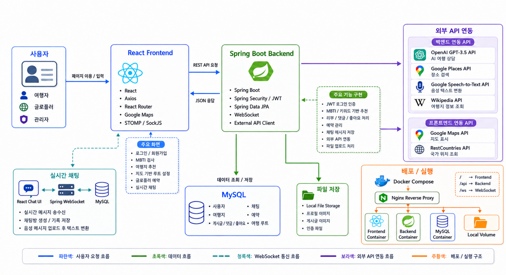

# Glople · MBTI 기반 여행지 추천 커뮤니티

> 여행자의 MBTI·연령·성별과 여행 취향 키워드로 여행지와 루트를 추천하고, 현지 전문가 '글로플러'와 실시간 채팅·예약으로 연결하는 여행 커뮤니티입니다.
> 7인 팀 프로젝트에서 키워드·유사 사용자 추천 로직과 추천 화면 일부를 맡았습니다.

| 기간 | 팀 구성 | 내 역할 |
| :-- | :-- | :-- |
| 2024.03 ~ 2024.11 | 7인 (개발자 5인 + 디자인 2인) | 추천 로직 구현 · 프론트 일부 개발 |

**링크** · [포트폴리오 상세](https://portfolio-sys13-9a4d.vercel.app/projects/glople) · [시연 영상](https://www.youtube.com/watch?v=5vuvjGWdCII)

> 프로젝트 종료 후 두 추천 경로의 조회·정렬 방식을 **사후 개선**했습니다. 본문에서 해당 내용에 "(사후 개선)"을 붙였습니다.

<br>

## 주요 기능

`구분`이 **본인**인 항목이 제가 구현한 부분이고, **팀**은 팀 전체가 만든 서비스 기능입니다.

| 기능 | 설명 | 구분 |
| :-- | :-- | :-- |
| 키워드 여행지 추천 | 고른 여행 키워드와 겹치는 키워드가 많은 여행지 21곳을 반환. 사후 개선에서 키워드를 두 개의 63-bit 마스크로 바꿔 MySQL `BIT_COUNT`로 계산 | 본인 |
| 유사 여행자 루트 추천 | 연령·성별·MBTI를 수치 벡터로 바꿔 코사인 유사도를 계산하고, 성향이 비슷한 여행자 12명의 여행 루트를 추천. 마음에 드는 루트 저장·불러오기 | 본인 |
| 추천 조회·정렬 개선 (사후 개선) | 전체 조회 후 정렬하던 두 추천 경로를 DB 후보 필터링과 PriorityQueue Top-K 방식으로 변경 | 본인 |
| 세계 지도 홈 | SVG 세계 지도에서 나라를 고르면 해당 국가의 최근 여행 리뷰와 예약 바로가기 표시 | 팀 |
| MBTI 진단 · MBTI 여행지 | 문항형 MBTI 진단, MBTI 유형별로 정해 둔 여행지 목록을 Google Places 사진과 함께 카드로 표시 | 팀 |
| 여행지 정보 | 위키백과 본문, Google Places 사진, 해당 장소의 리뷰 제목을 한 화면에 모아 표시 | 팀 |
| 여행 경로 설정 | 출발지·경유지·도착지를 장소 검색으로 고르고 드래그로 순서를 바꾸며 Google Maps Directions로 경로 표시 | 팀 |
| 여행 리뷰 커뮤니티 | Quill 에디터 리뷰 작성, 썸네일·이미지 업로드, 댓글·좋아요, 베스트 리뷰, 리뷰 작성 시 포인트 적립 | 팀 |
| AI 챗봇 | 사용자 질문을 STOMP 메시지로 받아 OpenAI `gpt-3.5-turbo`에 전달하고 답변을 돌려줌 | 팀 |
| 글로플러 채팅 | STOMP over SockJS 1:1 채팅방, 대화 기록 저장, 이미지 전송, 음성 메시지를 Google Speech-to-Text로 텍스트 변환 | 팀 |
| 글로플러 · 예약 | 인증 파일을 첨부한 글로플러 신청, 해시태그 검색·팔로우, 예약 진행도(글로플러 매칭 → 대행 진행 → 입금 완료 → 여행 완료) 관리, 채팅방에서 글로플러에게 포인트 전송 | 팀 |
| 회원 · 관리자 | JWT 로그인, 회원가입 단계의 MBTI 입력, 관리자 API(글로플러 승인, 포인트 조정, 관리자 승격, 회원 삭제) | 팀 |

MBTI 여행지 카드는 유형별로 미리 정한 목록을 보여주는 화면이고, 사용자 데이터 기반 추천은 유사 여행자 루트 추천입니다.

<br>

## 내가 맡은 부분

추천 로직(백엔드)과 추천 화면 일부를 맡았습니다. 사용자가 고른 키워드와 프로필(연령·성별·MBTI)로 여행지와 루트를 추천하는 API를 만들고, 이후 조회·정렬 범위를 줄이는 방향으로 개선했습니다.

| 메서드 | 경로 | 동작 |
| :-- | :-- | :-- |
| `POST` | `/api/search` | 선택한 키워드 목록으로 여행지 상위 21곳 조회 |
| `POST` | `/api/info-recommend` | 생년월일·성별·MBTI로 유사 여행자 상위 12명과 각자의 여행 루트 조회 |
| `POST` | `/api/save-route` | 추천받은 여행자 루트를 내 루트로 저장 |
| `GET` | `/api/get-routes` | 저장한 루트 목록 조회 |

### 키워드 여행지 추천 (사후 개선 후 현재 코드 기준)

- 서버의 키워드 목록(`KeywordMask`)에서 키워드 위치를 비트 번호로 사용합니다. 부호 비트를 피해 앞 63개는 `keyword_mask_low`, 나머지는 `keyword_mask_high`에 담습니다.
- 여행지(`DestinationInfo`)는 저장·수정 시 `@PrePersist`/`@PreUpdate`에서 설명문(`info`)에 들어 있는 키워드로 마스크를 다시 계산합니다. 서버가 뜰 때 마스크가 비어 있는 기존 행은 `DestinationKeywordMaskBackfill`이 채웁니다.
- 목록에 없는 키워드만 들어오면 쿼리를 실행하지 않고 빈 목록을 반환합니다.
- 화면: 키워드 선택 화면(`keyword.js`)을 만들고, 선택 결과를 `/api/search`로 보내 추천 결과 화면으로 넘기도록 연결했습니다.

### 유사 여행자 루트 추천

- 입력값을 `[나이/100, 성별, E·I, S·N, T·F, J·P]` 6차원 벡터로 바꿉니다. 회원 정보의 MBTI는 `E80/N70/T60/J50`처럼 축별 비율과 함께 저장되지만, 추천에는 각 축의 글자만 0/1 값으로 사용합니다.
- 생년월일은 `yyyyMMdd`와 `yyyy-MM-dd`를 모두 받고, MBTI는 `ENTJ`와 `E80/N70/T60/J50` 형식을 같은 4글자로 정규화합니다. 요청한 사용자 본인 행은 결과에서 제외합니다.
- 추천받은 루트는 `MyRoute`(사용자 id ↔ 추천 여행자 id)로 저장하고, 저장 목록에서 다시 불러옵니다.

관련 코드

- 키워드: [`KeywordMask.java`](src/main/java/proj/travien/service/KeywordMask.java), [`KeywordRecommendService.java`](src/main/java/proj/travien/service/KeywordRecommendService.java), [`DestinationInfoRepository.java`](src/main/java/proj/travien/repository/DestinationInfoRepository.java), [`DestinationInfo.java`](src/main/java/proj/travien/domain/DestinationInfo.java), [`DestinationKeywordMaskBackfill.java`](src/main/java/proj/travien/service/DestinationKeywordMaskBackfill.java)
- 유사 사용자: [`UserInfoRecommendationService.java`](src/main/java/proj/travien/service/UserInfoRecommendationService.java), [`UserInfoRepository.java`](src/main/java/proj/travien/repository/UserInfoRepository.java), [`MyRouteService.java`](src/main/java/proj/travien/service/MyRouteService.java), [`RecommendController.java`](src/main/java/proj/travien/controller/RecommendController.java)
- 화면: [`frontend/src/pages/recomendation/Personal/keyword.js`](frontend/src/pages/recomendation/Personal/keyword.js)
- 테스트: [`KeywordMaskTest`](src/test/java/proj/travien/service/KeywordMaskTest.java), [`KeywordRecommendServiceTest`](src/test/java/proj/travien/service/KeywordRecommendServiceTest.java), [`UserInfoRecommendationServiceTest`](src/test/java/proj/travien/service/UserInfoRecommendationServiceTest.java)

<br>

## 문제 해결 / 성능 개선

두 추천 모두 결과는 상위 몇 건만 필요한데, 전체 데이터를 읽고 전체를 정렬한 뒤 앞부분만 쓰고 있었습니다. 조회 대상과 정렬 범위를 줄이는 방향으로 각각 고쳤습니다.

### 1. 키워드 추천: 문자열 탐색을 비트 연산으로 (사후 개선)

- **문제**: `findAll()`로 여행지 전체를 메모리로 읽은 뒤, Java에서 설명문에 키워드가 있는지 `contains`로 확인했습니다. 정렬 비교 때마다 일치하는 키워드 수를 다시 세고, 그 뒤에 21건만 잘라 썼습니다.
- **해결**: 키워드를 두 개의 63-bit 마스크로 바꿔 여행지 행에 미리 저장하고, 후보 필터링과 점수 계산을 native query 하나로 DB에 넘겼습니다. 애플리케이션은 상위 21건만 받습니다.

  ```sql
  WHERE (d.keyword_mask_low & :lowMask) <> 0
     OR (d.keyword_mask_high & :highMask) <> 0
  ORDER BY (BIT_COUNT(d.keyword_mask_low & :lowMask)
          + BIT_COUNT(d.keyword_mask_high & :highMask)) DESC,
           d.id ASC
  LIMIT 21
  ```

- **결과**: 평균 응답 시간 15.7ms → 8.92ms, p95 20ms → 10ms
- **한계**: 서버 목록의 순서가 곧 비트 번호라서, 목록 중간에 키워드를 넣거나 빼면 저장된 마스크를 모두 다시 계산해야 합니다(현재 백필은 마스크가 0인 행만 채웁니다). 설명문에서 키워드를 찾는 방식은 기존과 같은 부분 문자열 일치라서 '성'처럼 짧은 키워드는 '성당'에도 매칭됩니다.

### 2. 유사 사용자(MBTI) 추천: 전체 정렬을 Top-K 추출로 (사후 개선)

- **문제**: 상위 12명만 필요한데 전체 사용자를 조회해 모두 벡터로 바꾸고 유사도를 계산한 뒤, 전체 목록을 정렬하고 12건을 잘랐습니다.
- **해결**
  - 같은 성별이면서 생년월일이 ±5년 안인 사용자만 후보로 조회합니다(`findByGenderAndAgeBetween`).
  - 크기 12의 `PriorityQueue`(최소 힙)를 유지하며, 새 점수가 힙의 최솟값보다 클 때만 교체합니다. 마지막에 남은 12건만 정렬해 반환하고, 유사도가 같으면 id로 순서를 고정합니다.

  ```java
  if (topScores.size() < TOP_K) {
      topScores.offer(scored);
  } else if (similarityComparator.compare(scored, topScores.peek()) > 0) {
      topScores.poll();
      topScores.offer(scored);
  }
  ```

- **결과**: 평균 응답 시간 27.9ms → 7.21ms, p95 33ms → 9ms
- **대가**: 후보를 같은 성별·±5년으로 제한하므로 이 범위 밖의 사용자는 유사도가 높아도 추천되지 않고, 후보가 12명보다 적으면 결과도 그만큼 줄어듭니다.

> 두 측정 모두 로컬 테스트 환경에서 JMeter로 같은 데이터셋과 같은 요청 시나리오의 Before/After 평균·p95를 비교한 값이며, 운영 환경 성능을 뜻하지 않습니다.

<br>

## 기술 스택

| 구분 | 기술 |
| :-- | :-- |
| Backend | Java 17, Spring Boot 3.2.3, Spring Security, Spring Data JPA (Hibernate), Gradle |
| Auth | JWT (jjwt 0.9.1), BCrypt |
| Realtime | Spring WebSocket, STOMP, SimpleBroker, SockJS |
| Data | MySQL 8.0, 업로드 파일은 서버 로컬 디렉터리(`src/main/resources/static/`) |
| Frontend | React 18 (Create React App), React Router 6, Axios, styled-components, Emotion, Ant Design, React-Quill, react-beautiful-dnd, `@react-google-maps/api`, `@stomp/stompjs`, `sockjs-client` |
| 외부 API | OpenAI Chat Completions (`gpt-3.5-turbo`), Google Cloud Speech-to-Text, Google Places, Google Maps JavaScript API, Wikipedia, RestCountries, Pixabay |
| Infra | Docker, Docker Compose, Nginx (리버스 프록시) |
| API 문서 | springdoc-openapi 2.6.0 (Swagger UI) |

<br>

## 아키텍처



- React 화면은 REST로 Spring Boot를 호출하고, 채팅과 챗봇은 `/ws` SockJS 엔드포인트에 STOMP로 연결합니다. 메시지는 `/app/...`으로 보내고 SimpleBroker의 `/topic/public/{roomId}`(채팅방)와 `/topic/public`(챗봇)에서 받습니다.
- 추천 연산(비트마스크 필터, 코사인 유사도 Top-K)은 서버와 DB에서 처리하고, 화면은 결과에 Google Places 사진과 지도를 붙여 보여줍니다.
- OpenAI(WebClient), Google Speech-to-Text(클라이언트 라이브러리), Google Places 텍스트 검색(RestTemplate)은 백엔드가 호출합니다. Google Maps JavaScript API, RestCountries(국가 좌표), Pixabay(국가 이미지)는 화면에서 직접 호출하고, 위키백과도 화면에서 바로 조회합니다. 같은 위키백과 조회를 대신하는 백엔드 엔드포인트(`/api/wikipedia`, `/api/country-info`)도 있습니다.
- Spring Security는 JWT 필터로 인증 정보를 채우고 `/api/admin/**`에 관리자 권한을 요구합니다. 프로필 사진, 글로플러 인증 파일, 채팅 이미지는 서버 로컬 디렉터리에 저장해 `/profile-pictures/**`, `/verification-files/**`, `/image/**` 경로로 제공합니다.
- Docker Compose는 MySQL, 백엔드, 프론트엔드(빌드 결과를 Nginx로 서빙), 리버스 프록시 Nginx 네 컨테이너로 구성되고, 리버스 프록시가 `/`는 프론트엔드로, `/api/`와 `/ws/`는 백엔드로 보냅니다.

### 주요 API

| 도메인 | 엔드포인트 |
| :-- | :-- |
| 추천 | `POST /api/search`, `POST /api/info-recommend`, `POST /api/save-route`, `GET /api/get-routes` |
| 회원 · 글로플러 | `POST /api/users/signup`, `POST /api/users/login`, `GET /api/users/my-info`, `POST /api/users/apply-agent`, `POST /api/users/approve-agent/{userId}`, `GET /api/users/agents`, `GET /api/users/search-agents-by-hashtag`, `/api/follow` |
| 예약 · 포인트 | `POST /api/booking/update-progress`, `GET /api/booking/all-progress`, `POST /api/users/transfer-points`, `/api/bookReviews` |
| 리뷰 커뮤니티 | `/api/posts` (작성·조회·수정·삭제·신고·썸네일·검색), `/api/comments`, `/api/likes` |
| 채팅 | STOMP `/app/chat.sendMessage/{roomId}` → `/topic/public/{roomId}`, `POST /chat/createRoom`, `GET /chat/history/{roomId}`, `POST /chat/uploadFile/{roomId}`, `POST /chat/uploadVoiceMessage/{roomId}` |
| 챗봇 | STOMP `/app/chat.sendMessage` → `/topic/public` |
| 외부 API 중계 | `GET /api/search-place`, `GET /api/wikipedia`, `GET /api/country-info`, `POST /api/convert` |
| 관리자 | `POST /api/admin/adjust-points`, `POST /api/admin/promote-user`, `GET /api/admin/all-users`, `DELETE /api/admin/delete-user/{userId}` |

<br>

## 실행 방법

화면 코드 일부가 `http://localhost:8080`을 직접 호출하고, CORS와 WebSocket 허용 Origin이 `http://localhost:3000`으로 고정되어 있어 아래는 로컬 개발 실행(프론트엔드 3000 · 백엔드 8080)을 기준으로 안내합니다.

**필요 환경**: Java 17, MySQL 8.x, Node.js 18 이상, Yarn

### 1. 데이터베이스

```sql
CREATE DATABASE travien;
```

테이블은 JPA(`ddl-auto=update`)가 만듭니다. 저장소에는 시드 데이터가 없으므로 추천 결과를 보려면 `destination_info`(여행지와 설명문)와 `user_info`(여행자 프로필과 여행 루트) 데이터를 넣어야 합니다. 여행지 키워드 마스크는 서버 시작 시 자동으로 채워집니다.

### 2. 백엔드

`src/main/resources/application.properties`는 `.gitignore` 대상이라 직접 만듭니다.

```properties
spring.datasource.url=jdbc:mysql://localhost:3306/travien
spring.datasource.username=<DB 사용자>
spring.datasource.password=<DB 비밀번호>
spring.jpa.hibernate.ddl-auto=update

jwt.secret=<JWT 서명 키>
jwt.expiration=<토큰 만료 시간(ms)>
gpt_api.key=<OpenAI API 키>
upload.location=src/main/resources/static/image/
```

| 설정 | 용도 |
| :-- | :-- |
| `jwt.secret`, `jwt.expiration` | JWT 발급·검증 |
| `gpt_api.key` | AI 챗봇(OpenAI) |
| `upload.location` | 리뷰·채팅 이미지 저장 경로 (`/image/**`로 제공되는 위치, 끝에 `/` 포함) |
| 환경 변수 `GOOGLE_APPLICATION_CREDENTIALS` | Google Speech-to-Text 서비스 계정 키 파일 경로 (음성 메시지 변환) |

Google Places 텍스트 검색 키는 [`PlaceController.java`](src/main/java/proj/travien/controller/PlaceController.java)의 `API_KEY` 상수에서 지정합니다.

```bash
sh gradlew bootRun             # Windows: gradlew.bat bootRun  →  http://localhost:8080
```

API 문서는 서버 실행 후 `http://localhost:8080/swagger-ui/index.html`에서 확인합니다.

서버가 시작될 때 `admin` 관리자 계정이 없으면 [`AdminAccountInitializer`](src/main/java/proj/travien/AdminAccountInitializer.java)가 만듭니다. 초기 비밀번호가 코드에 있으므로 로컬 개발용으로만 사용합니다.

추천 로직 단위 테스트는 DB 없이 실행됩니다.

```bash
sh gradlew test --tests "proj.travien.service.KeywordMaskTest" \
               --tests "proj.travien.service.KeywordRecommendServiceTest" \
               --tests "proj.travien.service.UserInfoRecommendationServiceTest"
```

### 3. 프론트엔드

```bash
cd frontend
yarn install
yarn start                     # http://localhost:3000
```

개발 서버는 [`setupProxy.js`](frontend/src/setupProxy.js)로 `/api` 요청을 `http://localhost:8080`에 넘깁니다. Google Maps 키는 환경 변수가 아니라 화면 코드에서 지정합니다. `frontend/src/pages/` 아래의 `GOOGLE_MAPS_API_KEY` 상수, 각 `MapComponent.js`의 `googleMapsApiKey`, `routeNavigation/routeNavigationPage.js`의 `apiKey`를 사용할 키로 바꿉니다.

### 4. Docker Compose (참고)

```bash
cd docker
docker compose up --build      # 리버스 프록시 http://localhost, MySQL은 호스트 3307 포트
```

백엔드 이미지는 저장소 전체를 복사해 빌드하므로 `application.properties`를 먼저 만들어 두어야 합니다. DB 접속 정보는 `docker-compose.yml`의 환경 변수가 덮어씁니다.

<br>

## 폴더 구조

```
Glople/
├── src/main/java/proj/travien/
│   ├── controller/          # REST·STOMP 컨트롤러 (추천, 회원·글로플러, 리뷰, 채팅·챗봇, 예약, 외부 API 중계, 관리자)
│   ├── service/             # KeywordMask, KeywordRecommendService, UserInfoRecommendationService, ChatBotService ...
│   ├── repository/          # Spring Data JPA (비트마스크 native query 포함)
│   ├── domain/              # JPA 엔티티 (User, UserInfo, DestinationInfo, Booking, ChatMessage ...)
│   ├── dto/
│   ├── jwt/                 # JWT 발급·검증 필터, Spring Security 설정
│   ├── config/              # CORS, 정적 파일 경로, Swagger
│   └── WebSocketConfig.java # STOMP 엔드포인트(/ws), SimpleBroker
├── src/main/resources/static/  # 업로드 파일 저장 위치 (프로필 사진, 인증 파일, 이미지)
├── src/test/java/proj/travien/ # 추천 로직 단위 테스트 등
├── frontend/                # React (Create React App)
│   ├── public/              # 이미지, MBTI 캐릭터, 국가 코드 CSV
│   └── src/
│       ├── pages/           # recomendation/, chat/, chatbot/, review/, reservation/, routeNavigation/, signup/, admin/ ...
│       ├── components/      # TopBar, Agent(글로플러), Editor(Quill), MyPageDetail ...
│       └── setupProxy.js    # 개발 서버 /api 프록시
├── docker/                  # Dockerfile(백엔드·프론트엔드), docker-compose.yml, nginx.conf
└── docs/images/             # README 이미지
```
