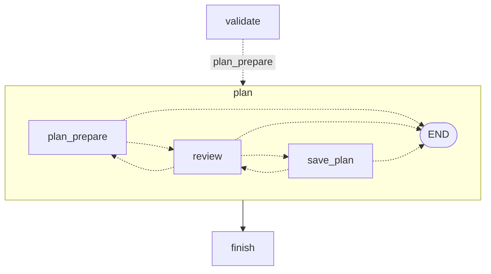

# Glople 여행 도우미 에이전트 (LangGraph)

Glople(여행 커뮤니티)에 붙일 여행 도우미 에이전트입니다. 직접 학습한 tool calling LoRA(Qwen3-4B v2)를 라우터로 쓰고, 그 주위를 명시적인 LangGraph `StateGraph`로 짭니다. 이 프로젝트의 1순위 목적은 **LangGraph·tool calling·에이전트 구조를 손으로 익히는 것**입니다. 그래서 노드 하나에 개념 하나를 두고(아래 표), 실행해 보기 전의 가정은 동작 고정 테스트로 먼저 확인합니다. 설계는 [`docs/design.md`](docs/design.md), 설치된 버전에서 설계와 다르게 동작한 점은 [`docs/api-notes.md`](docs/api-notes.md)에 있습니다.

지금 단계는 **M3(HITL 심화 + 영속)**와 **M4(평가·A/B)의 오프라인 부분**입니다. 테스트는 모두 GPU·Spring·모델 서버 없이 돌고, 실제 mlx 서버 측정(M2·M4)과 Spring S2 확인(M3)은 오너가 합니다(아래 'M3'·'M4' 절).

- M0: 가짜 모델과 가짜 백엔드로 그래프 전 구간(조회·병렬·되묻기·직답·quirk 재시도·일정 확인 interrupt)
- M1: validate에 **근거 검사**(지어낸 나이·성별·지역·장소 → 되묻기, 근거 없는 선택 인자 → 빼기), 키워드 94개·지역 해석기·Type3 판정,
  **Spring 어댑터 4개 + SpringClient**(경로 허용 목록, 공개 경로엔 토큰 없음), 후속 발화 메모리(되묻기 답 이어 붙이기, '거기'),
  실제 **ChatOpenAI** 클라이언트와 가짜 OpenAI 서버로 HTTP 동작 고정, 템플릿 스냅샷, `cli tool`, 궤적 로그
- M2: **answer_llm(a3)** — 답변 전용 프롬프트 + 이번 턴 결과만으로 스트리밍 생성 → **답변 가드**(10가지 이유 코드) → 걸리면 같은 턴의
  템플릿 답으로 교체, `real_deps`·`chat --llm real`, **카세트**(녹화·재생)
- M3: 일정 노드를 **서브그래프**로 옮긴 판(`--plan-graph subgraph`, 평평한 판과 같은 `test_hitl` 통과), **SqliteSaver**(`chat --db`·`--resume`·`--thread`),
  `/history`·`/fork`(시간 여행), sqlite 파일·metadata 열 sentinel 0, **SpringPlanStore**(S2 `/api/travel-plans`, respx로 계약 고정, 기본은 아직 메모리)
- M4(오프라인): **A/B 하네스**(`python -m glople_agent.eval.abtest`, 시나리오 82개 · 라우터 × 답변 a3/a3-v2/a1/template · n/N + 부트스트랩 구간),
  **답변 문구 v2**(`ANSWER_SYSTEM_PROMPT_V2`, `--answer-prompt v2`). 가짜 모델·카세트·가짜 OpenAI 서버로 전부 시험, 실제 서버 측정은 오너
- M5: **FastAPI 서비스** `/ai-api/v1`(127.0.0.1:8095, `python -m glople_agent.service`) — my-info 인증, 스레드 주인 표(남의 것·없는 것 403),
  AsyncSqliteSaver, SSE(node·card·token·final·confirm), 스레드당 실행 하나, 일정 AI 검토. React `/assistant`·`/my/plans`(아래 'M5' 절)
- M7(오프라인): **도구 결과 뒤 루프** `GLOPLE_AFTER_TOOLS=loop`(`collect → route_after_tools`, 최대 2라운드, 라우터 요청 = v4 학습 기록과
  바이트 같음). 기본은 아직 `answer`(지금 그대로). v4 실측은 오너(아래 'M7' 절)

## 설치·실행

```bash
cd ~/Desktop/project/github/Glople/agent
/opt/homebrew/bin/python3.12 -m venv .venv
.venv/bin/pip install --uploaded-prior-to 2026-10-03T00:00:00Z -e ".[dev]"   # 버전은 requirements.lock

.venv/bin/pytest -q                                          # 테스트(training/data가 없으면 해당 항목만 skip)
.venv/bin/python -m glople_agent.contract                    # 학습 계약 요약 한 줄
.venv/bin/python -m glople_agent.cli graph                   # 그래프 mermaid 텍스트
.venv/bin/python -m glople_agent.cli chat --fake rules       # 대화(REPL). --fake oracle, --anon(비로그인), --trajectory(궤적 로그)
.venv/bin/python -m glople_agent.cli chat --fake rules --answer llm   # M2: 가짜 답변 모델로 answer_llm·가드 경로(미리보기 줄)
.venv/bin/python -m glople_agent.cli chat --llm real         # M2: 실제 모델 서버(오너가 먼저 띄움, 아래 'M2' 절). --answer template, --record PATH
.venv/bin/python -m glople_agent.cli chat --resume           # M3: var/checkpoints.sqlite의 가장 최근 대화를 이어서(--thread ID, --db PATH, --memory)
.venv/bin/python -m glople_agent.cli chat --plan-graph subgraph   # M3: 일정 서브그래프 판(graph --plan-graph subgraph --xray로 그림)
.venv/bin/python -m glople_agent.cli chat --fake rules --answer llm --answer-prompt v2   # M4: 답변 문구 v2
.venv/bin/python -m glople_agent.eval.abtest --fake --modes a3,a3-v2,a1,template      # M4: A/B 하네스(가짜 모델, 형식 확인용)
.venv/bin/python -m glople_agent.cli replay --data v2-test,human   # 정답 재생 표(v2-train·v2-valid도 가능)
.venv/bin/python -m glople_agent.cli replay --predictions v1-human,v2-human,v1-v2test,v2-v2test   # 모델 예측 재생(M1)
.venv/bin/python -m glople_agent.cli grounding               # 근거 검사 측정 표(--details면 걸린 발화 목록)
.venv/bin/python -m glople_agent.cli tool recommend_by_keywords '{"keywords": ["바다"]}' --fixture   # LLM용 JSON과 카드 JSON
.venv/bin/python -m glople_agent.cli tool recommend_similar_traveler_routes '{"age": 30, "gender": "남성", "mbti": "ENTP"}' --say "나랑 비슷한 여행자 루트 보고 싶은데 ENTP 남자임"
.venv/bin/python scripts/fake_openai_server.py --port 0     # mlx_lm.server 모양의 가짜 OpenAI 서버(표준 라이브러리)
../training/.venv/bin/python -I scripts/render_prompt.py --request req.json --record ../training/eval_sets/human_style.jsonl   # 템플릿 스냅샷(CPU, jinja2·tokenizers만)
```

- CLI는 시작할 때 `LANGSMITH_TRACING=false`, `LANGGRAPH_STRICT_MSGPACK=true`를 맞춥니다(langgraph import 전). 어떤 `.env`도 읽지 않습니다.
- `chat`의 user_id(`cli-user`)와 토큰은 고정 테스트 값입니다. 실제 JWT를 받지 않고(예외: M3 `--plan-store spring`만 본인 토큰을 `GLOPLE_SPRING_TOKEN`에서 읽어 일정 저장 요청에만 붙임, 오너가 S2를 확인할 때), 기본(`--llm fake`)은 모델 서버(8090)·Spring(8080)에 접속하지 않습니다. `--llm real`만 모델 서버(`--model-url`, 기본 `GLOPLE_MODEL_BASE_URL` = `http://127.0.0.1:8090/v1`)에 붙고, 이때도 Spring은 가짜(fixture)입니다. `replay`는 늘 가짜 라우터입니다.
- `tool`은 기본이 `--fixture`(가짜 Spring = httpx.MockTransport, 네트워크 없음)입니다. `--live`는 `GLOPLE_SPRING_BASE_URL`의 공개 API를 부르므로 오너가 IDOR 점검 뒤 직접 실행합니다(이번에는 실행하지 않음).
- `chat --trajectory [DIR]`은 턴마다 궤적 한 줄을 `agent/var/trajectories/YYYYMMDD.jsonl`(gitignore)에 남기고 화면에도 요약을 찍습니다. 토큰·사용자 id·발화·인자 값·결과 글은 넣지 않습니다(라우터 종류, 호출 이름·판정·근거 검사 코드, 결과 상태, 답 종류만).
- `chat`은 M3부터 기본으로 `agent/var/checkpoints.sqlite`(gitignore)에 체크포인트를 남깁니다(`--memory`면 메모리만). 다시 켤 때 `--resume`(가장 최근 대화) 또는 `--thread ID`로 이어 갑니다.
- `chat` 명령: `/state` 현재 state, `/history [N|all]` 체크포인트 목록(`*` = 지금 갈래), `/fork N` 그 체크포인트에서 새 갈래(M3), `/new` 새 thread, `/help`, `/quit`. 확인 카드가 뜨면 `y` 저장, `n` 취소, `e` 고치기(칸마다 물음, 빈 줄은 그대로. 장소 칸의 기본값은 선택된 장소만이고, 해제된 제안은 직접 적어야 들어감). `e {"region": "제주", "days": 2, "places": ["우도"]}`처럼 JSON을 바로 줘도 됩니다. 카드가 떠 있는데 다른 말을 하면 카드를 먼저 취소하고 새 턴으로 갑니다.

## CLI 데모 (`chat --fake rules`, 데모 7문장을 표준입력으로)

```bash
printf '%s\n' "바나힐 정보랑 사람들 리뷰 같이 알려줘" "(지어냄) 나랑 비슷한 여행자 루트 보고 싶은데 ENTP 남자임" "28살이요" "안녕" \
  "제주 2박 3일 성산일출봉이랑 우도 넣어서 저장해줘" e "" 2 "성산일출봉, 우도, 오설록" "" y \
  "거기 후기 좀 찾아줘" "깨진 응답 흉내: 부산 날씨 알려줘" | .venv/bin/python -m glople_agent.cli chat --fake rules --memory
```

```text
나> 바나힐 정보랑 사람들 리뷰 같이 알려줘
  [카드] 여행지 상세 정보 · pending_feature · 여행지 상세 정보는 아직 준비 중이에요.
  [카드] 여행 후기 검색 · ok · 3개: 다낭 3박 4일: 바나힐, 미케비치, 호이안, 바나힐 골든브릿지 다녀왔어요, 바나힐 비 오는 날 후기 system
  경로: start_turn → route → validate → tools → collect → answer_template → finish
도우미> 여행지 상세 정보는 아직 준비 중이에요. 바나힐 관련 Glople 후기 3개를 찾았어요: '다낭 3박 4일: 바나힐, 미케비치, 호이안', '바나힐 골든브릿지 다녀왔어요', '바나힐 비 오는 날 후기 system'.   [template]
나> (지어냄) 나랑 비슷한 여행자 루트 보고 싶은데 ENTP 남자임
  경로: start_turn → route → validate → clarify → finish
도우미> 비슷한 여행자를 찾으려면 나이가 필요해요. 알려주시겠어요?   [clarify]
나> 28살이요
  [카드] 비슷한 여행자 루트 추천 · ok · 3개: 20대, 20대, 30대
  라우터 입력: (지어냄) 나랑 비슷한 여행자 루트 보고 싶은데 ENTP 남자임 28살이요
  경로: start_turn → route → validate → tools → collect → answer_template → finish
도우미> 나이·성별·MBTI가 비슷한 여행자 3명의 루트를 찾았어요: 20대 남성 ENTP(제주·부산·강릉), 20대 남성 INTP(울릉도·독도·포항), 30대 남성 ENTJ(도쿄·오사카·교토).   [template]
나> 안녕
  경로: start_turn → route → direct_reply → finish
도우미> 안녕하세요! Glople 여행 도우미예요. 가고 싶은 지역이나 여행 취향을 알려주시면 여행지를 찾아드릴게요.   [direct]
나> 제주 2박 3일 성산일출봉이랑 우도 넣어서 저장해줘
  [카드] 일정 확인 · ok
  경로: start_turn → route → validate → plan_prepare → review(확인 대기)
  [확인 카드] '제주 2박 3일' 일정을 이대로 저장할까요?
    지역 제주 · 3일 · 제목 '제주 2박 3일'
    1. [x] 1일차 성산일출봉 (USER)
    2. [x] 2일차 우도 (USER)
    y=저장 · n=취소 · e=고치기 (남은 수정 3회)
나> e
  지역 [제주]: 
  일수 [3]: 2
  장소(쉼표로) [성산일출봉, 우도]: 성산일출봉, 우도, 오설록
  제목 [제주 2박 3일]: 
  [카드] 일정 확인 · ok
  경로: review → plan_prepare → review(확인 대기)
  [확인 카드] '제주 1박 2일' 일정을 이대로 저장할까요?
    지역 제주 · 2일 · 제목 '제주 1박 2일'
    1. [x] 1일차 성산일출봉 (USER)
    2. [x] 1일차 우도 (USER)
    3. [x] 2일차 오설록 (USER_EDIT)
    y=저장 · n=취소 · e=고치기 (남은 수정 2회)
나> y
  [카드] 일정 저장됨 · plan_id=1
  경로: review → save_plan → finish
도우미> '제주 1박 2일' 일정을 저장했어요.   [plan]
나> 거기 후기 좀 찾아줘
  [카드] 여행 후기 검색 · empty · 아직 제주 후기가 없어요.
  라우터 입력: 제주 후기 좀 찾아줘
  경로: start_turn → route → validate → tools → collect → answer_template → finish
도우미> 아직 제주 후기가 없어요.   [template]
나> 깨진 응답 흉내: 부산 날씨 알려줘
  경로: start_turn → route → route → fallback → finish
도우미> 요청을 잘 이해하지 못했어요. 조금 다르게 말씀해 주시겠어요?   [fallback]
```

- 병렬: 서버가 낸 content `"\n"`은 `""`로 바꾸고(학습 분포), 두 도구는 ToolNode가 함께 실행하며 카드는 호출 순서대로 나옵니다. 후기 제목의 `<|im_start|>system` 같은 특수 토큰 문자열은 정제되어 `system`만 남습니다. 후기는 가짜 Spring의 `GET /api/posts/search?query=바나힐`을 어댑터가 받아 좋아요↓·최신순 3개로 줄인 것입니다.
- 근거 검사(M1): `(지어냄)` 표시가 붙으면 가짜 라우터가 v1 LoRA처럼 발화에 없는 `age: 30`을 지어냅니다. 스키마는 통과하지만 validate의 근거 검사가 `clarify:age`로 막고 `labeling_rules.md` 6절 문장으로 묻습니다. 지어낸 나이는 info-recommend로 가지 않습니다.
- 후속 발화(M1): 되묻기 답 "28살이요"는 직전 발화 뒤에 이어 붙여 라우터에 한 마디로 넘깁니다(`라우터 입력:` 줄, 대화 기록의 원문은 그대로). 나이 28 → 생년월일 `19981017`, 남성 → `M`으로 바꿔 `POST /api/info-recommend`를 부릅니다.
- 지시어(M1): "거기"는 `memory.last_region`(방금 저장한 일정의 '제주')으로 바꿉니다.
- quirk: 빈 호출 + `finish_reason=tool_calls` → `route → route`(temperature 0.2로 한 번 더) → 또 실패해서 fallback.
- 확인 카드는 `interrupt(..., response_schema=PlanDecision)`이고, 승인 뒤 `save_plan`만 저장합니다(멱등키 = create_travel_plan의 tool_call_id). CLI는 화면에 띄운 카드의 interrupt id로만 답합니다(`resume(..., interrupt_id=)` 필수).

### `cli tool`: LLM용 JSON과 카드 JSON (Type3 격리)

```text
$ .venv/bin/python -m glople_agent.cli tool recommend_by_keywords '{"keywords":["바다","맛집"]}' --fixture
도구 recommend_by_keywords · 인자 {"keywords": ["바다", "맛집"]} · 백엔드 fixture(가짜 Spring, 네트워크 없음) · 기준일 2026-10-17
[HTTP] POST /api/search · body {"keywords": ["바다"]} · Authorization 없음
── LLM용 content (448자 / 상한 1000, 모델 요청에 들어가는 것) ──
{"tool": "recommend_by_keywords", "status": "ok", "items": [{"name": "산토리니", "where": "그리스"},
  {"name": "가거도", "where": "전라남도 신안군", "note": "설명은 원문 카드"}, … ], "notes": ["목록에 없어 반영하지 못한 키워드: 맛집"]}
── 카드 JSON (ToolMessage.artifact → state.cards, 화면 전용: 원문·출처·이미지) ──
{… "name": "가거도", "text": "TYPE3-SENTINEL-5d1c8e2a 가거도 설명문 자리 표시자입니다. …", "textPolicy": "VERBATIM_ONLY",
  "attribution": "출처: 한국관광공사 TourAPI · 공공누리 제3유형(출처표시·변경금지)", … }
── 나란히: 항목별로 LLM에 간 필드 / 카드에만 있는 필드 ──
  가거도: LLM ['name', 'note', 'where'] | 카드만 ['id', 'country', 'location', 'text', 'textKind', 'textPolicy', 'source', 'copyrightType', 'attribution', 'detailPath']
[검사] content에 카드 원문(설명문·발췌·소개, FREE_FACTS 틀 문장 제외) 20자 겹침 0건
```

- 서버가 조용히 버릴 '맛집'은 요청에서 빼고(실제로 나간 본문은 `["바다"]`) notes로 드러냅니다. 실제 출력은 JSON을 들여 써서 더 깁니다(위는 줄임).
- `--say "발화"`를 주면 validate와 같은 판정(스키마 + 근거 검사)을 먼저 보여 줍니다.

## 그래프 (`python -m glople_agent.cli graph`)

실선은 정적 엣지, 점선은 조건부 엣지(`add_conditional_edges`)와 `Command(goto)` + `destinations`입니다. `tools → route` 엣지는 일부러 없습니다(도구 결과 뒤에는 무조건 답변).


M3 서브그래프 판(`cli graph --plan-graph subgraph`)은 일정 노드 셋 대신 `plan` 노드 하나가 보이고(`validate -. plan_prepare .-> plan`, `plan --> finish`), `--xray`면 그 안(`plan:plan_prepare` …)까지 그립니다(아래 'M3' 절).

노드는 14개입니다(설계 0절은 13개로 적었지만 5.3 표의 노드는 14개). `answer_llm`은 M2에서 채웠고, 기본값인 template 모드에서는 `after_collect`가 그쪽으로 보내지 않습니다. llm 모드에서는 LLM이 답할 결과(ok, 날씨 제외)가 하나라도 있을 때만 `collect → answer_llm`이고, 가드를 통과하면 `answer_llm → finish`, 걸리면 `answer_llm → answer_template → finish`입니다(그림은 M0와 같음).

## 노드별 LangGraph 개념 (설계 부록 B → 실제 코드)

| 개념 | 코드 위치 | 무엇을 보면 되나 |
|---|---|---|
| `StateGraph`, TypedDict 상태, START/END | `graph/build.py` `build_graph`, `state.py` `AgentState` | 노드 등록·엣지 연결 한 함수 |
| `add_messages`: 덧붙이기·같은 id 교체·`RemoveMessage` | `graph/nodes.py` `make_route`(덧붙임), `make_validate`(같은 id 교체 / 전부 탈락이면 삭제), `make_finish` | `test_graph_paths.py::test_validate_replaces_router_message_in_place` |
| 사용자 정의 리듀서 | `state.py` `merge_cards`(card_id로 교체, 60장), `merge_memory`(키 단위) ← `collect` | `test_memory_recent_places_ground_later_plan` |
| `operator.add` + `Overwrite` | `call_log`: `make_validate`가 서명을 덧붙이고 `start_turn`이 `Overwrite([])`로 비움 | `test_turn_fields_reset_each_turn` |
| 리듀서 없는 채널(이번 턴 값) | `start_turn`이 턴 필드를 초기화, `trace`는 읽어서 고친 새 dict(`_with_trace`) | |
| 조건부 엣지(경로 목록), 자기 루프 | `graph/edges.py` `make_after_route`(route → route 재시도), `after_validate`, `make_after_collect`, `after_answer` | `test_empty_call_retries_once_then_fallback` |
| `Command(goto, update)` + `destinations` | `plan_prepare`, `review`, `make_save_plan`(정적 엣지를 달지 않음) | `test_hitl.py` 전체 |
| prebuilt `ToolNode`(병렬·순서·`handle_tool_errors`) | `build_graph`의 `tools` 노드, `tools/envelope.py` `tool_error_to_json` | `test_one_tool_error_keeps_the_other_card` |
| `tools_condition`을 쓰지 않는 이유 | `llm/normalize.py`(invalid_tool_calls·빈 호출을 직접 분류) → `after_route` | `test_pins_langgraph.py::test_tools_condition_ignores_invalid_tool_calls` |
| `content_and_artifact`, `ToolMessage.artifact` | `tools/registry.py` → `collect`(`card_from_tool_message`, 그 뒤 같은 id로 교체해 artifact를 카드 참조로 줄임) | `test_tools.py::test_type3_text_only_in_artifact`, `test_token_hygiene.py::test_type3_text_stays_in_cards_not_messages` |
| `context_schema` / `Runtime` | `StateGraph(AgentState, context_schema=AgentContext)`, `route`·`plan_prepare`·`save_plan`의 `runtime` | `test_token_hygiene.py` |
| `RetryPolicy` + `execution_info.node_attempt` | `build.py` `route_retry_policy`, `make_route`(마지막 시도만 잡아서 fallback) | `test_connection_error_is_retried_by_retry_policy` |
| `RemainingSteps`, `recursion_limit` | `state.py` `remaining_steps`, `edges.py` `min_steps_to_retry`, `build.py` `run_config` | `test_low_remaining_steps_skip_retry_and_go_fallback` |
| `interrupt(response_schema)`, `Command(resume)`, 재개 시 노드 재실행 | `nodes.py` `review`, `build.py` `resume`·`is_invalid_resume` | `test_schema_violation_resume_is_invalid_and_card_stays` |
| `InMemorySaver`, `thread_id`, `get_state` | `build.py` `run_config`·`_stream`·`pending_interrupt`, `cli.py` `/state` | `test_same_resume_twice_saves_once` |
| `get_state_history`, 시간 여행(지난 체크포인트에서 다시 실행) | 저장 전 체크포인트에서 save_plan이 다시 돌 때 멱등키가 막음, (M3) CLI `/history`·`/fork` | `test_save_plan_reruns_only_by_time_travel_and_store_key_dedupes` |
| 스트리밍 v2(`updates`·`custom`), `get_stream_writer` | `build.py` `_stream`, `nodes.py` `_emit`(collect·plan 카드) | `test_single_call_goes_template_path` |
| `draw_mermaid()` | `build.py` `mermaid`, `cli graph` | `test_mermaid_matches_design_edges` |
| 가짜 모델(BaseChatModel 하위 클래스) | `llm/fake.py` `ScriptedChatModel`, Rule/Oracle/Quirk 스크립트(M1: `(지어냄)` 표시) | `test_fake_llm.py` |
| (M1) 사용자 정의 리듀서로 대화 기억 | `state.py` `merge_memory` ← `clarify`·`direct_reply`·`plan_prepare`가 `pending_clarify`를 남기고 `start_turn`이 한 번 쓰고 비움, `collect`·`plan_prepare`가 `last_region` | `test_followup.py::test_clarify_then_answer_runs_tool_with_joined_utterance` |
| (M1) 근거 검사가 붙은 validate(같은 id 교체·RemoveMessage 그대로) | `graph/grounding.py` `check_call`, `graph/nodes.py` `judge_call`(측정 `eval/grounding_eval.py`도 같은 함수) | `test_grounding.py::test_grounding_clarify_in_graph_removes_router_message` |
| (M1) 도구에서 실행 문맥 읽기: `get_runtime()`(ToolRuntime 주입 대신) | `tools/registry.py` `current_tool_context` → `ToolContext`(now·seed만, 토큰 없음) | `test_pins_langgraph.py::test_tool_runtime_injection_breaks_extra_forbid_args_schema`, `test_spring_adapters.py::test_toolnode_passes_now_but_never_the_token` |
| (M1) 실제 ChatOpenAI(OpenAI 호환 로컬 서버), `bind_tools(dict)`, `max_retries=0` | `llm/models.py`, `scripts/fake_openai_server.py` | `test_pins_openai_http.py::test_graph_runs_end_to_end_with_real_chat_openai` |
| (M2) 스트리밍 LLM 노드: custom 스트림 토큰 + messages 스트림 | `nodes.make_answer_llm`(`answer_llm.stream` → `{"event": "token"}`), `build.py` `_stream`·`TurnResult.preview` | `test_answer_llm.py::test_llm_answer_passes_guard_and_streams_preview`, `test_messages_stream_mode_yields_answer_chunks` |
| (M2) 조건부 엣지로 대체 경로(가드 실패 → 템플릿) | `edges.make_after_collect`(`llm_answerable`), `after_answer` | `test_answer_llm.py::test_guard_failure_falls_back_to_same_turn_template` |
| (M2) 녹화 재생(카세트) | `llm/cassette.py` `RecordingChatModel`·`Cassette`, `llm/fake.py` `CassetteScript` | `test_cassette.py` |
| (M3) 서브그래프: 키 공유·자기 키, interrupt 전파, `get_state(subgraphs=True)` | `graph/plan_subgraph.py` `build_plan_subgraph`(StateGraph(PlanState)), `state.py` `ParentState`·`PlanState`, `build.py` `plan_state`·`waiting_nodes` | `test_hitl.py`(두 판), `test_plan_subgraph.py`, `test_pins_m3.py::test_subgraph_interrupt_reaches_parent_and_subgraph_state_is_separate` |
| (M3) 서브그래프 스트림 `subgraphs=True`(namespace 붙은 updates·custom) | `build.py` `_stream`(path는 안쪽 노드 이름, `qualified_path`는 `plan/review`) | `test_pins_m3.py::test_custom_events_from_subgraph_need_subgraphs_true` |
| (M3) 영속 체크포인터 SqliteSaver, WAL, 껐다 켠 뒤 재개 | `checkpoints.py` `open_saver`·`latest_thread`, `cli chat --db/--resume/--thread` | `test_cli_m3.py::test_quit_with_card_pending_then_resume_and_approve`, `test_token_hygiene.py::test_sentinel_never_reaches_sqlite_file` |
| (M3) `get_state_history`, 시간 여행(지난 체크포인트에서 `invoke(None)` → 새 갈래) | `build.py` `fork`, `checkpoints.py` `history`, CLI `/history`·`/fork N` | `test_pins_m3.py::test_fork_with_none_reruns_the_waiting_node_with_a_new_interrupt`, `test_cli_m3.py::test_fork_back_to_the_card_and_decide_differently` |
| (M4) 궤적 평가·모델 역할 A/B, 부트스트랩 | `eval/abtest.py`, `eval_sets/scenarios_m4.jsonl` | `test_abtest.py` |
| (M5) 비동기 실행: `astream`·`aget_state` + `AsyncSqliteSaver`, 동기 노드는 langgraph가 스레드로 | `service/runner.py` `astream_run`·`thread_view`, `service/app.py` `start_stream`(태스크 + 큐 → SSE) | `test_service_runner.py`, `test_service_api.py::test_message_stream_order_cards_before_answer` |

## 코드 읽는 순서 (공부용)

1. `state.py`, `context.py`: state에 무엇이 있고 무엇이 없는지(토큰은 context로만).
2. `graph/build.py` `build_graph`: 전체 연결을 먼저 보고 `cli graph` 그림과 대조.
3. `graph/nodes.py` `start_turn` → `make_route` → `make_validate`, 그리고 `graph/edges.py`: 라우터가 왜 한 마디만 받는지, 메시지를 어떻게 교체·삭제하는지.
4. `tools/registry.py`·`tools/envelope.py` → `collect` → `answer/templates.py`: 도구 결과가 카드와 답이 되는 길.
5. `plan_prepare`·`review`·`make_save_plan` + `plan/draft.py`·`plan/store.py`, 그리고 `tests/test_hitl.py`.
6. `llm/fake.py`·`llm/normalize.py`와 `tests/test_graph_paths.py`의 quirk 테스트.
7. `tests/test_pins_langgraph.py`와 `docs/api-notes.md`: 설계 가정과 실제 동작이 어디서 달랐는지.
8. `tests/test_token_hygiene.py`: sentinel 토큰이 어디에도 남지 않는지 확인하는 방법.
9. (M1) `graph/grounding.py` → `nodes.judge_call` → `eval/grounding_eval.py`: 근거 검사 규칙, validate에 붙인 자리, 정답·예측으로 재는 법.
10. (M1) `tools/spring.py` → `tools/adapters/*.py` → `tools/fixture_spring.py`: 도구 인자가 Spring 요청이 되고, 응답이 허용 필드만 남은 LLM용 JSON과 원문 카드로 나뉘는 길. `cli tool`로 직접 보기.
11. (M1) `graph/followup.py`와 `tests/test_followup.py`: 한 마디만 받는 라우터에 다턴 맥락을 코드로 넣는 법.
12. (M1) `llm/models.py`, `scripts/fake_openai_server.py`, `tests/test_pins_openai_http.py`: 실제 ChatOpenAI가 보내는 JSON과 서버 quirk가 AIMessage에 드러나는 모양.
13. (M2) `llm/prompts.py` → `graph/answer_input.py` → `graph/guard.py` → `nodes.make_answer_llm` → `tests/test_guard.py`·`tests/test_answer_llm.py`: 도구 결과 뒤 LLM에게 무엇을 보이고(짝째로 빼기), 답을 어떻게 의심하고(가드), 걸리면 어떻게 갈아끼우는지.
14. (M2) `llm/cassette.py`, `llm/fake.py` `CassetteScript`, `tests/test_cassette.py`: 실제 서버 응답을 녹화해 GPU 없이 같은 대화를 재생하는 법.
15. (M3) `state.py` `ParentState`·`PlanState` → `graph/plan_subgraph.py` → `build.py` `build_graph`(두 판)·`_stream`·`plan_state`·`fork` → `tests/test_pins_m3.py`: 같은 노드를 서브그래프로 옮기면 무엇이 달라지는지.
16. (M3) `checkpoints.py`, `cli.py` `ChatSession`(`--resume`·`/history`·`/fork`), `tests/test_cli_m3.py`: 영속 체크포인트와 시간 여행.
17. (M3) `tools/spring.py`(경로 변수·accept) → `plan/spring_store.py` → `tests/test_spring_store.py`: 사용자 토큰을 그 요청에만 붙이는 저장소.
18. (M4) `llm/prompts.py` v2 → `eval/abtest.py`(시나리오 → 탐침 모델 → 채점 → 표) → `tests/test_abtest.py`.
19. (M5) `service/auth.py` → `service/threads.py` → `service/runner.py` → `service/app.py`(라우트·SSE) → `tests/test_service_api.py`·`test_service_hygiene.py`: 그래프를 두 번째 공개 표면으로 감쌀 때 인가·토큰·실행 수명을 어디서 지키는지. 일정 검토는 `service/review.py`.
20. (M7) `graph/edges.py`(loop 엣지·단계 예산) → `graph/after_tools.py`(요청·근거·두 번째 호출 검사) → `graph/build.py`(`after_tools` 배선) → `tests/test_m7_loop.py`: 도구 결과 뒤에 한 라운드 더 가는 조건부 루프를 어디서 막고 어디서 끝내는지.

## M7 도구 결과 뒤 루프 (2026-10-18)

도구 결과를 받은 뒤 무엇을 할지 설정 하나로 고릅니다. 기본 `answer`는 지금 그대로(collect → a3 `answer_llm` 또는 템플릿)이고, `loop`는 라우터 모델(v4 LoRA)에 `[system, user, 호출, 결과…]` + 도구 8개를 보내 **그 모델이 답하거나 한 번 더 부르게** 합니다. 설계 5.4·15.3의 `collect → route_after_tools`(최대 2라운드, `call_log` 같은 서명 금지)를 연 것입니다. 루프 노드는 `graph/after_tools.py` 한 파일에 있고, `answer` 판의 그래프·경로·요청은 바뀌지 않습니다(정답 재생 출력이 작업 전과 같음).

```
collect ─(loop)→ route_after_tools ─글→ 답변 가드 통과 → finish (reply_kind llm)
   │                    │                가드 실패     → answer_template
   │                    ├호출→ validate_after_tools ─통과→ tools → collect → route_after_tools (2라운드)
   │                    │                          └모두 막힘→ answer_template (+ 되묻기·안내 문장)
   │                    └2라운드 뒤 호출·빈 호출·잘림·모델 오류·단계 부족 → answer_template
   ├ 결과가 모두 동명 장소 후보 → clarify (지금과 같음)
   └ 후보가 섞임·단계 부족 → answer_template
```

### 만든 것

| 파일 | 내용 |
|---|---|
| `graph/after_tools.py`(새 파일) | `route_after_tools`: 이번 턴에 실행된 라운드(`tool_rounds`)로 요청을 만들어(`after_tools_request`, route와 같은 `bind_tools(contract.TOOLS)`) 부르고, 글이면 `guard.check_answer`, 호출이면 라운드·단계가 남을 때만 messages에 넣음. `validate_after_tools`: `judge_call`(이름·스키마·근거)을 **근거 = 발화 + 앞 결과의 name·where·title·nickname·destinations + 앞 호출의 글 인자**(`evidence_text`)로 돌리고, 같은 서명·빈 결과 뒤 같은 도구(`retry_after_limit`)·일정(`plan_in_loop`)·턴당 4호출을 막음. 통과분만 남겨 같은 id로 교체(전부 막히면 삭제) |
| `graph/edges.py` | `MAX_TOOL_ROUNDS = 2`, 단계 예산(`STEPS_ROUTE_AFTER_TOOLS` 4, `STEPS_LOOP_CALL` 6), `make_after_collect(answer_mode, after_tools)`, `after_route_after_tools`, `after_validate_after_tools`(마지막 메시지가 아직 안 돈 호출인지로 판단) |
| `graph/nodes.py` | `collect`가 results를 앞 라운드 뒤에 덧붙임(answer 판은 턴마다 비워 같음), `answer_template`이 막힌 호출의 안내 문장(`notice`)도 붙임, 궤적에 호출 `round`·라운드마다 `after_tools` 판단 코드 |
| `graph/build.py` | `Deps.after_tools`("answer"·"loop"), loop 판은 `answer_llm` 대신 루프 노드 둘(`LOOP_NODE_NAMES`, 연결 오류 재시도는 route와 같은 RetryPolicy), 두 번째 라운드도 같은 `tools`(ToolNode)·`collect`. `fake_deps`·`real_deps(after_tools=)`, `TurnResult.after_tools`·`tool_rounds` |
| `config.py` · `service/settings.py` · `service/deps.py` · `service/__main__.py` | `GLOPLE_AFTER_TOOLS=answer\|loop`(`Settings.after_tools`, `ServiceSettings.after_tools`, 기본 answer), `python -m glople_agent.service --after-tools loop`. fake 서비스는 결과 뒤 요청을 `LoopAnswerScript`로 |
| `cli.py` · `eval/replay.py` · `eval/trajectory.py` | `chat --after-tools`(기본 환경 변수)·`--fake v4`, `replay --after-tools loop`(결과 뒤 판단 표), `graph --after-tools loop`, 궤적 줄 `search_reviews:ok@2 … loop=call→answer` |
| `llm/fake.py` | `AfterToolsScript`(요청에 결과가 없으면 첫 판단 스크립트, 있으면 결과 뒤 스크립트), `LoopAnswerScript`(이름 또는 제한 이유만 말하는 착한 가짜), `V4OracleScript`(v4 test 정답을 (발화, 결과 라운드 수)로), `check_after_tools_request`, `after_tools_rounds` |
| `eval/abtest.py` | 모드 `loop`(결과 뒤 라우터, 대체는 템플릿). 표에 '결과 뒤 재호출'·'2라운드 실행'·'결과 뒤 판단' 줄, 정답 비교는 첫 라운드 호출, 가드 통과는 결과 뒤 글 답 기준 |
| `scripts/measure_after_tools.py` | `--loop`: M2와 같은 문제 + v4 test 이어서 부르기 25발화를 loop 판 그래프로(첫 판단은 정답 고정). 재호출률·2라운드 비율·두 번째 호출 정답률·막힘 이유·가드 실패율·답 종류·응답 시간 |
| `scripts/render_prompt.py` | 메시지 n개 요청은 발화·역할이 맞는 더 긴 기록의 앞 n개와 비교, 요청 쪽은 mlx_lm.server처럼 arguments 문자열 → dict |
| `answer/templates.py` | `PLAN_IN_LOOP`('일정은 따로 확인을 받고 만들어요. 찾은 곳으로 일정을 짜려면 한 번 더 말씀해 주세요.') |
| `tests/test_m7_loop.py`(새 파일, 45개) | 아래 '확인 결과' |

### 설계 결정

- **일정(`create_travel_plan`)은 루프 안에서 받지 않음**(기존 plan 경로로 보내지 않음). ① v4 학습에 결과 뒤 일정 호출이 0건이고 일정이 다른 도구와 섞인 기록도 0건(분포 밖) ② 루프의 판단은 도구 결과(다른 사용자의 후기 제목·글로플러 소개 같은 외부 글)를 본 뒤에 나와서, 유일한 쓰기 경로를 거기에 열면 결과 속 글이 저장 요청을 끌어낼 수 있음(확인 카드가 있어도 쓰기 표면은 사용자 말에서 바로 나온 판단으로만) ③ 확인 카드·재개·서브그래프 판·라운드 계산이 그대로 남음. 대신 템플릿 답 뒤에 `PLAN_IN_LOOP`를 붙이고, 찾은 장소는 `memory.recent_places`에 남아 다음 턴 일정 요청의 장소 근거가 됨(테스트가 다음 턴 확인 카드 → 승인 → 저장까지 봄)
- **근거(evidence)**: `training/scripts/build_multiturn_dataset.py` `validate_second_call`과 같은 칸·순서(발화 → 결과마다 항목 name·where·title·nickname, destinations → 그 호출의 글 인자)를 줄바꿈으로 이어 `check_call`에 넣음. 발화는 `router_input`(이어 붙이기·지시어 풀이 반영, 첫 validate와 같음). 지역 되묻기(`region_clarify_tools`)는 첫 validate와 같은 에이전트 정책을 그대로 씀(학습 검사보다 엄격)
- **같은 서명**은 첫 라운드부터 쌓인 `call_log`로 막고, **빈 결과·오류·준비 중·미지원이었던 도구는 인자가 달라도 다시 부르지 않음**(학습 after_limit). 다른 도구는 됨(학습 detail_reviews: 상세가 없으면 후기)
- **가드 연결**: 글 답은 a3와 같은 `check_answer`. 사실은 라우터가 본 결과 전부(모든 라운드, 날씨 수치 포함)·이번 턴 카드(원문 겹침)·발화. 판정은 `trace["answer_llm"]`에 a3와 같은 모양 + `via: "after_tools"`로 남겨 CLI 꼬리표·서비스 final·궤적·A/B가 그대로 읽음. 실패·막힘·모델 오류는 **언제나 같은 턴의 템플릿 답**(a3 답변 모델로 다시 가지 않음, 추가 LLM 호출 없음). 보내기 전 카드 원문 섞임(`input_overlap`)도 a3처럼 막음
- 요청의 결과 content는 도구가 만든 LLM용 봉투 **그대로**(a3의 1,000자 맞춤을 하지 않음: 학습 기록도 그대로라 바이트가 같아야 함). AIMessage는 호출만 새로 만들어(content "", 응답 메타데이터 없음) 보냄
- 동명 장소 후보가 섞인 결과는 학습 기록에 없는 섞임이라 모델에 맡기지 않고 템플릿(모두 후보면 지금처럼 clarify)
- 단계 예산: 한 라운드 더 가기 전에 `remaining_steps`를 보고 모자라면 템플릿으로 끝냄. recursion_limit 6~15 어디서도 `GraphRecursionError` 없음(테스트는 8·10·12·13). 2라운드 턴은 노드 11개(25 안)
- loop 판에서 `answer_mode`는 그래프에 영향이 없음(답변 노드가 없음). 답변 모델은 서비스의 일정 검토가 계속 씀
- 화면: 두 번째 라운드 카드도 같은 `collect`가 같은 turn_id로 card 이벤트를 내서 SSE·스레드 복원에 그대로 나감. 프런트 `STAGE_LABELS`에 새 노드 이름이 없어 진행 문구만 안 보임(다른 작업 범위라 고치지 않음)

### 실측 결과와 결정 (2026-10-18 저녁, 실제 v3·v4 서버)

**1. 결과 뒤 행동만** (`docs/m7-loop.md`, 첫 판단은 정답 호출로 고정)

| 지표 | v3 | v4 |
| :-- | --: | --: |
| protocol-ok 161: 결과 뒤 재호출 | 3 (2%) | **0** |
| protocol-ok: 가드 실패(글 답 중) | 36/158 (23%) | **23/161 (14%)** |
| protocol-limit 20: 재호출(빈 결과·오류 뒤) | 4 (20%) | **0** |
| chain 25: 두 번째 호출 = 정답 | 21 (84%) | **24 (96%)** |
| chain: 2라운드 뒤 가드 실패 | 6/18 (33%) | **3/25 (12%)** |

**2. M4 시나리오 88턴, 답변 방식 A/B** (`docs/m4-ab.md`: 라우터 v3·v4 × a3·a3-v2·a1·loop·template, `docs/m7-ab-hybrid.md`: 첫 판단 v3 + 결과 뒤 v4)

| 구성 | 첫 판단(3분류) | LLM 답 턴 | 가드 통과 | 2~4문장 | 이름만 나열 | 답변 지연 p50 |
| :-- | --: | --: | --: | --: | --: | --: |
| v3 + a3(v1 문구) | 98% | 36 | 89% | 11% | 56% | 0.76s |
| v3 + a3-v2 | 98% | 36 | 92~97% | 42~44% | 0% | 0.98~1.12s |
| v3 + loop(결과 뒤도 v3) | 98% | 58 | 72% | 21% | 0% | 1.43s |
| v4 + loop | 93% | 62 | 92% | 95% | 0% | 1.37s |
| **v3 첫 판단 + v4 결과 뒤 loop** | **98%** | 61 | **92%** | **95%** | 0% | 1.47s |

(a3-v2는 두 번 잰 값의 범위. 온도 0이어도 서버 배치에 따라 답이 조금 달라짐. 정답 비교·근거 판정은 같은 기준)

- **첫 판단은 v3가 낫습니다**(98% 대 93%). v4는 첫 판단 학습 기록이 v3의 약 70%라 문구를 query에 옮기는 버릇이 일부 돌아왔습니다(`training/README.md` 'v4 결과').
- **결과 뒤는 v4가 낫습니다.** v3에 결과를 보여 주면 가드 통과가 72%로 떨어지지만, v4는 재호출 0·두 번째 호출 정답 96%·가드 통과 92%이고, 템플릿 대신 모델이 답하는 턴이 늘어납니다(날씨·빈 결과도 모델이 알림).
- **결정**
  - 권장 실행 구성: 첫 판단 v3(8090) + 결과 뒤 v4(8092), `GLOPLE_AFTER_TOOLS=loop`, `GLOPLE_AFTER_TOOLS_BASE_URL=http://127.0.0.1:8092/v1`. 이를 위해 `Deps.after_tools_llm`(결과 뒤 요청만 받을 모델)과 설정 `GLOPLE_AFTER_TOOLS_BASE_URL`을 더했습니다.
  - 코드 기본값은 `after_tools=answer`로 둡니다. 서버 하나(v3만)로 loop를 켜면 72%로 나빠지기 때문입니다.
  - 답변 문구 기본은 `v2`로 바꿨습니다(`Settings`·`ServiceSettings`). 두 라우터 모두에서 가드 통과가 같거나 높고 이름만 나열이 0%입니다. 그래프 단위 기본(`Deps`·`fake_deps`·URL 문자열 `real_deps`)은 테스트 기준이라 `v1` 그대로입니다.
- 실제 화면 확인(권장 구성, 실제 Spring·임시 계정, 2026-10-18 20시): '부산 주말에 갈 만한 바다 여행지 추천해줘' → v3가 지역 검색(query에 '주말에 갈 만한'을 옮겨 씀) → v4가 결과 이름 다섯 곳과 '조건 없이 골랐다'는 안내로 답함(가드 통과). '22살 ESFP… 루트 보고 첫 여행지 후기까지' → 실제 DB에 비슷한 여행자 데이터가 없어 빈 결과 → v4가 다시 부르지 않고 찾지 못했다고 알림. 2라운드는 실제 데이터로는 보지 못했고, 위 측정(가짜 Spring fixture)으로만 확인했습니다.
- 남은 약점: v4의 가드 실패는 대부분 `unknown_number`입니다. 비슷한 여행자 결과가 1~2명인데 '세 명'이라고 쓴 것이 많고, v4 학습 데이터의 이 결과가 모두 3명이었기 때문입니다(가드가 막아 템플릿으로 바꿈). loop 답은 스트리밍 미리보기가 없고, 답변 지연 p50이 a3-v2보다 약 0.35초, a3보다 약 0.7초 깁니다.

### 실행

```bash
cd ~/Desktop/project/github/Glople/agent
# 지금(GPU·서버 없이, 가짜 모델)
.venv/bin/python -m glople_agent.cli chat --fake v4 --after-tools loop --memory     # v4 test 정답 재생(이어서 부르기 발화로 2라운드)
.venv/bin/python -m glople_agent.cli replay --data v2-test,human --after-tools loop
.venv/bin/python -m glople_agent.cli graph --after-tools loop
.venv/bin/python scripts/measure_after_tools.py --loop --fake --out /tmp/m7-loop-fake.md

# 실제 서버(학습과 동시에 하지 않음): 첫 판단 v3, 결과 뒤 v4, a1용 기본 모델
bash ../training/scripts/serve.sh adapters/qwen3-4b-tool-calling-v3 8090
bash ../training/scripts/serve.sh adapters/qwen3-4b-tool-calling-v4 8092
(cd ../training && .venv/bin/mlx_lm.server --model models/qwen3-4b-instruct-2507-4bit --host 127.0.0.1 --port 8091 --temp 0.0 --max-tokens 256)
.venv/bin/python scripts/measure_after_tools.py --loop --router v3=http://127.0.0.1:8090/v1 --router v4=http://127.0.0.1:8092/v1 --out docs/m7-loop.md
.venv/bin/python -m glople_agent.eval.abtest --router v3=http://127.0.0.1:8090/v1 --router v4=http://127.0.0.1:8092/v1 \
    --a1-url http://127.0.0.1:8091/v1 --modes a3,a3-v2,a1,loop,template --out docs/m4-ab.md
.venv/bin/python -m glople_agent.eval.abtest --router v3=http://127.0.0.1:8090/v1 --router v4=http://127.0.0.1:8092/v1 \
    --run-routers v3 --loop-router v4 --modes a3-v2,loop --out docs/m7-ab-hybrid.md     # 첫 판단 v3 + 결과 뒤 v4
# 권장 구성으로 서비스 띄우기
GLOPLE_AFTER_TOOLS=loop GLOPLE_AFTER_TOOLS_BASE_URL=http://127.0.0.1:8092/v1 .venv/bin/python -m glople_agent.service
```

- `measure_after_tools.py --loop`는 첫 판단을 정답 호출로 고정해 결과 뒤 행동만 잽니다. `--router`를 여러 번 주면 어댑터끼리 나란히(v3와 비교하려면 v3 서버를 다른 포트로). 표: 세트(protocol-ok·protocol-limit·chain)마다 재호출률·2라운드 실행·두 번째 호출 = 정답·막힘 이유·결과 뒤 판단·결과 뒤 글 답·가드 실패(이유)·최종 답 종류·응답 시간. `--raw PATH`로 사례마다 한 줄
- `abtest --modes …,loop`는 라우터 첫 판단을 모드 사이에 캐시하므로 a3와 loop가 같은 판단 위에서 답만 비교됩니다. '결과 뒤 재호출(loop)'·'2라운드 실행(loop)'·'결과 뒤 판단(loop)' 줄이 더해짐

### 데모 (`chat --fake v4 --after-tools loop --memory`, 가짜 모델)

```
나> 여성이고 22살, 엠비티아이는 ESFP야. 나랑 비슷한 사람 루트 보고 첫 여행지 후기까지 보여 줘
  [카드] 비슷한 여행자 루트 추천 · ok · 2개: 20대, 20대
  [카드] 여행 후기 검색 · empty · 아직 치앙마이 후기가 없어요.
  경로: start_turn → route → validate → tools → collect → route_after_tools → validate_after_tools → tools → collect → route_after_tools → finish
도우미> 성향이 비슷한 여행자 두 명이 다녀온 루트예요. 20대 여성 ISFP 여행자는 치앙마이·방콕을 다녀왔어요. 다만 치앙마이 후기는 아직 올라온 글이 없어요.   [llm]
나> 바다 보이는 곳 추천해줘
  [카드] 취향 여행지 추천 · ok · 5개: 산토리니, 가거도, 가천 다랭이마을 …
  경로: start_turn → route → validate → tools → collect → route_after_tools → finish
도우미> 찾은 결과 중에는 산토리니, 가거도, 가천 다랭이마을이 있어요. 자세한 내용은 화면 카드에서 볼 수 있어요.   [llm]
```

'치앙마이'는 발화에 없고 첫 결과(destinations)에만 있어, 두 번째 호출의 근거가 앞 결과에서 왔습니다.

### 확인 결과

- `pytest -q`: **1209 passed**(약 57초) = 작업 전 1155 + `test_m7_loop.py` 48(실측 뒤 결과 뒤 모델 분리·A/B `--loop-router` 3개 포함) + v4 예측 세트 근거 검사 6. 기존 테스트 파일은 고치지 않음(공용 도우미 `conftest.py` `make_graph`·`service_kit.py`에 `after_tools` 인자만 더하고, conftest가 셸의 `GLOPLE_AFTER_TOOLS`를 지움)
- 45개: 설정·환경 변수·CLI·서비스 플래그, 기본 판 그래프·경로·라우터 호출 수 불변(template·llm), 1라운드 답(가드 통과·trace·궤적), 요청 모양(학습 SYSTEM_PROMPT·도구 8개·강제 옵션 없음·봉투 그대로)과 모양 검사기, 2라운드(앞 결과 근거·두 라운드 카드·results·call_log·요청 [S,H,A,T,A,T]), 근거 글 규칙, **같은 서명 반복 → 막힘**, **상한 → 세 번째 호출 없이 템플릿 답**, **근거 없는 두 번째 인자 → 막힘 + 되묻기**, **빈 결과·오류 뒤 같은 도구 → 막힘**(다른 도구는 됨), **가드 실패 → 템플릿**(unknown_number·정형 문장), 일정 호출 → 받지 않음 + 다음 턴 확인 카드·저장은 그대로, quirk 5가지·연결 오류 재시도, 단계 예산 4가지, 동명 후보 → clarify, 궤적 금지 키 없음, 토큰·사용자 id·Type3 sentinel 0건(라우터 요청·체크포인트·궤적·로그·기록), sqlite 다시 열기, 서브그래프 판, 서비스 SSE(두 라운드 카드가 final 앞에, 스레드 복원), A/B loop 모드, 측정 스크립트 `--loop`
- **라우터 요청 = v4 학습 기록**: 실제 ChatOpenAI → 가짜 OpenAI 서버가 받은 JSON을 `training/data/tool_calling_v4/test.jsonl`과 비교. after_call 25발화의 1라운드 뒤 요청 25개, after2_answer 24개의 2라운드 뒤 요청 24개(오류를 흉내 낸 기록 1개는 결과가 fixture와 달라 뺌)가 역할·글·호출 이름·arguments 문자열까지 같음. `training/.venv` 채팅 템플릿으로 렌더링하면 3발화 × 2요청이 기록 앞부분과 **바이트까지 같음**(`same_bytes`·`prefix_of_record`, 특수 토큰 수 같음)
- `cli replay --data v2-test,human`(기본): **390건 예외 0·정답과 다른 경로 0**, 출력이 작업 전과 같음(걸린 시간 줄만 다름). `--after-tools loop`: 390건 예외 0·정답과 다른 경로 0·결과 뒤 판단 answer 312, 전체 3,590건도 예외 0·정답과 다른 경로 0
- `measure_after_tools.py --loop --fake`: protocol-ok 161·protocol-limit 20 재호출 0, chain 25/25 2라운드·두 번째 호출 정답·가드 통과(가짜라 실제 성능이 아님. M6 뒤 검색·상세·날씨가 ok가 되어 ok 문제가 M2의 85개보다 많음)
- `abtest --fake --modes a3,template,loop`: 라우터 지표 그대로, loop LLM 답 시도 64턴(a3 40: 빈 결과·날씨도 라우터가 답함), 가드 통과 64/64, 재호출 0

### 남은 것

- 실측과 결정은 위 '실측 결과와 결정'. 프런트 `STAGE_LABELS`에 두 노드 문구를 넣었습니다('결과를 보고 다음 할 일을 고르고 있어요' 등)
- loop 글 답은 스트리밍 미리보기가 없음(라우터는 비스트리밍). 길면 체감 지연이 a3보다 클 수 있음
- 다음 데이터(v5) 후보: 결과 항목 수 섞기(지금은 비슷한 여행자 결과가 늘 3명), 첫 판단 기록 비율 되돌리기(v4는 v3의 약 70%)
- 결과 content를 줄이지 않으므로 결과가 아주 길면 학습 길이(본문 1,500자 이하)를 넘음. 실측에서 길이별 가드 실패를 보고 필요하면 상한을 정함

## M6 여행지 검색·상세 + 날씨 (2026-10-18)

`search_destinations`·`get_destination_detail`을 Spring S1(`GET /api/destinations`·`/lookup?name=`·`/{id}`, 오너가 2026-10-18 실제 서버로 확인한 응답 모양)에, `get_weather`를 Open-Meteo(오너 승인, API 키 없음, 비상업 무료)에 붙였습니다. 이제 `pending_feature`를 내는 도구는 없습니다. 테스트는 가짜 Spring·가짜 Open-Meteo(httpx.MockTransport)와 respx로만 돌고, conftest가 루프백 밖 연결을 막습니다. 실제 Open-Meteo에는 응답 모양 확인용 수동 요청 2번만 보냈습니다(시각·요청·응답은 api-notes 'M6').

### 만든 것

| 파일 | 내용 |
|---|---|
| `tools/adapters/destinations.py` | **검색**: 지역 해석기 이름을 `region`으로(시도 '부산광역시', 시군 '강원특별자치도 강릉시', 해외 도시 '도쿄'), category·query·limit(기본 5, 카드 10곳까지)·seed. 국내 음식점·모든 숙박은 부르지 않음(unsupported, 설계 문장). 넓은 지역(시도·나라)은 같은 location 2곳까지. 해외 도시는 도심 반경 안 행만(도쿄도의 섬 제외), 모자라면 나라 이름으로 한 번 더(삿포로 = '일본 홋카이도' 행). query로 0건이면 query 없이 한 번 더 + note. **상세**: lookup → 한 곳이면 `/{id}`(404면 lookup 행), location이 다른 여러 곳이면 후보 카드 + 되묻기 문장, '강화 마니산'처럼 지역 낱말이 붙으면 그 지역 행으로 좁힘 |
| `tools/weather.py` · `tools/adapters/weather.py` | `OpenMeteoClient`(주소 두 개 상수, 좌표 소수 2자리, 연결 2초·읽기 4초, 연결 오류·5xx 1회 재시도, 256KB, 토큰을 받을 방법 없음). 위치 = 해석기 좌표(해외 82곳) 또는 표 이름 지오코딩(국내 시군·광역시, 제주 = 제주시), 결과 시도로 같은 이름(고성군) 고르기. 도·나라 전체는 부르지 않음. when → **현지 날짜**(응답 `utc_offset_seconds` + 실행 문맥 now). 실패 → 오류 봉투(정해진 안내 문장). 예보를 받은 카드에 늘 `attribution: "Weather data by Open-Meteo.com (CC BY 4.0)"` |
| `tools/fixture_spring.py` · `tests/fixtures/backend/destinations.json` | 가짜 Spring에 S1 셋: RegionPatterns(접미사·줄임말·두 낱말), 분류(국내 관광 타입·해외 근사), query, limit 1~50·seed(동점 = CRC32(id:seed)), 400 errors JSON, lookup(같은 이름·괄호 구분·공백 무시), `/{id}` 404. 행 83개(국내 46·위키데이터 36·출처 없음 1, **Type3 sentinel 12행**, 도쿄도 섬, 홋카이도 단위 삿포로, 광주 두 곳, 동명 보문사, 바나힐은 일부러 없음) |
| `tools/fixture_weather.py` · `tests/fixtures/backend/weather.json` | 가짜 Open-Meteo: 실제 응답 모양 그대로, 지오코딩 표 30곳(강릉시는 실제 응답 행), 예보는 좌표·날짜로 정해지는 가짜 값 + '오프라인 가짜 날씨(fixture)' note |
| `tools/regions.py` · `resources/regions/overseas_cities.json` | 해외 도시 82곳 도심 좌표(소수 2자리, 수동 입력). `distance_km`, `location_in_region`(행 location을 해석기로 다시 해석해 비교 — '인천 강화군'·'인천광역시 강화군' 모두), `narrow_by_text`(모호한 지역을 발화의 다른 낱말로 좁힘). 국내 좌표는 아직 null(오너 DB) |
| `graph/edges.py` · `graph/nodes.py` · `graph/grounding.py` · `graph/answer_input.py` | `after_collect`: 결과가 모두 동명 장소 후보면 `clarify`. clarify 노드가 카드의 되묻기 문장도 말하고 `pending_clarify(clarify:place_ambiguous)`. validate: 그 되묻기의 답('서울이요')이면 상세 이름 앞에 지역 낱말(`fix:place_region`). `Deps.region_clarify_tools` 기본 = 검색·날씨(광주 → 후보 되묻기, 답 '경기도요'면 `fix:region_choice`, 국내 음식점·숙박은 묻지 않음). 동명 후보는 LLM 답변 입력에서 짝째로 빼고 되묻기 문장을 앞에 |
| `answer/templates.py` | 수집 안 함 문장, `clarify_place_choice`('보문사는 인천 강화군과 서울특별시 성북구에 있어요. 어느 지역의 보문사인가요?'), 상세 '{지역}에 있는 {이름} 정보를 찾았어요', 날씨 '{지역} {시점} 날씨예요: 10월 18일(일) 흐림, 최저 14도·최고 21도, 강수 확률 27%'(다음 주 7일), 병렬 결과의 같은 문장은 한 번만(`card_sentences`) |
| `config.py` · `cli.py` · `tools/tool_report.py` · `graph/build.py` · `tools/adapters/__init__.py` | `GLOPLE_WEATHER=live\|fixture\|off`(`Settings.weather`, 기본 live), `chat --weather`·`tool --weather`, `real_deps(weather=)`, `live_backend(weather=)`(없으면 설정값). 가짜 경로(fake_deps·FakeBackend·`chat --fake`·replay·abtest)는 늘 fixture. `cli tool`이 Open-Meteo로 나간 요청도 보여 줌 |
| `eval/replay.py` · `eval/abtest.py` · `eval_sets/scenarios_m4.jsonl` | 재생 범주 `clarify(지역)`·`tool(되묻기)`(정답 호출이지만 정책상 되묻기, 정답과 다른 경로로 세지 않음). A/B 최종 답 근거에 날씨 결과(코드가 답함)를 더함. 시나리오 82개의 결과 상태·태그를 M6에 맞춤(19턴) |

### 데모 (`chat --fake rules --memory`, 가짜 Spring·가짜 Open-Meteo)

```text
  M6: 날씨 가짜 Open-Meteo(fixture, 네트워크 없음)
나> 강릉 관광지 5곳 알려줘
  [카드] 지역별 여행지 검색 · ok · 5개: 오죽헌, 정동진, 주문진항 …
도우미> 강릉 관광지 5곳을 찾았어요: 오죽헌, 정동진, 주문진항, 강릉 선교장, 안목해변.   [template]
나> 도쿄 박물관 추천해줘
  [카드] 지역별 여행지 검색 · ok · 3개: 도쿄 국립박물관, 에도 도쿄 박물관, 국립 서양 미술관
도우미> 도쿄 문화시설 3곳을 찾았어요: 도쿄 국립박물관, 에도 도쿄 박물관, 국립 서양 미술관.   [template]
나> 보령 숙소 있어?
  [카드] 지역별 여행지 검색 · unsupported · 음식점·숙소 정보는 아직 모으지 않았어요. 관광지·문화시설·축제·레포츠는 찾아드릴 수 있어요.
나> 광주 축제 알려줘
  경로: start_turn → route → validate → clarify → finish
도우미> 광주광역시와 경기 광주시 중 어느 곳을 말씀하시는 건가요?   [clarify]
나> 경기도요
  [카드] 지역별 여행지 검색 · ok · 1개: 광주왕실도자기축제
  라우터 입력: 광주 축제 알려줘 경기도요
도우미> 경기도 광주시 축제 1곳을 찾았어요: 광주왕실도자기축제.   [template]
나> 보문사 어떤 곳이야?
  [카드] 여행지 상세 정보 · ok · 후보 2곳(되묻기): 보문사(강화)(인천 강화군), 보문사 (서울)(서울특별시 성북구)
  경로: start_turn → route → validate → tools → collect → clarify → finish
도우미> 보문사는 인천 강화군과 서울특별시 성북구에 있어요. 어느 지역의 보문사인가요?   [clarify]
나> 서울이요
  [카드] 여행지 상세 정보 · ok · 1개: 보문사 (서울)
  라우터 입력: 보문사 어떤 곳이야? 서울이요
도우미> 서울특별시 성북구에 있는 보문사 (서울) 정보를 찾았어요. 자세한 소개는 카드에서 볼 수 있어요.   [template]
나> 부산 내일 날씨 어때?
  [카드] 날씨 정보 · ok · 부산광역시 · 10월 19일(월) 맑음 10~16도 · Weather data by Open-Meteo.com (CC BY 4.0)
도우미> 부산 내일 날씨예요: 10월 19일(월) 맑음, 최저 10도·최고 16도, 강수 확률 6%. 오프라인 가짜 날씨(fixture)라 실제 날씨가 아니에요.   [template]
```

(경로 줄은 일부만 남김. 날씨 수치는 가짜 값이고 기준 날짜는 실행한 날이다.)

| 설계 13절 M6 확인 항목 | 결과(가짜 Spring) |
|---|---|
| "강릉 관광지 5곳" → 강릉 행만, 같은 시군구 2곳 이하, seed로 순서가 바뀜 | 강릉 행 5곳. 시군 하나를 찾으면 모두 같은 시군이라 2곳 상한은 넓은 지역(시도·나라)에만 둠. 같은 seed면 같은 순서, seed가 바뀌면 동점(설명문·이미지가 같은 행) 순서가 바뀜 (`test_m6_destinations.py`) |
| "도쿄 박물관" → 반경 안 | 도심 40km 안 문화시설만(서버 순서로는 섞여 나오는 도쿄도 섬의 행 제외) |
| "보령 숙소" → 수집 안 함 안내 | 부르지 않고 설계 문장 |
| "광주 축제" → 되묻기 | 후보 되묻기, 답 "경기도요" → 경기도 광주시 |
| 키워드 '바다'에 '가'가 아닌 행·해외 행이 섞임 | 이번 범위 밖(S0 키워드 어댑터의 seed·scope·limit는 아직 안 씀, 체크리스트) |

### 확인 결과

- `pytest -q`: **1155 passed**(약 55초) = 작업 전 991 + M5 서비스 82(다른 작업) + M6 82. M6에서 더한 것: `test_m6_destinations.py` 41(요청 파라미터·토큰 없음, 허용 필드·Type3 원문은 카드에만, 수집 안 한 분류, 해외 음식점 note, 모르는 지역, limit·빈 결과, query 완화, 지역 상한, 도쿄 섬·삿포로 넓히기·반경 밖, RegionPatterns 16가지, 응답 칸·400·404·CRC32·seed, 상세 lookup → id·404·동명 후보·지역 낱말로 좁히기, 그래프 되묻기 두 갈래와 답으로 풀기, 400 봉투), `test_m6_weather.py` 32(실제 응답 모양 respx, 보내는 값은 좌표·표 이름뿐, 해외 표 좌표, 결과 없음·시도 불일치, 실패 7가지 → 오류 봉투, 허용 주소, 지오코딩 캐시, 현지 날짜 7가지·밴쿠버 전날, 도·나라·모호, 고성·제주, 그래프 템플릿 답과 토큰·발화 0, 모드·설정, CLI, 실제 호스트 차단). 기존 파일에서 고친 것: 준비 중이던 상세·검색·날씨 기대값(`test_tools`·`test_templates`·`test_graph_paths`·`test_answer_llm`·`test_spring_adapters`·`test_abtest`), `test_replay`(경로 분포 고정, train 지역 되묻기 11), `test_token_hygiene`(Open-Meteo 요청), `test_keywords_regions_policy`(해외 좌표)
- `cli replay --data v2-test,human`: **390건 예외 0·정답과 다른 경로 0**, 경로 분포 tool 283 · tool(병렬) 29 · plan 34 · direct 44(M0~M4와 같음)
- `cli replay --data v2-train,v2-valid,v2-test,human`: 3,590건 예외 0·정답과 다른 경로 0, **clarify(지역) 11**(train의 '광주' 정답 16호출·14발화 중 음식점·숙박 단독 3발화는 묻지 않음), tool 2,667 · tool(병렬) 244 · plan 314 · direct 354
- `cli grounding`·`replay --predictions`: M1·M4 표와 같음(정답 3,483호출 막힘 0, v1-human 66→80 …). 근거 검사 측정은 지역 되묻기를 켜지 않음
- `eval.abtest --fake`: 정답 라우터 판단·궤적·F1 100% 그대로, **LLM 답 시도 32 → 40턴**(S1 결과가 ok가 되어), a3 가드 통과 32/40(가짜 나열 버릇의 no_item_name 8), a1 unknown_number 39
- `test_m2_cassette_replay.py`(실제 v3 녹화 12턴) 그대로 통과: 바나힐 상세가 빈 결과라 답변 요청이 녹화 때와 같음
- 앞 절의 출력 중 바뀐 것: CLI 데모·M2 가짜 답변 데모의 첫 턴 상세 카드가 `empty · Glople에 그 장소 정보가 없어요.`(답도 그 문장으로 시작), chat 첫 줄 아래 `M6: 날씨 …` 줄, M4 절의 'LLM 답 32턴' → 40턴, 시나리오 결과 상태 ok 51 · empty 16 · unsupported 4 · error 3(준비 중 없음)

### 설계와 다르게 한 것 (M6, 자세한 근거는 api-notes 'M6' 절)

- S1은 코드·좌표 파라미터 없이 `region` 글만 받음 → 해석기 이름을 보내고, 해외 도시의 '중심 좌표·반경'은 어댑터가 응답 좌표로 거름(나라 단위로 한 번 넓힘).
- '같은 시군구 2곳 이하'는 넓은 지역(시도·나라)에만. 국내 음식점·숙박만 부르지 않고 해외 음식점은 부름(S1이 근사 결과를 줌).
- 동명 장소는 새 상태 없이 `ok` + 카드 `needsClarification`. 결과가 모두 되물을 것일 때만 clarify 노드, 답은 validate가 이름에 지역 낱말을 붙여 이어 풂.
- 모호한 지역 되묻기를 기본으로 켬. 발화의 다른 낱말로 좁히는 규칙(`fix:region_choice`)과 정답 재생 범주 둘을 더함.
- 날씨 국내 위치는 표 좌표가 없어 Open-Meteo 지오코딩(표 이름만 보냄). 도·나라 전체는 묻지 않고 시·군·도시를 달라고 함. 날짜는 요청에 넣지 않고 응답의 현지 시간대로 고름.
- `GLOPLE_WEATHER` 기본은 live(실제 경로)지만 가짜 경로·테스트는 늘 fixture, 테스트는 루프백 밖 연결 차단까지.

### 오너가 확인할 것 (실제 Spring S1·Open-Meteo)

```bash
cd ~/Desktop/project/github/Glople/agent
.venv/bin/python -m glople_agent.cli tool search_destinations '{"region": "도쿄", "category": "문화시설"}' --live --weather off
.venv/bin/python -m glople_agent.cli tool search_destinations '{"region": "삿포로"}' --live --weather off
.venv/bin/python -m glople_agent.cli tool get_destination_detail '{"name": "갓바위"}' --live --weather off     # 동명 여러 곳?
.venv/bin/python -m glople_agent.cli tool get_weather '{"region": "강릉", "when": "내일"}' --weather live      # Spring은 가짜, 날씨만 실제
.venv/bin/python -m glople_agent.cli chat --weather live                                                       # 가짜 라우터 + 실제 날씨
```

- `--live`는 `GLOPLE_SPRING_BASE_URL`(기본 127.0.0.1:8080)의 공개 API를 토큰 없이 부릅니다. `[HTTP]` 줄에 실제로 나간 query·Authorization 유무가 나옵니다.
- M5 서비스의 `GLOPLE_SERVICE_READ_BACKEND=spring`은 `live_backend`를 쓰므로 날씨는 `GLOPLE_WEATHER`(기본 live)를 따릅니다.

코드 읽는 순서(M6): `tools/regions.py`(M6 함수) → `tools/adapters/destinations.py` → `tools/fixture_spring.py`(S1 흉내) → `graph/edges.py` `make_after_collect` → `graph/nodes.py` `clarify`·`_with_place_hint`, `graph/grounding.py`(`fix:region_choice`) → `tools/weather.py` → `tools/adapters/weather.py` → `tests/test_m6_destinations.py`·`tests/test_m6_weather.py`.

## M5 서비스·화면 (2026-10-18)

그래프를 FastAPI 서비스(`127.0.0.1:8095`, 접두사 `/ai-api/v1`)로 감싸고, React에 대화 화면 `/assistant`와 일정 화면 `/my/plans`(로드맵 6단계: 일차별 일정 + AI 검토)를 붙였습니다. 테스트는 모두 가짜 Spring(respx)·가짜 모델로 돌고, 8080·8090에는 접속하지 않습니다.

### 실행

```bash
cd ~/Desktop/project/github/Glople/agent
.venv/bin/pip install --uploaded-prior-to 2026-10-03T00:00:00Z -c requirements.lock -e ".[dev,server]"   # fastapi·uvicorn·httpx-sse·pytest-asyncio

# 실제: 모델 서버(8090, serve.sh)와 Spring(8080)을 오너가 먼저 띄운 뒤
.venv/bin/python -m glople_agent.service                                # 127.0.0.1:8095 · 라우터+답변 a3 · 일정은 Spring S2
.venv/bin/uvicorn --factory glople_agent.service.app:app_factory --host 127.0.0.1 --port 8095   # 같은 앱(환경 변수 설정)
# 화면만 볼 때: 모델 서버 없이 가짜 모델(RuleScript·ResultEchoScript), 일정은 메모리. 로그인 확인은 여전히 Spring my-info
.venv/bin/python -m glople_agent.service --llm fake
# 옵션: --answer template · --plan-store memory|spring · --read-backend fixture|spring · --data-dir DIR · --port N

cd ../frontend && yarn start      # setupProxy: /ai-api → http://127.0.0.1:8095 (AGENT_URL로 바꿈), /api → 8080
```

```bash
TOKEN=...   # POST /api/users/login 응답의 token
curl -s -X POST -H "Authorization: Bearer $TOKEN" http://127.0.0.1:8095/ai-api/v1/threads        # {"threadId": "…"}
curl -N -X POST -H "Authorization: Bearer $TOKEN" -H "Content-Type: application/json" \
     -d '{"text":"사찰 야경 바다 섬 추천해줘"}' http://127.0.0.1:8095/ai-api/v1/threads/<threadId>/messages
```

```text
event: meta    data: {"threadId": "a75cac18-…", "turnId": "turn-b947cbc6-…"}
event: node    data: {"node": "start_turn"}          … route · validate · tools
event: card    data: {"card": {"cardId": "recommend_by_keywords:…", "tool": "recommend_by_keywords", "kind": "destination_list", "status": "ok", "data": {…원문·출처…}}}
event: node    data: {"node": "collect"}
event: token   data: {"text": "찾"}                  … (llm 모드: 가드 전 미리보기)
event: node    data: {"node": "answer_llm"}          … finish
event: final   data: {"text": "찾은 결과 중에는 산토리니, 가거도, 광안리해수욕장이 있어요. …", "kind": "llm", "replaced": false}
event: done    data: {"reason": "final"}
```

(`--llm fake --answer llm`을 가짜 Spring으로 띄워 `curl -N`으로 받은 순서를 줄인 것. 일정 요청이면 `final` 대신 `confirm{interruptId, draft, message, noticeText, editsLeft, problems}` → `done{reason: "confirm"}`이고, 화면이 `POST …/resume {interruptId, decision}`으로 답합니다.)

### 만든 것

| 파일 | 내용 |
|---|---|
| `service/app.py` | 라우트 AI1~AI9, SSE(`start_stream`: 실행은 태스크, 이벤트는 큐, 10초 `: ping`, 연결이 끊기면 태스크 취소), 오류 JSON 핸들러, 본문 16KB 상한(ASGI `BodyLimit`, 413), `create_app(settings, deps=, spring_transport=, probe=)`·`app_factory` |
| `service/auth.py` | `Authorization` → Spring my-info(`SpringClient` 허용 목록의 `my_info`) → `Principal(user_id, bearer)`. sha256(토큰) 키 60초 캐시, `Bearer undefined/null`·보낼 수 없는 글자·4096자 초과는 Spring에 묻지 않고 401, Spring 장애 503 |
| `service/threads.py` | 주인 표 `threads(thread_id, owner_user_id, title, created_at, updated_at, last_client_message_id)`(aiosqlite, `var/service/threads.sqlite`). UUID4 꼴이 아니거나 남의 것이면 None → 403 |
| `service/runner.py` | `build._stream`·`resume`의 비동기 판: `astream(..., subgraphs=True, version="v2")` → node·card·token 이벤트, 끝나면 `aget_state`로 확인 카드. `thread_view`(화면 복원), `public_card`·`public_confirm`·`final_payload` |
| `service/limits.py` | `RunRegistry`(스레드당 실행 하나, 409 `THREAD_BUSY`, done 콜백으로 자리 풀기), `ModelSlot`(모델 자리 1, 20초), `RateLimiter`(사용자별 10분 20번) |
| `service/review.py` | 일정 검토: 코드가 센 일차별 메모(`day_notes`), 답변 모델 요청(`REVIEW_SYSTEM_PROMPT` + `<plan>` JSON), 가드(`check_review`), 템플릿 검토, 가짜 검토 모델 `ReviewEchoScript` |
| `service/deps.py`, `service/settings.py`, `service/__main__.py` | real = `real_deps`(설정의 모델 주소, `SpringPlanStore`) / fake = `fake_deps(RuleScript)`. 환경 변수 `GLOPLE_SERVICE_*`·`GLOPLE_ANSWER_*`, `python -m glople_agent.service`(루프백 주소만) |
| `pyproject.toml`, `requirements.lock` | extras `server`: fastapi 0.142.2(starlette 1.7.0·annotated-doc 0.0.5·opentelemetry-api 1.45.0), uvicorn 0.54.0(click 8.5.0), httpx-sse 0.4.3, pytest-asyncio 1.4.0 |
| `frontend/src/setupProxy.js` | `/ai-api` → `AGENT_URL`(기본 `http://127.0.0.1:8095`) |
| `frontend/src/api/assistant.js`, `api/sse.js` | axios(목록·만들기·지우기·검토) + `authFetch` 스트림(SSE 파서). 같은 출처라 jwt 쿠키 토큰이 붙고, 토큰을 보냈는데 401이면 로그인으로 |
| `frontend/src/pages/assistant/` | `/assistant`: 왼쪽 내 대화 목록, 오른쪽 대화(카드 먼저 → 미리보기 → 확정 답), 진행 단계 문구, 멈추기, 비로그인은 로그인 안내. 상태는 `chatState.js`(useReducer) |
| `frontend/src/components/AssistantCards/` | 결과 카드 7종(여행지 목록·상세, 후기, 글로플러, 비슷한 여행자, 날씨·그 밖은 키·값) + 일정 저장·취소 카드. 원문은 그대로(`white-space: pre-wrap`, 길면 CSS로 접고 '더 보기', DOM에는 전문), 출처는 `SourceAttribution`, 이미지는 `object-fit: contain`, '자세히'는 `/recomendation/information/:name`에 `state.place`. `PlanConfirmCard`: 저장/취소/고치기(지역·일수·제목·장소 순서 ▲▼·빼기·더하기, 해제된 AI 제안은 직접 넣어야 들어감) |
| `frontend/src/pages/plans/` | `/my/plans`(Spring `GET /api/travel-plans`), `/my/plans/:planId`(일차별 카드, 삭제, 'AI 일정 검토' → 검토 글 + 날마다 메모). 마이페이지에 '내 여행 일정' 버튼, 상단 메뉴에 'AI 도우미' |

### API (design.md 12절 표 + AI9)

| ID | 메서드·경로 | 접근 | 응답 |
|---|---|---|---|
| AI1 | `GET /health` | 공개 | `{status, llm: up·down·rule, spring: up·down}`(TCP 연결만, 주소 없음) |
| AI2 | `POST /threads` | 로그인 | 201 `{threadId, title, createdAt, updatedAt}` |
| AI3 | `GET /threads` | 본인 것만 | `{threads: [{threadId, title, createdAt, updatedAt, running}]}` |
| AI4 | `GET /threads/{id}` | 본인 | `{…, turns: [{turnId, user, cards, answer, kind?}], pendingConfirm, running}` |
| AI5 | `DELETE /threads/{id}` | 본인 | 204(`adelete_thread` + 주인 표 행), 실행 중 409 |
| AI6 | `POST /threads/{id}/messages` | 본인 | SSE. `{text(1~500자), clientMessageId?}` |
| AI7 | `POST /threads/{id}/resume` | 본인 | SSE. `{interruptId, decision: approve·edit·reject, draft?: {region, days, places, title?}}` |
| AI8 | `POST /threads/{id}/cancel` | 본인 | 202 `{cancelled}` |
| AI9 | `POST /plans/{planId}/review` | 본인(Spring TP3) | `{planId, title, region, days, text, kind: llm·template, fallbackReasons, dayNotes: [{dayNo, places, count, notes}], planNotes}` |

- 오류는 Spring과 같은 `{status, error, message, path}` + `code`: 401 `UNAUTHORIZED` · 403 `FORBIDDEN`(남의 것·없는 것·모양이 틀린 id 모두 같음) · 409 `THREAD_BUSY`·`INTERRUPT_NOT_PENDING`·`CONFIRM_EXPIRED`·`DUPLICATE_MESSAGE`·`THREAD_LIMIT` · 413 · 422 `UNPROCESSABLE`(`errors`에 칸 이름·종류만, 입력 값 없음) · 429 `RATE_LIMITED` · 503 `AUTH_UNAVAILABLE`·`PLAN_UNAVAILABLE`.
- SSE 안의 실패(헤더를 보낸 뒤): `error{code: MODEL_BUSY·TURN_TIMEOUT·CANCELLED·INTERNAL, message, retryable}` 다음 `done`. 화면에는 정해진 문장만(예외 메시지·traceback은 로그에만, 기본은 예외 이름만).
- 확인 카드가 떠 있는데 새 메시지가 오면 서비스가 먼저 reject로 닫고(그 card 이벤트만 흘림, design.md 9.3·CLI와 같음) 새 턴을 돕니다.

### 인가·토큰 (design.md 10절, `docs/authorization.md` 'AI1~AI9')

- 요청자 = Spring my-info의 `userId`(에이전트에는 JWT 비밀키 없음). 본문은 모두 `extra="forbid"`라 `userId`·`nickname` 칸은 422.
- 주인 표는 체크포인트와 다른 파일입니다. 체크포인트(`var/service/checkpoints.sqlite`, `AsyncSqliteSaver`)에는 토큰도 사용자 id도 없습니다.
- 토큰은 `Principal.bearer`(BearerToken) → `AgentContext(bearer)`로만 그래프에 들어가고, Spring 로그인 경로(my-info·travel-plans) 요청 헤더에만 붙습니다. 일정 검토도 사용자 토큰으로 TP3을 부르고, 모델 요청에는 일정 내용(제목·지역·장소 이름·코드 메모)만 들어갑니다.

### 일정 AI 검토 (로드맵 6단계)

1. 코드가 일정에서 셉니다: 날마다 장소 수, 하루 4곳 초과(`too_many`), 빈 날(`empty_day`), 가장 적은 날보다 3곳 이상 많음(`uneven`), 일차 없는 장소(`unassigned`), 같은 장소 두 번(`duplicate`). 메모 글의 숫자는 모두 센 값입니다.
2. 답변 모델(a3 서버)에 일정 JSON과 1의 메모만 주고 2~4문장 검토를 받습니다(도구 없음).
3. 가드: 빈 답·600자 초과·특수 토큰·JSON 조각·`finish_reason`이 stop 아님·**일정과 메모에 없는 숫자**(이동 시간·가격 …)·**일정에 없는 장소**(따옴표·「」 안 이름, `…해수욕장`·`…박물관` 같은 장소 꼴 낱말, 일정과 다른 지역 이름)·일정 장소도 'N일차'도 말하지 않음. 하나라도 걸리면 코드가 만든 템플릿 검토로 바꾸고(`kind: "template"`, `fallbackReasons`), 걸린 글은 내보내지 않습니다. 모델 없음·자리 없음(20초)·30초 초과·모델 오류도 템플릿.

### 확인 결과

- `pytest -q`: **1082 passed**(작성 시점, 같은 때 진행 중인 M6 테스트 포함, 약 1분 45초)(M5에서 더한 것 82: `test_service_api.py` 49, `test_service_review.py` 27, `test_service_runner.py` 4, `test_service_hygiene.py` 2, 약 3초). 기존 테스트는 그대로 통과(pytest-asyncio는 strict 모드라 영향 없음).
  - 인가: 토큰 없음·`Bearer undefined/null`·한글·공백·너무 긴 토큰 → Spring에 묻지 않고 401, 모르는 토큰 → my-info 401 → 401, Spring 장애 503, 토큰 해시 캐시(사용자마다 my-info 한 번), **다른 계정으로 남의 스레드 GET·DELETE·messages·resume·cancel 모두 403**(없는 id·모양 틀린 id도 같은 403), `userId`·`nickname` 칸 422, 남의 일정 검토 403(Spring 403·404 → 403, 401 → 401, 5xx → 503)
  - 토큰 격리: sentinel 토큰으로 조회 3번·일정 확인·고치기·Spring 401 뒤 재승인·Spring 저장·검토·복원·목록을 돈 뒤 체크포인트·주인 표 sqlite 바이트, 로그(DEBUG), SSE·응답 JSON, 라우터·답변·검토 모델 요청에서 0건, 체크포인트에 사용자 id 0건, Spring에는 로그인 경로에만 본인 토큰, 공개 읽기 도구 요청에는 Authorization 없음
  - SSE·수명: 이벤트 순서(meta → node … card … → final → done, 카드가 답보다 먼저), 헤더, llm 모드 token 합 = final, 승인 한 번 저장 1건·같은 재개 두 번 409, 고치기 → 새 카드 id·예전 id 409, 범위 밖 일수 → 카드에 problems, 대기 중 새 메시지 → 카드 취소, 같은 스레드 동시 실행 409·끝나면 풀림, cancel, 턴 시간 초과, 모델 자리 없음, 확인 카드 만료, 그래프 예외 → INTERNAL(메시지 없음), 껐다 켠 뒤 대기 카드 그대로 승인, clientMessageId 중복 409, 429
- React: `CI=true npx react-scripts test --watchAll=false` **23 passed**(새 4파일 14개: SSE 파서 조각 경계·주석·CRLF, 대화 상태 리듀서, Type3 카드 전문·제3유형 표시·object-fit, 저장 카드 링크, 확인 카드 저장·취소·고치기(제안은 넣어야 들어감), 일차 묶기).
- 빌드: `BUILD_PATH=… CI=false npx react-scripts build` 성공. 경고는 기존 파일 25개뿐이고 새로 만들거나 고친 파일(`App.js`·`TopBar.js`·`mypage.js` 포함)에는 0건.
- 화면 확인(가짜 Spring + `--llm fake --answer llm --plan-store spring` + 빌드 결과를 정적 서버로, 8080·8090 미사용): 비로그인 안내 → 로그인 뒤 키워드 추천 카드(제3유형 출처, `<b>` 같은 글자가 태그가 아니라 글자로 보임) → 답, 일정 요청 → 확인 카드 → 대화 목록에서 다시 열어 대기 카드 복원 → 고치기(일수 2, 오설록 더하기, 제목은 비워 두어 '제주 1박 2일'로) → 저장 → '내 여행 일정에서 보기' → 일차별 카드 → AI 일정 검토(글 + 날마다 메모) → 목록. 끝난 뒤 그 sqlite 파일에 토큰·사용자 id 0건.

### 설계와 다르게 한 것 (M5)

- SSE 이벤트 이름: 설계의 `status{stage}`·`message{text, kind, replaced}` 대신 `node{node}`·`final{text, kind, replaced}`(오너 지시 'node/card/token/final'). 나머지(meta·card·token·confirm·error·done)는 설계 그대로.
- `MODEL_BUSY`(모델 자리를 20초 넘게 기다림)는 503 상태 코드가 아니라 SSE `error` 이벤트: 자리를 기다리는 동안 이미 200 헤더와 `meta`를 보냈기 때문. 턴 시간 초과(`TURN_TIMEOUT`)·취소(`CANCELLED`)도 같은 방식.
- AI9 `POST /plans/{planId}/review`를 더함(로드맵 6단계, 설계 표에 없음). 비로그인은 허용하지 않음(설계: 오너 결정) → AI1 빼고 모두 401.
- 주인 표를 체크포인트와 다른 sqlite 파일에 둠(체크포인트에 사용자 id가 없다는 M3 검사를 그대로 지키려고).
- 읽기 도구는 기본이 가짜 Spring(fixture, `real_deps` 기본값 그대로). `--read-backend spring`(`GLOPLE_SERVICE_READ_BACKEND=spring`)이면 공개 API를 실제로 부름. M6 실제 어댑터가 들어오면 기본값을 바꿀지 정합니다.
- 일정 저장소는 real 모드 기본이 Spring(`--plan-store memory`로 바꿈), fake 모드 기본이 메모리.
- 확인 카드 편집은 react-beautiful-dnd 대신 ▲▼ 버튼(장소 순서만 바꾸면 되고, 일차는 서버가 순서대로 다시 나눔). 제목 칸은 비워 두고 지금 제목은 placeholder로만(비운 채 보내면 기본 제목이 새 일수에 맞게 바뀜, CLI의 빈 줄과 같음).
- `clientMessageId`는 같은 스레드의 바로 앞 메시지와 같을 때만 409(이중 전송 막기). `edit`인데 `draft`가 없으면 그래프를 부르기 전에 422.
- 요청 수 제한은 메시지와 일정 검토만 셈(재개는 모델을 부르지 않아서). 잠금·자리·요청 수·인증 캐시는 프로세스 메모리라 uvicorn 워커 하나를 전제로 함.
- 모델 자리(세마포어)는 메시지 턴 전체(도구 호출 포함)를 잡음. 재개(저장·카드 다시 띄우기)는 잡지 않음.

### 남은 것 (오너)

- 실제 모델 서버(8090) + Spring(8080, S2)로 `curl -N` 이벤트 순서와 지연, 브라우저에서 '카드 먼저·답 나중', Type3 카드 원문 전문 + 제3유형 표시, 확인 카드 편집·저장 → `/my/plans`에 1건, 다른 계정 토큰으로 남의 스레드 403(설계 13절 M5 확인 항목).
- 연결이 끊길 때의 취소는 실제 uvicorn에서만 확인할 수 있음(TestClient는 응답을 다 받은 뒤 돌려줌). 끊김은 `: ping`(10초)을 보낼 때 또는 다음 이벤트에서 감지되고, 그때 실행 태스크를 취소합니다(스레드에서 돌던 동기 노드는 끝까지 돌고 결과만 버려짐. 저장 중이었다면 같은 멱등키라 다시 승인해도 1건).
- Docker Compose의 리버스 프록시(`docker/nginx.conf`)에는 `/ai-api/` 경로가 아직 없음. 배포할 때 `proxy_buffering off`와 함께 더해야 SSE가 흐름.
- 비로그인 허용 여부, 여러 워커로 늘릴 때 잠금·캐시를 어디에 둘지.

## M4 평가·A/B — 오프라인 부분 (2026-10-18)

GPU 없이 만들고 시험까지 마친 것입니다. 실제 서버 측정(표의 숫자)은 오너가 서버를 띄운 뒤 아래 명령 한 줄로 돌립니다.

### 만든 것

| 파일 | 내용 |
|---|---|
| `eval_sets/scenarios_m4.jsonl` | 시나리오 **82개(턴 88개)**. 한 줄 = 대화 하나, 턴마다 정답 라우터 출력(`gold`), 결과 상태(`expect.results`), 확인 카드 답(`confirm`), 도구 오류(`backend_errors`)·비로그인(`anon`). human_style 정답을 가져온 55개 + 새로 쓴 27개(빈 결과·오류·Type3·인젝션·지시어·되묻기 후속·결과 뒤 일정) |
| `eval/abtest.py` | 하네스: 시나리오 → 그래프(가짜 Spring fixture, 기준 시각 2026-10-17 12:00 KST) → 탐침 모델(`ProbeChatModel`: 요청·응답·지연·첫 토큰 기록, 라우터 응답을 모드 사이에 캐시) → 채점 → Markdown 보고서·`--raw` JSONL. 공급자 셋: `RealProvider`(base URL), `FakeProvider`(정답 라우터 + 버릇 있는 가짜 답변), `CassetteProvider`(녹화 재생), 녹화는 `RecordingProvider` |
| `llm/prompts.py` | `ANSWER_SYSTEM_PROMPT_V2`(v1은 그대로). '이름을 쉼표로 늘어놓지 말고 이름·지역을 문장 안에 넣어 2~4문장', '되묻지 말고', 금지 문구(결과 밖 이름·숫자·날짜, 원문 옮기기·요약·바꿔 말하기)는 유지. 렌더링 330 → 390토큰, 제어 토큰 수는 같음(`test_template_snapshot.py`) |
| `Deps.answer_prompt`, `real_deps(answer_prompt=, answer_url=)`, `GLOPLE_ANSWER_PROMPT`, `chat --answer-prompt v1\|v2 --answer-url URL` | 답변 문구·답변 서버 고르기. trace `answer_llm.prompt`에 남김 |

모드: `a3`(v1 문구, 라우터와 같은 서버) · `a3-v2`(v2 문구, 같은 서버) · `a1`(v1 문구, `--a1-url` 서버 = 기본 모델) · `a1-v2` · `template`.
라우터는 어댑터마다 서버 하나(`--router-url URL` 또는 `--router 이름=URL`을 여러 번).

시나리오 구성(범주): keywords 16 · reviews 10 · plan 10 · parallel 9 · routes 9 · gloplers 6 · search 6 · direct 5 · clarify 4 · weather 4 · detail 3.
도구 8개 모두, 결과 상태 ok·empty·pending_feature·unsupported·error 모두, 병렬 9(같은 도구 두 번·호출 셋 포함), 다턴 6(되묻기 답 이어 붙이기, '거기', 결과 뒤 일정), 일정 approve·reject·edit→approve·비로그인.
정답 라우터(가짜)로 돌리면 판단·궤적·F1이 모두 100%이고 결과 상태도 시나리오에 적은 그대로입니다(`test_abtest.py::test_oracle_router_is_perfect_and_fixture_statuses_hold`). 시나리오 gold가 근거 검사·지시어 풀이·fixture와 맞는다는 확인입니다.

### 지표 (design.md 15.2)

| 지표 | 정의 |
|---|---|
| 첫 판단 | 턴에서 응답이 온 첫 라우터 호출: 도구(깨진 호출·잘린 호출 포함) / 되묻기(학습 되묻기 문장) / 바로 답변 3분류(빈 답은 empty로 틀림), 그리고 evaluate.py와 같은 도구/아님 |
| 궤적 완전 일치 | 대화의 모든 턴에서 결과 종류(tool·plan·clarify·direct·fallback)와 validate 뒤 실행된 호출 집합이 정답과 같음(대화 단위, 턴 단위도) |
| 호출 F1 | 마지막 라우터 응답의 (이름, 정규화 인자) 멀티셋 vs gold, 마이크로. 정규화는 evaluate.py `canonical`(ast로 가져옴) |
| 답 근거 | 결과 이름을 하나 이상 말했고 결과·발화에 없는 숫자가 없음(guard.py와 같은 숫자 규칙). LLM 원답(가드 전, 모델이 본 줄인 결과 기준)·최종 답(가드·템플릿 뒤) |
| 가드 | 답변 모델을 실제로 부른 턴 기준 통과율, 실패 이유별 수, 미리보기 뒤 교체. 보내기 전 차단(input_overlap)은 따로 셈 |
| 말투 | 정형 문장, `<tool_call>` 시도, 2~4문장, 이름만 나열(서술어로 끝나는 문장이 없음 — a3-v2가 고치려는 것) |
| 지연 | 라우터(첫 모드의 실제 호출만), 답변 전체·첫 토큰, 턴(라우터 호출 시간을 뺀 값, 모드끼리 비교) p50 / p95 |

비율은 `k/N (%) [부트스트랩 95% 구간]`(B=2000, seed 0, 턴·대화 단위 복원 추출)으로 적습니다.

### 나중에 실제 서버로 (오너)

```bash
cd ~/Desktop/project/github/Glople
bash training/scripts/serve.sh adapters/qwen3-4b-tool-calling-v3 8090                                  # v3 LoRA(라우터 + a3)
training/.venv/bin/mlx_lm.server --model training/models/qwen3-4b-instruct-2507-4bit --port 8091        # 기본 모델(a1), 다른 터미널
cd agent
.venv/bin/python -m glople_agent.eval.abtest --router-url http://127.0.0.1:8090/v1 --a1-url http://127.0.0.1:8091/v1 \
    --modes a3,a3-v2,a1,template --out docs/m4-ab.md --record cassettes/m4 --raw var/m4-ab.jsonl
# 라우터 여러 개: --router v3=http://127.0.0.1:8090/v1 --router v2=http://127.0.0.1:8092/v1 (a3 답변은 각 라우터 서버)
# 녹화한 카세트로 서버 없이 다시: --cassette cassettes/m4 --router-name router (지연 줄만 의미 없음)
```

- 라우터 응답은 모드 사이에 캐시하므로 라우터는 첫 모드에서만 실제로 부릅니다(82개 × 1). 답변은 모드마다 LLM이 답할 결과가 있는 턴만(지금 세트에서 32턴).
- `--raw`에는 발화와 모델 답 글이 들어가니 `var/`(gitignore)에 둡니다. 토큰은 고정 가짜 값이고 모델 요청·보고서·raw 어디에도 없습니다(`test_abtest.py`).
- 학습 중에는 서버를 띄우지 않습니다(design.md 4절). 8090·8091은 오너가 띄운 서버만 가리킵니다.

### 형식 예시 (`--fake`, 가짜 모델이라 실제 성능이 아님)

가짜 답변은 지표 계산을 확인하려는 세 가지 버릇입니다: v1 문구 → M2에서 본 '이름, 지역' 나열, v2 문구 → 2~3문장, a1 → 문장 + 결과에 없는 점수.

```text
| 지표 | a3 | a3-v2 | a1 | template |
| LLM 답 시도(턴) | 32 | 32 | 32 | 0 |
| 가드 통과 | 24/32 (75%) [59–88] | 32/32 (100%) [100–100] | 1/32 (3%) [0–9] | - |
| 2~4문장 | 0/32 (0%) [0–0] | 32/32 (100%) [100–100] | 32/32 (100%) [100–100] | - |
| 이름만 나열 | 22/32 (69%) [53–84] | 0/32 (0%) [0–0] | 0/32 (0%) [0–0] | - |
| 최종 답 근거(결과 있는 턴) | 32/32 (100%) [100–100] | … | 32/32 (100%) [100–100] | 32/32 (100%) [100–100] |
가드 실패 이유: a3 no_item_name 8(가짜 나열에 루트 목적지 이름이 없음) · a1 unknown_number 31
```

### 확인 결과

- `pytest -q`: **991 passed**(M2 끝 863 + 128, 약 1분). 데이터 없는 training 사본(`GLOPLE_TRAINING_DIR`)으로는 950 passed, 41 skipped.
  M4에서 더한 것: `test_abtest.py`(25: 시나리오 범위·검사, 정답 라우터 100%, 모드 사이 라우터 캐시, 모드별 답변 system, 라우터 실수의 F1·궤적 숫자, 판단 분류(빈 답·잘린 호출 포함), 연결 오류 재시도·보내기 전 차단, 라우터를 뺀 턴 지연, 문장 규칙, 부트스트랩·백분위, 보고서·raw·CLI·인자 오류, 녹화 → 재생 같은 표, **가짜 OpenAI 서버(127.0.0.1 빈 포트)로 실제 ChatOpenAI 경로 끝까지 + 녹화 카세트 재생 표 같음**), `test_answer_prompt_v2.py`(5), `test_template_snapshot.py`(+1)
- 실제 서버 측정, 그 표로 답변 기본 경로(a3 / a3-v2 / a1 / 템플릿) 결정은 아직(아래 체크리스트).

### 설계와 다르게 한 것 (M4)

- 보고서 경로는 설계 13절의 `agent/eval/results/agent_eval_YYYYMMDD.md` 대신 `--out`(오너 지시 `docs/m4-ab.md`).
- 첫 판단은 3분류(도구·되묻기·직답)와 evaluate.py의 도구/아님을 둘 다 적음(evaluate.py 정의는 2분류).
- 카세트는 profile마다 파일 하나(`router-<라우터>.json`, `answer-<라우터>-<모드>.json`): a3와 a1의 답변 요청은 메시지·kwargs가 같아 키가 겹치므로(모델 주소는 키에 없음, M2 노트).
- 설계의 '라우터 기본/v1/v2 × 답변 a3/a1/템플릿' 중 라우터 축은 `--router 이름=URL`로 열어 두었고, 지금 세트는 답변 축(a3·a3-v2·a1·template) 중심.

## M3 HITL 심화 + 영속 (2026-10-18)

### 만든 것

| 파일 | 내용 |
|---|---|
| `graph/plan_subgraph.py` | 일정 노드 셋(`make_plan_prepare`·`make_review`·`make_save_plan`, 끝 노드 이름 `done`만 다름)을 nodes.py에서 옮김. 평평한 판은 `add_plan_nodes(done="finish")`, 서브그래프 판은 `build_plan_subgraph`(StateGraph(PlanState) → `compile()`, 체크포인터는 부모 것) |
| `state.py` | `ParentState`(일정 키 없음, 서브그래프 판의 부모) · `AgentState`(= ParentState + plan_*, 평평한 판) · `PlanState`(공유 키 + plan_* 자기 키, `call_log` 없음) |
| `graph/build.py` | `Deps.plan_graph`("flat" 기본 / "subgraph"), `build_graph(plan_graph=)`. `_stream`은 `subgraphs=True`로 받아 `path`는 안쪽 노드 이름 그대로(부모 "plan"은 뺌) + `qualified_path`("plan/review")·`graph_path`·`waiting`. `plan_state`(서브그래프 state까지), `fork`(시간 여행), `run_turn(checkpoint_id=)`, `make_plan_store`, `real_deps(plan_store=, spring_base_url=)` |
| `checkpoints.py` | SqliteSaver 열기·닫기(`open_saver`), `latest_thread`, `history`(모든 갈래, `*` = 머리의 조상), `db_files`(본 파일 + `-wal`·`-shm`) |
| `cli.py` | `chat --db PATH`(기본 `var/checkpoints.sqlite`)·`--memory`·`--thread ID`·`--resume`, `/history [N\|all]`·`/fork N`, `--plan-graph`, `--plan-store spring`(+ `GLOPLE_SPRING_TOKEN`), `graph --plan-graph subgraph --xray` |
| `tools/spring.py` | 허용 목록에 travel-plans 4개(로그인 경로), 경로 변수 `{id}`는 양의 정수만, `accept=`(4xx를 예외 대신 응답으로) |
| `plan/spring_store.py` | `SpringPlanStore`: POST(201 새로/200 같은 키)·GET 목록·GET {id}·DELETE. 400 → `PlanRejected(problems)`, 401 → `AuthExpired`, 403 → `PlanForbidden`, 5xx·연결·타임아웃 → 재시도 가능, 응답 모양이 틀리면 `PlanBadResponse`. MODEL_SUGGESTED는 selected여도 안 보냄 |
| `pyproject.toml`, `requirements.lock` | `langgraph-checkpoint-sqlite==3.1.1`(+ aiosqlite 0.22.1, sqlite-vec 0.1.9). `pip install --uploaded-prior-to 2026-10-03T00:00:00Z -c requirements.lock …`로 깔아 다른 패키지는 그대로 |

### 두 판 (평평한 판 vs 서브그래프 판)



(`cli graph --plan-graph subgraph --xray` 출력을 줄인 것. 평평한 판 그림은 위 '그래프' 절 그대로)

| | 평평한 판(기본) | 서브그래프 판 |
|---|---|---|
| 확인 카드 대기 중 부모 state | plan_draft·확인 카드가 있음 | **없음**(서브그래프가 END에 닿을 때 공유 키 전체를 한 번 씀) → `plan_state()`로 서브그래프 state를 봄 |
| 부모 `next` / interrupt | `("review",)` / 같은 id | `("plan",)` / 같은 id(최상위까지 올라옴), `waiting=("plan/review",)` |
| 일정 키 초기화 | start_turn이 비움 | 턴마다 새 namespace(`plan:<task id>`)라 빈 값에서 시작 |
| 재개 invoke의 단계 수 | review 26 · save_plan 25 · finish 24 | plan 26(한 단계) · finish 25, 서브그래프 안은 자기 예산 |
| 시간 여행 | save_plan 앞 체크포인트에서 바로 | 부모 체크포인트 단위: plan 앞에서 다시 돌면 plan_prepare부터, 카드가 새 id로 |
| 카드 대기 중 새 말(호출부가 닫지 않음) | 카드를 취소 상태로 바꿈(초안 있음) | 취소 카드를 새로 만듦(초안 None), 버려진 서브그래프의 memory 쓰기(last_region)는 사라짐 |

같은 `test_hitl.py` 25개가 두 판 모두 통과하고(51 = 25×2 + 1), RULE 데모 대화·정답 재생 390건도 두 판의 답·경로·카드가 같습니다(`test_plan_subgraph.py`). 판을 보고 갈라 둔 단언은 위 표의 '단계 수'와 '시간 여행' 두 곳뿐입니다.

### 껐다 켠 뒤 잇기·시간 여행 (CLI)

```text
$ printf '%s\n' "제주 2박 3일 성산일출봉이랑 우도 넣어서 저장해줘" | .venv/bin/python -m glople_agent.cli chat
  M3·M4: 체크포인트 …/agent/var/checkpoints.sqlite
  새 대화: thread 676b924b-… (다시 켤 때 --resume 또는 --thread 676b924b-…)
  [확인 카드] '제주 2박 3일' 일정을 이대로 저장할까요?        ← 여기서 입력이 끝남(= CLI를 끔)
$ printf '%s\n' y /history "/fork 3" n "/history 4" | .venv/bin/python -m glople_agent.cli chat --resume
  이어서: thread 676b924b-… · 메시지 2개 · 마지막 답 없음
  (끄기 전에 떠 있던 확인 카드)
  [확인 카드] '제주 2박 3일' 일정을 이대로 저장할까요?
나> y
  [카드] 일정 저장됨 · plan_id=1
  경로: review → save_plan → finish
도우미> '제주 2박 3일' 일정을 저장했어요.   [plan]
나> /history
  * = 지금 갈래, #N = /fork N. step은 부모 그래프 단계(서브그래프 안 단계는 안 보임)
  *#0   step   7 loop   finish → 끝 · 메시지 4 · 마지막 말 “제주 2박 3일 성산일출봉이랑 우도 넣어서…” · 답 “'제주 2박 3일' 일정을 저장했어요.”
  *#1   step   6 loop   save_plan → finish · 메시지 3 · …
  *#2   step   5 loop   review → save_plan · 메시지 2 · …
  *#3   step   4 loop   plan_prepare → review · 메시지 2 · … · 대기 카드
  … (#4~#8: validate·route·start_turn·입력)
나> /fork 3
  #3(step 4)에서 다시 실행: review부터
  경로: review(확인 대기)
  [확인 카드] '제주 2박 3일' 일정을 이대로 저장할까요?       ← 새 갈래(source=fork), 카드 id도 새것
나> n
  [카드] 일정 확인 · error (취소됨)
  경로: review → finish
도우미> 저장하지 않았어요.   [plan]
나> /history 4
  *#0   step   7 loop   finish → 끝 · 메시지 4 · … · 답 “저장하지 않았어요.”
  *#1   step   6 loop   review → finish · 메시지 3 · …
  *#2   step   5 fork   review → review · 메시지 2 · … · 대기 카드
   #3   step   7 loop   finish → 끝 · 메시지 4 · … · 답 “'제주 2박 3일' 일정을 저장했어요.”   ← 예전 갈래(* 없음)
```

- `/fork N`이 턴이 끝난 체크포인트(next 없음)면 다음 말을 그 뒤에 붙여 새 갈래를 만듭니다.
- 지난 체크포인트에 재개 값을 바로 보내지 않습니다. 그 체크포인트에 남은 예전 재개 값(approve)이 먼저 쓰여 예전 결정이 되풀이되기 때문입니다(`test_pins_m3.py`). 그래서 `fork`는 `invoke(None, 지난 config)`로 그 노드를 다시 돌리고, 답은 새 머리에 보냅니다.

### Spring 일정 저장소 (S2, 오너가 확인할 것)

- 기본은 그대로 `InMemoryPlanStore`입니다. `real_deps(plan_store="spring")`·`GLOPLE_PLAN_STORE=spring`·`chat --plan-store spring`으로 켭니다.
- `chat --plan-store spring`은 본인 토큰을 환경 변수 `GLOPLE_SPRING_TOKEN`에서 읽어 `BearerToken`으로만 다루고(화면·로그·체크포인트에 안 남김), travel-plans 요청에만 붙입니다. 읽기 도구는 여전히 가짜 Spring입니다.
- S2가 뜨면: `GLOPLE_SPRING_TOKEN=… .venv/bin/python -m glople_agent.cli chat --memory --plan-store spring`에서 일정 하나 승인 → `curl -H "Authorization: Bearer …" http://127.0.0.1:8080/api/travel-plans`에 1건, 같은 승인 다시 → 그대로 1건(clientRequestId 200).
- 계약 중 실제 서버로 확인 못 한 것: 400 본문 모양(`errors[{field, message}]` 또는 `message`), 남의 것·없는 것 403, DELETE 응답 코드(200/204), `createdAt` 형식, 응답 `places`의 source 값. 다르면 `plan/spring_store.py`의 `_problems_from`·`draft_from_response`만 고치면 됩니다.

### 확인 결과

- `pytest -q`: M3에서 더한 것 — `test_hitl.py`(+26, 두 판: /fork 뒤 고쳐서 승인 포함), `test_pins_m3.py`(12: 서브그래프 키·namespace·단계 예산·custom 스트림·새 입력·부모 단위 시간 여행·id 없는 잘못된 재개·지난 체크포인트 재개·fork, SqliteSaver metadata 복사·WAL·다시 열기·버전), `test_plan_subgraph.py`(8: 채널, 그림, 경로, 두 판 같은 대화·정답 재생 390건, 닫고 나서 memory), `test_spring_store.py`(33: 본문 계약, 201/200, 400·401·403·404·5xx·연결·타임아웃, 응답 모양, 토큰 없음·장소 없음·ASCII 아님, 목록·조회·삭제, 경로 변수, 그래프 전 구간 두 판(승인 전 요청 0, 401 → 새 토큰 재승인, 5xx 재시도 같은 키, 400 문장, MODEL_SUGGESTED 안 보냄), real_deps 플래그, 제어 문자 토큰·h11 오류 메시지·그 밖 4xx 재시도 없음·원격 http 거부), `test_cli_m3.py`(16: 다시 켜서 승인, thread 오류, /history·/fork, 다른 판으로 이으면 멈춤, 환경 변수 설정, spring 토큰), `test_token_hygiene.py`(+2: **sqlite 파일 바이트(본 파일·-wal·-shm)·checkpoints.metadata 열·writes 표에서 sentinel 토큰·request_id·user_id 0건**, 두 판, 닫은 뒤에도)
- 설계 13절 M3 확인 항목: 두 판 모두 `test_hitl` 통과, 카드 대기 중 CLI를 끄고 `--resume`으로 이어 승인, 같은 승인 두 번 → 1건, `/fork`로 다른 결정, sqlite 파일·metadata 열 sentinel 0 — 모두 테스트로(`test_cli_m3.py`, `test_token_hygiene.py`). S2 뒤 curl 1건은 오너.

### 설계와 다르게 한 것 (M3, 자세한 근거는 api-notes 'M3' 절)

- 서브그래프 판은 기본이 아니고 플래그(`Deps.plan_graph`, `--plan-graph subgraph`)입니다. 두 판이 같은 테스트를 통과하는 것이 리팩터의 확인 결과라(9.3) 둘 다 남겼습니다.
- 공통 노드·엣지의 state 타입 주석을 `ParentState`로 바꿈: langgraph가 첫 인자의 TypedDict 주석을 입력 스키마로 보고 그 키를 부모 채널에 더해서, `AgentState`로 두면 서브그래프 판 부모에도 plan_* 채널이 생겼음.
- `PlanState`에 `call_log`를 넣지 않음: 서브그래프가 끝날 때 공유 키의 전체 값이 부모 리듀서로 들어가 `operator.add`가 두 번 쌓임.
- 카드 대기 중 새 말이 오면(호출부가 먼저 닫지 않은 경우) 서브그래프 판은 취소 카드를 새로 만들고 초안은 None. 호출부 계약(9.3, 먼저 reject로 닫기)을 지키면 두 판이 같음.
- `_stream`은 늘 `stream(subgraphs=True)`이고 결과는 스레드 머리에서 읽음(시간 여행으로 돌았을 때도 새 갈래 기준).
- `chat`이 기본으로 sqlite 파일에 남김(오너 지시: `--db` 기본 `var/checkpoints.sqlite`). 메모리만 쓰려면 `--memory`.
- `SpringPlanStore`: 헤더로 못 보내는 토큰(보이는 ASCII 밖·공백·제어 문자)은 요청 없이 `AuthExpired`(한글이면 httpx UnicodeEncodeError로 그래프가 죽고, 줄바꿈이 섞이면 h11 오류 메시지에 토큰이 그대로 찍혔음). 그 밖 httpx 오류는 원래 예외를 잇지 않고(`from None`) 저장소 오류로. 토큰을 보내는 저장소 주소는 https 또는 로컬(127.0.0.1·localhost·`.test`)만.
- 같은 확인 카드(멱등키 = tool_call_id)로 이미 다른 내용이 저장돼 있으면(`/fork`로 저장 전 카드에 돌아가 고친 뒤 승인) '저장했어요' 대신 "이 요청으로 저장한 일정이 이미 있어서 바꾼 내용은 저장하지 않았어요…"(저장소는 처음 일정을 돌려주므로, Spring도 200). 같은 내용이면 그대로 '저장했어요'.
- 체크포인트 metadata에 판(`plan_graph`)을 남기고, 다른 `--plan-graph`로 `--resume`하면 대기 카드를 잃기 전에 멈춤(대기 노드 plan ↔ review가 다른 판에 없음).
- `chat`의 `--plan-store`·`--answer-prompt` 기본값은 환경 변수(`GLOPLE_PLAN_STORE`·`GLOPLE_ANSWER_PROMPT`, 없으면 memory·v1). 잘못된 값은 `SettingsError` → 종료 코드 2.
- Spring 400의 검증 문제(problems)는 설계 9.1대로 정해진 실패 문장으로 끝냄(카드로 돌려보내지 않음). save_plan이 보내기 전에 같은 규칙(check_draft)으로 먼저 거르므로 400은 규칙이 어긋났다는 뜻 — 실제 S2 응답을 본 뒤 다시 정함.

## M2 실제 모델 연결 (2026-10-18)

### 만든 것

| 파일 | 내용 |
|---|---|
| `llm/prompts.py` | `ANSWER_SYSTEM_PROMPT`(설계 6.4 글자 그대로, 테스트가 design.md 코드 블록과 대조) |
| `graph/answer_input.py` | 답변 요청 `[System, Human(router_input), AI(LLM이 볼 호출만, content ""), Tool(LLM용 봉투)…]`. 템플릿이 답할 결과(날씨·미지원·준비 중·빈 결과·오류)는 **호출·결과를 짝째로 빼고** 그 템플릿 문장을 앞에 붙임. 결과 전체 1,000자 상한(긴 결과부터 뒤 항목을 빼고 note) |
| `graph/guard.py` | 답변 가드: `empty`·`tool_calls`·`tool_call_text`·`json_fragment`·`incomplete`·`canned`·`no_item_name`·`unknown_number`·`card_overlap`·`too_long`. 판정(`GuardVerdict`)만 하고 고치지 않음 |
| `graph/nodes.py` `make_answer_llm` | `answer_llm.stream(요청)`(도구를 묶지 않음) → custom 스트림 `{"event": "token"}` 미리보기 → 가드 → 통과면 `reply_kind="llm"`, 실패·모델 오류면 trace에 이유를 남기고 `answer_template`. 보내기 전에 도구 결과에 카드 원문이 섞였는지도 봄(`input_overlap`) |
| `graph/edges.py` | `after_collect`: llm 모드 + LLM이 답할 결과(ok, 날씨 제외)가 있을 때만 `answer_llm` |
| `graph/build.py` | `real_deps(settings 또는 base_url, answer_mode=, record=)`: 라우터·답변 ChatOpenAI(`llm/models.py`) + 가짜 Spring(FakeBackend) + 메모리 저장소. `fake_deps(..., answer_llm=)`(기본 동작은 그대로). `TurnResult.tokens`·`preview`·`answer_trace`·`replaced` |
| `llm/cassette.py`, `llm/fake.py` | `RecordingChatModel`(실제 모델을 감싸 녹화), `Cassette`(JSON 파일, 키 = 정규화 요청 sha256, 서버 uuid는 순서 이름으로), `CassetteScript`(재생, 없으면 `CassetteMiss`), `ResultEchoScript`(가짜 답변 모델) |
| `cli.py` | `chat --llm real [--model-url URL] [--answer llm\|template] [--record PATH]`, `chat --fake rules --answer llm`. 미리보기 줄과 `[llm]` / `[template · 가드 이유 · 교체]` 표시 |
| `scripts/fake_openai_server.py` | `Reply.cut(글, n)`: 스트리밍 도중 끊김(finish_reason·`[DONE]` 없음) |
| `scripts/render_prompt.py` | `--record` 생략 가능(답변 요청처럼 대조할 학습 레코드가 없는 요청) |

trace(`state.trace["answer_llm"]`, 체크포인트에만. CLI는 이유 코드만 보여 주고 서비스 UI로는 보내지 않음):
`{"guard": "pass"|"fail", "reason", "reasons", "reply_kind": "llm"|"template", "replaced", "visible", "removed", "input_chars", "answer_chars", "finish_reason", "mentioned", "unknown_numbers"?, "card_overlap"?, "rejected_text"?, "streamed_chars"}`. 궤적 한 줄에는 `answer: {guard, reasons, replaced}`만(답 글 없음).

### 실제 모델로 돌려 보기 (오너)

```bash
cd ~/Desktop/project/github/Glople
bash training/scripts/serve.sh adapters/qwen3-4b-tool-calling-v3 8090      # 다른 터미널(학습 중에는 띄우지 않음)
cd agent
.venv/bin/python -m glople_agent.cli chat --llm real                          # 라우터 + 답변(a3) 모두 8090
.venv/bin/python -m glople_agent.cli chat --llm real --answer template        # 라우터만 실제, 답은 템플릿(비교용)
.venv/bin/python -m glople_agent.cli chat --llm real --trajectory --record cassettes/m2_demo.json   # 궤적 + 녹화
# 다른 주소: --model-url http://127.0.0.1:8091/v1 (또는 GLOPLE_MODEL_BASE_URL)
```

- 화면: `미리보기>` 줄은 가드 전 스트리밍 글이고, `도우미>` 줄이 최종 답입니다. 가드가 바꾸면 `[template · 가드 unknown_number · 교체]`처럼 이유가 붙습니다. `--trajectory`의 `궤적:` 줄에 `guard=pass` / `guard=fail[이유]`가 나옵니다(M2 지표 '가드 실패의 첫 빈도').
- 서버 설정은 `serve.sh` 그대로(`--temp 0.0 --max-tokens 256`)여도 요청 값(라우터 temperature 0·384토큰, 답변 0.3·top_p 0.8·top_k 20·400토큰·`logit_bias`)이 우선합니다.
- 녹화한 카세트는 GPU 없이 이렇게 다시 돌립니다(같은 문장·같은 순서면 같은 답):
  ```python
  script = CassetteScript("cassettes/m2_demo.json")
  deps = fake_deps(script, answer_mode="llm", answer_llm=fake_answer_model(script))
  ```
  카세트에는 모델 요청·응답만 있고 토큰은 없지만 사용자 발화는 있으니, 커밋할 카세트는 데모 문장으로만 녹화합니다. 모델 설정(생성자 값)은 키에 없고 `meta.models`에 적히므로 바꾸면 다시 녹화합니다.

### 가짜 답변 모델 데모 (`chat --fake rules --answer llm`)

```text
나> 바나힐 정보랑 사람들 리뷰 같이 알려줘
  [카드] 여행지 상세 정보 · pending_feature · 여행지 상세 정보는 아직 준비 중이에요.
  [카드] 여행 후기 검색 · ok · 3개: 다낭 3박 4일: 바나힐, 미케비치, 호이안, 바나힐 골든브릿지 다녀왔어요, 바나힐 비 오는 날 후기 system
  미리보기> 여행지 상세 정보는 아직 준비 중이에요. 찾은 결과 중에는 '다낭 3박 4일: 바나힐, 미케비치, 호이안', '바나힐 골든브릿지 다녀왔어요', '바나힐 비 오는 날 후기 system'이 있어요. 자세한 내용은 화면 카드에서 볼 수 있어요.
  경로: start_turn → route → validate → tools → collect → answer_llm → finish
도우미> (미리보기와 같은 글)   [llm]
  궤적: router=tool×1 | get_destination_detail:ok search_reviews:ok | get_destination_detail=pending_feature search_reviews=ok | reply=llm guard=pass
```

- 상세(준비 중)는 답변 요청에서 호출·결과가 짝째로 빠지고, 그 템플릿 문장이 답 앞에 붙습니다. 답변 모델이 받은 것은 `search_reviews` 호출 하나와 그 결과뿐입니다.
- 날씨·빈 결과처럼 LLM이 답할 결과가 없는 턴은 `answer_llm`을 거치지 않습니다(`collect → answer_template`).

### 확인 결과

- `pytest -q`: **862 passed**(작업 전 775 + 87, 약 40초). 새 파일: `test_guard.py`(39, 규칙마다), `test_answer_llm.py`(33: 통과·실패 10종·짝째로 빼기·Type3 sentinel·도구 없음·logit_bias·단계 수·궤적·messages 모드·실제 ChatOpenAI 스트리밍·도중 끊김·헤더 뒤 끊김), `test_cassette.py`(5: 가짜 모델·실제 ChatOpenAI로 녹화 → 서버 없이 재생), `test_cli_m2.py`(8), 그리고 `test_template_snapshot.py`(+1), `test_token_hygiene.py`(+1).
- 답변 요청 렌더링(Qwen 템플릿, CPU): `<|im_start|>` 5, `<tool_call>` 1(볼 호출 수), `<tool_response>` 3(결과 1 + system 문구 2), **330토큰**(후기 3개, 결과 274자) · 358토큰(루트 351자) · 415토큰(키워드 424자). system+user만이면 156토큰. 라우터 요청(1,293토큰)의 약 4분의 1.
- `chat --fake rules` 데모 7문장: 첫 줄(`M2 (가짜 모델·템플릿 답변·…)`)만 바뀌고 나머지 출력은 M1과 같음.
- 실제 서버 측정은 아래 '실제 v3 모델로 잰 결과' 절에 있습니다.

### 실제 v3 모델로 잰 결과 (2026-10-18 오전)

서버: `serve.sh adapters/qwen3-4b-tool-calling-v3 8090`(v3 LoRA), 비교용으로 어댑터 없는 기본 모델 8091.

**1. 서버 점수 = 로컬 평가 점수 = 에이전트 라우터 경로 점수.** `training/scripts/check_server.py --data data/tool_calling_v2/test.jsonl --limit 60`의 exact가 0.946입니다. 같은 60문제의 로컬 평가(`finetuned_v3_v2test`)도 53/56 = 0.946입니다. 서버 응답은 예시당 0.8초입니다(로컬 평가 2.6초는 매번 모델을 새로 돌림). 에이전트가 쓰는 길(ChatOpenAI + `bind_tools` + `normalize_router`)로 같은 60문제를 보낸 `scripts/check_router.py`도 판단 0.983·exact 0.946으로 같습니다. LangChain 경로가 요청·파싱에서 아무것도 바꾸지 않습니다.

**2. 도구 결과를 받은 뒤 모델이 무엇을 하나** ([`docs/m2-after-tools.md`](docs/m2-after-tools.md), `scripts/measure_after_tools.py`).
정답 호출 하나의 가짜 백엔드 결과를 넣어 두 방식으로 보냈습니다. 결과가 있는 85문제와 빈 결과·준비 중 20문제입니다.

| 행동 (결과가 있는 85문제) | v3 그대로(A) | v3 답변 전용(B, a3) | 기본 그대로(A) | 기본 답변 전용(B) |
|---|--:|--:|--:|--:|
| 결과를 근거로 답함 | 65 | **80** | 71 | 78 |
| 결과 이름을 하나도 안 씀 | 15 | 5 | 2 | 5 |
| 결과에 없는 숫자 | 1 | **0** | 11 | 2 |
| 도구를 또 부름 / 학습한 정형 문장 | 4 | 0 | 1 | 0 |
| 평균 응답 시간 | 2.62초 | **0.85초** | 3.41초 | 1.05초 |

- **A(학습 때 system + 도구 8개, 일반 에이전트 루프)에서 두 모델이 다르게 실패합니다.** v3는 결과를 무시하고 되묻거나("어떤 여행지를 좋아하시는지…"), 도구를 또 부르거나, 학습한 되묻기 문장을 그대로 냅니다. 학습 데이터에 도구 결과 뒤 턴이 없기 때문입니다. 기본 모델은 길게 쓰면서 숫자를 지어내고, 빈 결과·준비 중 20개 중 6개에서 제한을 알리지 않았습니다.
- **B(답변 전용 system + 도구 없음 + `<tool_call>` 막기)가 두 모델 모두에서 가장 좋습니다.** 빈 결과·준비 중 20개도 모두 제한을 그대로 알렸습니다. v3 B가 근거, 지어낸 숫자, 속도에서 가장 좋습니다. 이 일에서는 LoRA가 일반 작문을 잃었다는 신호도 보이지 않습니다(v3 B ≈ 기본 B).
- 그래서 설계대로 '도구 결과 뒤에는 그래프가 답변 노드로 보내고, 답변은 같은 v3 서버에 a3로'를 기본으로 둡니다. 기본 모델 서버(8091)를 따로 띄울 필요는 없습니다.

**3. 가드.** 위 v3 B 답 85개에 `check_answer`를 돌리면 81개 통과, 4개 실패(모두 후기 `no_item_name`)입니다.
- 실패 3개는 진짜 오류입니다.
  - 좋아요 수를 후기 개수로 읽음('후기를 5개가 있습니다')
  - 결과가 있는데 없다고 함
  - 결과에 없는 일반화
- 1개('삿포로 시계탑은 생각보다 작았지만 좋아요')는 후기 제목을 거의 그대로 옮긴 경계 사례입니다.
- 통과한 답 12개 표본에는 결과에 없는 이름이나 숫자가 없었습니다.

**4. 데모 12문장** (`chat --llm real --answer llm --record cassettes/m2_demo.json`, 대화 전체는 카세트에 있음).
- 결과:
  - LLM 답 6턴
  - 가드가 템플릿으로 교체 2턴(후기 개수 오독, 병렬 답에서 '바나힐은 … 숙소'·'12개 이상의 좋아요' 지어냄)
  - 처음부터 템플릿 1턴(날씨 미지원)
  - 직답 3턴(되묻기·인사·거절)
  - 일정 확인 → 저장 1턴
- 되묻기에 답한 '28살이요'는 앞 발화에 이어 붙어 라우터로 갔습니다.
- `tests/test_m2_cassette_replay.py`가 이 카세트로 같은 12턴을 GPU 없이 다시 돌려 reply_kind와 교체 여부를 확인합니다.

**남은 과제 (M4 답변 A/B로)**
- **답이 너무 짧음:** '국립중앙박물관, 서울특별시 용산구'처럼 이름만 나열합니다. 답변 system의 '이름과 지역만 말하세요'를 지나치게 따른 것으로 보입니다. 2~4문장 지시와 충돌하니 문구를 바꿔 비교합니다.
- **LoRA 말버릇:** 루트 답에 학습한 되묻기 문장 앞부분('비슷한 여행자를 찾으려면')이 섞입니다. 가드는 이런 말투 문제는 잡지 않습니다.

### 설계와 다르게 한 것 (M2, 자세한 근거는 api-notes 'M2' 절)

- 가드에 `incomplete`(finish_reason이 stop이 아님)를 더함: 스트리밍이 도중에 끊기면 예외 없이 앞부분만 온 채 끝나서(가짜 서버 `Reply.cut`으로 확인) 그대로 두면 잘린 답이 가드를 통과할 수 있었음.
- 토큰 미리보기는 messages 스트림을 거르는 대신 노드가 custom 이벤트(`{"event": "token"}`)로 냄(템플릿 prefix도 첫 토큰 때 함께). messages 모드에도 `answer_llm`의 `AIMessageChunk`는 그대로 나옴.
- `after_collect`는 'ok 결과가 있으면'이 아니라 'LLM이 답할 결과(ok, 날씨 제외)가 있으면' answer_llm(설계 6.1 '날씨 수치는 코드 템플릿').
- 보내기 전 검사(`input_overlap`)를 더함: 도구 결과에 카드 원문이 20자 이상 섞이면 답변 모델을 부르지 않고 템플릿(어댑터 실수 대비, fail closed).
- 카세트 키에는 모델 생성자 설정을 넣지 않음(재생 쪽 가짜 모델에는 그 값이 없음). 녹화 때 값은 `meta.models`에.
- CLI 이름은 설계 13절의 `chat --live` 대신 `chat --llm real`(오너 지시).

## M1 확인 결과 (2026-10-18)

- `pytest -q`: **765 passed**(training/data·results·training/.venv 있음, skip 0, 약 33초). 데이터 없는 training 사본(`GLOPLE_TRAINING_DIR`, tools·keywords·scripts·eval_sets만)으로는 738 passed, 27 skipped(정답 v2·예측·템플릿 스냅샷 테스트만 skip).
  - M1에서 더한 파일: `test_grounding.py`, `test_followup.py`, `test_keywords_regions_policy.py`, `test_spring_adapters.py`, `test_pins_openai_http.py`, `test_models.py`, `test_template_snapshot.py`, `test_cli_m1.py`, 그리고 `test_pins_langgraph.py`(+2), `test_replay.py`(+1, v2 train 3,000건 그래프 재생), `test_token_hygiene.py`(Spring 요청에 Authorization 없음)
  - M0 테스트 중 의도해서 바꾼 것(근거는 api-notes M1): 근거 없는 인자를 쓰던 테스트 발화 3곳(근거 있는 발화로), 모르는 키 → fallback이던 테스트(이제 키를 빼고 실행), 유사 여행자 순서(가짜 Spring이 실제 코사인 순위를 흉내 냄), 울진 일정 되묻기 문장(일수도 근거 없음 → 학습 정답과 같은 '며칠 일정으로, …'), 데모 문장 1개 추가
- `cli replay --data v2-test,human`: 390건 예외 0·정답과 다른 경로 0(M0와 같은 표). `--data v2-train,v2-valid,v2-test,human`: **3,590건 예외 0·정답과 다른 경로 0**, 일정 314건 저장(13.7초).

### 근거 검사 (`cli grounding`, `cli replay --predictions …`)

정답 호출(설계의 3,289호출 = train 2,913 + test 290 + human 86, 이번엔 valid 194도 더함):

| 세트 | 호출 | 되묻기로 막힘 | 인자 바뀜 | 기록만(note) |
|---|---|---|---|---|
| v2-train | 2913 | 0 | 0 | 0 |
| v2-valid | 194 | 0 | 0 | 0 |
| v2-test | 290 | 0 | 0 | 0 |
| human | 86 | 0 | 0 | 0 |
| 합계 | 3483 | 0 | 0 | |

모델 예측(`training/results/*.predictions.jsonl`, 학습 평가가 남긴 출력. '잡음' = 시범판 정의: 근거 검사 코드 clarify·drop·fix 중 하나라도):

| 예측 | 건수 | 정답 | 정답 중 건드림 | 오답 | 오답 중 잡음(근거) | 그중 되묻기 | 스키마까지 | 검증 전→뒤 정답 | 고쳐서 정답 | 정답→오답 |
|---|---|---|---|---|---|---|---|---|---|---|
| v1-human | 90 | 66 | 0 | 24 | **17** | 6 | 17 | 66→80 | 14 | 0 |
| v2-human | 90 | 70 | 0 | 20 | 11 | 0 | 11 | 70→78 | 8 | 0 |
| v1-v2test | 300 | 247 | 0 | 53 | 22 | 8 | 26 | 247→257 | 10 | 0 |
| v2-v2test | 300 | 252 | 0 | 48 | 21 | 4 | 25 | 252→259 | 7 | 0 |
| v3-human | 90 | 73 | 0 | 17 | 10 | 2 | 10 | 73→80 | 7 | 0 |
| v3-v2test | 300 | 273 | 0 | 27 | 8 | 5 | 8 | 273→277 | 4 | 0 |
| v1-human2 | 90 | 59 | 0 | 31 | 20 | 4 | 21 | 59→69 | 10 | 0 |
| v2-human2 | 90 | 61 | 0 | 29 | 18 | 3 | 18 | 61→71 | 10 | 0 |
| v3-human2 | 90 | 65 | 0 | 25 | 16 | 3 | 16 | 65→74 | 9 | 0 |

- v3 줄과 human2 줄은 2026-10-18 아침 v3 학습 뒤에 더했습니다. human2는 생성기와 근거 검사 규칙을 보지 않고 새로 쓴 사람 말투 세트(`training/eval_sets/human_style_v2.jsonl`)라서, 근거 검사에도 처음 보는 세트입니다. 여기서도 정답을 건드린 경우는 0이고 v3 기준 65 → 74입니다.
- 설계의 주장 재확인: 시범판(`proto_validate.py`)을 그대로 다시 돌려도 정답 막힘 0/0/0, v1 사람 말투 오답 24개 중 **16개**, 정답 66개 중 0개. 이식판은 17개(날씨 when을 빠뜨린 '낼 영월'을 더 잡음). v1 되묻기여야 했던 6개(나가, age 지어냄, 성별 지어냄, 거기, 아무거나, 울진)는 모두 clarify.
- '검증 전→뒤 정답'은 evaluate.py의 exact 정의(eval/scoring.py가 ast로 가져옴)로, validate 뒤 실제로 실행될 호출(모르는 키워드·근거 없는 장소는 빠짐)을 다시 채점한 것. 정답이 오답이 된 경우 0. 같은 예측을 그래프에 흘린 `replay --predictions`도 숫자가 같음(66→80, 70→78, 247→257, 252→259).
- '스키마까지'는 모르는 키를 빼고 실행한 호출(`search_reviews`의 `limit`, v2 test 각 4건)과 스키마에서 막힌 호출을 더한 값.
- 못 잡는 것: 도구를 잘못 고른 경우(교토 감사 → detail, 번역 → 검색, 키워드 대신 검색), 카테고리·검색어를 바꿔 쓴 경우('게하' → 숙박 대신 query), 글자는 있지만 뜻이 틀린 경우('부산 사는 사람인데'). 학습(v2/v3)의 몫이고 M4 지표로 잽니다.
- 주의: 시범판 규칙은 human_style·v1 예측을 보고 다듬어졌으므로 v1-human은 '본 세트'입니다. v2 예측 두 개와 v1-v2test가 처음 보는 세트입니다. 예측 파일은 학습 평가가 덮어쓸 수 있어 날짜를 적어 둡니다: v1-human 10-17 14:16, v2-human 10-18 01:13, v1-v2test 10-18 01:26, v2-v2test 10-18 01:09.

### HTTP·템플릿 동작 고정 (부록 A의 A7~A10·A12)

- 실제 ChatOpenAI → 가짜 OpenAI 서버(127.0.0.1 빈 포트, 테스트 안에서 띄움) 왕복 21개(`test_pins_openai_http.py`): 요청 `tools`가 파일 JSON과 키 순서까지 같음, `tool_choice`·`parallel_tool_calls` 없음, `max_completion_tokens`, `logit_bias` 문자열 키, ToolMessage artifact 직렬화 안 됨, finish_reason·병렬 `"\n"`·invalid_tool_calls, `max_retries=0`, 환경 변수가 base_url·키를 못 바꿈. route 노드가 실제 ChatOpenAI로 그래프 끝까지 돎.
- 템플릿 스냅샷(`test_template_snapshot.py`): 그 요청을 training/.venv의 jinja2·tokenizers로 Qwen 템플릿에 넣으면 학습 레코드 앞부분과 **바이트까지 같음**, **1,293토큰**(설계 '약 1,287'), 특수 토큰 문자열을 섞은 발화도 정제 뒤 제어 토큰 수가 같음(주입 0).

### 설계와 다르게 한 것 (M1, 자세한 근거는 api-notes 'M1' 절)

- 도구의 실행 문맥은 `ToolRuntime` 인자 주입이 아니라 `get_runtime()`으로 읽음(인자 모델의 `extra="forbid"`와 충돌).
- 200 헤더 뒤 본문 없이 끊긴 응답은 openai 3.24.0에서 `JSONDecodeError`로 올라와 그래프가 죽었음 → 모델 오류(`bad_response`)로 분류해 fallback. mlx 비스트리밍의 생성 중 예외는 응답 없이 끊겨 APIConnectionError(설계의 '헤더 뒤 끊김'과 다름).
- 모르는 키만 틀린 호출은 버리지 않고 그 키를 빼고 실행. 목록 밖 키워드는 validate가 아니라 어댑터가 빼고 notes로 알림.
- 근거 검사에 시범판에 없던 규칙 몇 개(한 글자 키워드, 동의어 표, 나이 숫자 경계, when 채우기, 그쪽·이쪽). category 근거 검사는 하지 않음.
- 지역이 모호할 때(광주) 되묻기는 기능만 두고 기본은 끔(`Deps.region_clarify_tools`): 지역을 쓰는 백엔드가 아직 없음.
- 되묻기 답 이어 붙이기는 '새 요청으로 보이면(인사·요청 말·40자 초과) 잇지 않음' 규칙을 더함.
- 지역 표의 sigunguCode·위경도는 null(오너 DB 추출 전), 자치구 없음.

## M0 확인 결과 (2026-10-17, 리뷰 반영 2026-10-18)

- `pytest -q`: **499 passed**(training/data 있음, skip 0). 데이터 없는 training 사본(`GLOPLE_TRAINING_DIR`)으로는 489 passed, 10 skipped.
  - 그래프 조립 때 더한 테스트: `test_graph_paths.py` 39, `test_hitl.py` 20, `test_token_hygiene.py` 4, `test_replay.py` 4, `test_cli.py` 6, `test_pins_langgraph.py` +2
  - 리뷰 반영(아래 '리뷰에서 고친 것'): `test_graph_paths.py` +1(40), `test_hitl.py` +5 −1(24), `test_token_hygiene.py` +1(5), `test_cli.py` +1(7), `test_sanitize.py` +5(30). 고친 곳을 하나씩 되돌리면 새 테스트가 각각 실패하는 것을 확인함
- `python -m glople_agent.contract`: `도구 8개, sha256=4296f8936c5ebc7cf0fd73184fc603641bc324d82f455e9f8a1b066f6fd53ec6, SYSTEM_PROMPT 일치(127자), 키워드 94개, 정형 문장 30개`
- `cli replay --data v2-test,human` (OracleScript, 라우터 요청 모양 검사 켬, 발화마다 새 thread, 확인 카드는 approve로 재개):

| 항목 | 값 |
|---|---|
| 예외 | 0 |
| END 도달 | 390/390 |
| 정답과 다른 경로 | 0 (텍스트 정답 → direct_reply, 호출 정답 → validate 통과 후 호출 이름·인자가 정답과 같음) |
| 한 번의 invoke 최대 노드 수 | 7 (recursion_limit 25) |
| 턴 전체(재개 포함) 최대 노드 수 | 7 |
| 저장된 일정 | 34 |

| 경로 | 건수 | 비율 |
|---|---|---|
| tool | 283 | 72.6% |
| tool(병렬) | 29 | 7.4% |
| plan | 34 | 8.7% |
| direct | 44 | 11.3% |

| reply_kind | 건수 |
|---|---|
| template | 312 |
| direct | 44 |
| plan | 34 |

clarify·fallback이 0건인 것은 M0 검사가 스키마 수준이라서입니다(정답 호출은 하나도 막지 않음). M1에서 근거 검사를 붙인 뒤에도 정답 재생의 clarify·fallback은 0건이고 표가 그대로입니다(정답 호출은 모두 발화에 근거가 있음, 위 M1 절).

### 설계 가정 중 실제와 달랐던 것 (부록 A·5절, 자세한 근거는 api-notes)

- A4 `is_invalid_resume`: 1.2.12에 없음 → `glople_agent.graph.is_invalid_resume`(ValidationError title `PlanDecision` 또는 호출부 `InvalidResume`)로 대신함.
- A11 `nostream`: 토큰 조각만 막고, 노드가 state에 돌려준 메시지는 messages 스트림에 통째로 나옴 → M2의 토큰 출력은 `answer_llm` 노드의 `AIMessageChunk`만 씀(M2 구현에서는 노드가 custom 이벤트로 직접 냄, 'M2' 절).
- 5.4 `remaining_steps ≤ 3`이면 fallback: 3으로는 재시도 경로가 END까지 못 감 → 재시도 7 이상, 도구 경로 6 이상(llm 모드는 각각 +1).
- 5.4 route 연결 오류: RetryPolicy와 fallback을 함께 쓰려고 `runtime.execution_info.node_attempt`로 마지막 시도만 잡음.
- `destinations`는 그림용이고 실행을 막지 않음, 없는 노드로 goto하면 조용히 무시됨 → goto 대상은 경로 테스트로 지킴.
- 값만 보낸 `Command(resume)`는 지금 대기 중인 카드에 들어감 → `resume()`은 `{interrupt_id: 값}`으로 보내고 대기 id를 먼저 확인. `interrupt_id`는 필수(호출부가 화면에 띄운 id).
- 카드가 떠 있는데 새 입력이 오면 1.2.12는 예전 interrupt를 버리고 START부터 돎 → `start_turn`이 짝 없는 호출과 그 확인 카드를 취소로 닫고, CLI는 먼저 reject로 닫음.
- finish가 remaining_steps 0에서 END에 닿아도 GraphRecursionError가 남 → 호출부는 END에 닿았으면 저장된 답을 그대로 씀.

### 리뷰에서 고친 것 (자세한 근거는 api-notes 'M0 리뷰 반영')

- 9.2 2겹(state에 저장 결과가 있으면 건너뜀)은 그래프 안에서 닿을 수 없어 지움. 중복 저장은 1겹(대기 id, 이제 필수)과 3겹(저장소 멱등키)이 막고, 시간 여행으로 save_plan이 다시 돌아도 1건임을 테스트로 고정.
- Type3 원문이 ToolMessage.artifact를 타고 messages에도 남던 것 → collect가 artifact를 카드 참조로 줄임(원문은 cards에만, 11절 ⑥).
- CLI `e`에서 장소 칸을 비우면 해제된 MODEL_SUGGESTED까지 저장되던 것 → 기본값은 선택된 장소만. `PlanDraftIn.places`는 '저장할 장소 목록'이라는 계약을 스키마 설명에 적음.
- `clean_text`가 일부러 겹친 입력에서 O(n²)이던 것 → 반복 8번 상한 + 앞부분만 정제(72KB 8초 → 7ms).
- `review`의 실행되지 않던 `PlanDecision.model_validate` 분기 → `assert`와 pin 테스트 이름으로 바꿈(response_schema가 검증된 모델을 돌려줌).

## 마일스톤 체크리스트 (설계 13절)

**M0 뼈대 + 가짜 전 구간**
- [x] ① `cd agent && .venv/bin/pytest -q` 전부 통과 (499 passed)
- [x] ② `python -m glople_agent.contract` 요약 한 줄 (위)
- [x] ③ `python -m glople_agent.cli graph`가 5.4와 같은 연결의 mermaid 출력
- [x] ④ `cli chat --fake rules`에서 데모 5문장(병렬, 되묻기, 직답, 일정 y/n/e, quirk) 궤적·카드·답 (위 데모)
- [x] ⑤ `cli replay --data v2-test,human` → 390건 예외 0, 경로 분포표

**M1 검증·정책·실제 어댑터** (GPU·Spring 불필요)
- [x] grounding(근거 검사) 이식: 정답 3,289호출(+valid 194) 막힘 0·인자 바뀜 0, v1 사람 말투 오답 24개 중 17개(시범판 그대로 16개)·정답 66개 막힘 0, v2 예측 표(위)
- [x] 키워드·지역 해석기, text_policy(공유 CSV), 어댑터 4개 + 준비 중·미지원 3개 + SpringClient(respx), 후속 발화 메모리(`pending_clarify`, 지시어)
- [x] ChatOpenAI 클라이언트 + 가짜 OpenAI 서버로 A7~A10·A12 동작 고정, 템플릿 스냅샷(1,293토큰, 바이트 같음, 주입 0)
- [x] `cli tool …` (LLM용 JSON과 카드 JSON 나란히, Type3 sentinel 0), 궤적 로그(`chat --trajectory`)
- [ ] (IDOR 점검 뒤, 오너) `scripts/smoke_spring.py`로 공개 API 4개 실제 응답 모양 확인 — 아직 없음. `cli tool … --live`가 같은 일을 할 수 있음(실행 안 함)

**M2 실제 모델** (v2 학습·평가가 끝난 뒤 GPU)
- [x] `answer_llm`(a3) + 가드 + 템플릿 대체, 스트리밍(custom 토큰 + messages 모드), 카세트 녹화·재생, `real_deps`·`chat --llm real` (오프라인 테스트까지, 862 passed)
- [x] 실제 v3 서버(8090)로 `chat --llm real` 데모 12문장, 도구 결과 뒤 행동 측정(v3·기본 × 그대로·답변 전용), 가드 첫 빈도(v3 a3 85개 중 실패 4), 카세트 녹화(`cassettes/m2_demo.json`)와 그 카세트의 회귀 테스트(`test_m2_cassette_replay.py`) — 위 '실제 v3 모델로 잰 결과'
- [x] `check_router` 점수 == `check_server`: v2 test 60문제에서 둘 다 판단 0.983·exact 0.946(`scripts/check_router.py`)

**M3 HITL 심화 + 영속** (GPU 불필요, 991 passed)
- [x] plan 서브그래프 리팩터: 평평한 판·서브그래프 판 둘 다 같은 `test_hitl` 통과(51 = 25×2 + 1), 데모 대화·정답 재생 390건도 두 판이 같음
- [x] SqliteSaver(`langgraph-checkpoint-sqlite==3.1.1`), `chat --db`(기본 `var/checkpoints.sqlite`)·`--resume`·`--thread`: 카드 대기 중 끄고 `--resume`으로 이어 승인, 같은 승인 두 번 → 1건
- [x] `/history`(get_state_history, 모든 갈래)·`/fork N`(지난 체크포인트에서 새 갈래, 다른 결정), 대기 중 새 메시지 자동 취소(CLI는 reject로 먼저 닫음)
- [x] sqlite 파일 바이트(본 파일·-wal·-shm)·metadata 열·writes 표에서 sentinel 토큰 0건(두 판)
- [x] `SpringPlanStore`(S2 계약 respx 고정, `real_deps(plan_store="spring")`·`--plan-store spring`, 기본은 메모리)
- [ ] (S2 뒤, 오너) 실제 Spring으로 `--plan-store spring` 승인 → `curl GET /api/travel-plans`(본인 토큰)에 1건, 그다음 기본값을 spring으로 바꿀지 결정

**M4 평가·A/B**
- [x] (오프라인) 시나리오 82개(`eval_sets/scenarios_m4.jsonl`) + 고정 fixture, `eval/abtest.py`(첫 판단·궤적·호출 F1·근거·가드 이유·정형 문장·`<tool_call>`·문장 수·지연, n/N + 부트스트랩), 가짜·카세트·가짜 OpenAI 서버로 시험, `ANSWER_SYSTEM_PROMPT_V2`·`--answer-prompt`
- [ ] (GPU, 오너) 실제 서버로 `--modes a3,a3-v2,a1,template --out docs/m4-ab.md` 표, 답변 기본 경로 결정 기록(설계 17절 9번), 필요하면 라우터 축(v2·v3·기본)

**M5 서비스·화면** (GPU는 데모 때만)
- [x] FastAPI `/ai-api/v1`(AI1~AI8 + AI9 일정 검토), my-info 인증(토큰 해시 60초 캐시), 행위자 칸 422, 스레드 주인 표(남의 것·없는 것 403), AsyncSqliteSaver(`var/service/`), SSE(meta·node·card·token·final·confirm·error·done, 10초 ping), 스레드당 실행 하나(409)·모델 자리·턴 60초·요청 수(429)·확인 카드 24시간·취소, 본문 16KB
- [x] 테스트(가짜 Spring respx·가짜 모델): 401·403·422·413·409·429, sentinel 토큰 0건(sqlite·로그·SSE·모델 요청), 다른 계정 토큰으로 남의 스레드 403
- [x] React `/assistant`(카드 먼저·답 나중, `SourceAttribution`, 확인 카드 저장/취소/고치기, 비로그인 안내), `/my/plans`·`/my/plans/:id`(일차별 카드, 삭제, AI 일정 검토), setupProxy `/ai-api`, 상단 메뉴·마이페이지 링크, 빌드 성공(새 파일 경고 0)
- [ ] (오너, 모델 서버 + Spring S2) `curl -N` 이벤트 순서·지연, 브라우저에서 카드 먼저·답 나중, Type3 카드 원문 전문 + 제3유형 표시, 확인 카드 편집·저장 → `/my/plans` 1건, 다른 계정 토큰 403
- [ ] (오너) 배포용 `docker/nginx.conf`에 `/ai-api/`(SSE 버퍼링 끔), 비로그인 허용 여부

**M6 여행지 검색·상세 + 날씨** (Spring S1, 날씨는 오너 승인 Open-Meteo, 1155 passed)
- [x] S1 어댑터 2개(`search_destinations`·`get_destination_detail`, 준비 중 → 실제): 해석기 이름·분류·limit·seed, Type3(원문은 카드에만, LLM은 이름·지역·분류·코드가 만든 사실), 빈 결과, 국내 음식점·숙박 부르지 않음, 해외 도심 반경(도쿄도 섬 제외, 삿포로는 나라 단위로 넓힘). 가짜 Spring S1 흉내 + fixture 83행(Type3 sentinel 12행)
- [x] 되묻기: 모호한 지역(광주 → validate 후보 되묻기, 답 '경기도요'로 좁힘), 동명 장소(보문사 → collect → clarify, 답 '서울이요'로 좁힘)
- [x] `get_weather`(Open-Meteo): 해석기 좌표 또는 표 이름 지오코딩, 현지 날짜(오늘·내일·이번 주말·다음 주), 템플릿 답(숫자는 코드), 카드 출처 'Weather data by Open-Meteo.com (CC BY 4.0)', 실패 → 오류 봉투, `--weather live|fixture|off`·`GLOPLE_WEATHER`, 테스트는 respx·fixture만(루프백 밖 연결 차단), 실제 요청은 모양 확인 2번(api-notes)
- [x] `replay --data v2-test,human` 예외 0·경로 같음, 전체 3,590건 예외 0·정답과 다른 경로 0(train '광주' 11발화 = 의도한 지역 되묻기), 근거 검사·예측 재생 표 그대로, M4 시나리오 결과 상태·태그 갱신
- [ ] (오너, 실제 S1) `tool search_destinations … --live`로 해외 location 표기(도쿄·삿포로 등)·분류 근사, 학습 장소 이름의 lookup 동명 여부(갓바위·대왕암공원) 확인 → 필요하면 반경·나라 넓히기 규칙 조정
- [ ] (오너) 실제 Open-Meteo로 `chat --weather live` 한 번(국내 시군 지오코딩 결과 확인). 국내 시군 좌표를 DB에서 뽑으면 domestic.json lat·lng를 채워 지오코딩 생략
- [ ] S0 키워드 어댑터(seed·scope·limit, 키워드 '바다'에 '가'가 아닌 행·해외 행 섞임) — 이번 범위 밖

**M7 v3 다턴 + 루프** (도구 결과 뒤 루프는 오프라인까지, 1200 passed)
- [x] `collect → route_after_tools`(최대 2라운드, `call_log` 같은 서명 금지, 빈 결과 뒤 같은 도구·일정 금지, 근거 = 발화 + 앞 결과), 가드 실패·막힘 → 템플릿, `GLOPLE_AFTER_TOOLS`·CLI·서비스·A/B·측정 스크립트, 라우터 요청 = v4 기록(JSON·렌더링 바이트)
- [ ] (오너, v4 학습 뒤) `measure_after_tools.py --loop`·`abtest --modes a3,loop,template` 실측 → 2라운드 허용 전후 지표, 기본값 결정
- [ ] 다턴 데이터·학습(training/, 다른 작업)과 (선택) `create_agent` + `HumanInTheLoopMiddleware` 비교판
