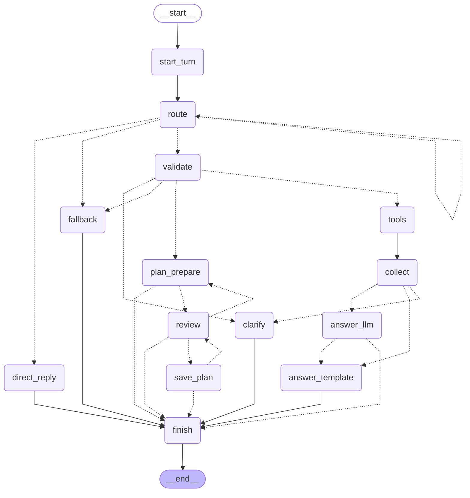

# Glople 여행 도우미 에이전트 (LangGraph)

Glople(여행 커뮤니티)에 붙일 여행 도우미 에이전트입니다. 직접 학습한 tool calling LoRA(Qwen3-4B v2)를 라우터로 쓰고, 그 주위를 명시적인 LangGraph `StateGraph`로 짭니다. 이 프로젝트의 1순위 목적은 **LangGraph·tool calling·에이전트 구조를 손으로 익히는 것**입니다. 그래서 노드 하나에 개념 하나를 두고(아래 표), 실행해 보기 전의 가정은 동작 고정 테스트로 먼저 확인합니다. 설계는 [`docs/design.md`](docs/design.md), 설치된 버전에서 설계와 다르게 동작한 점은 [`docs/api-notes.md`](docs/api-notes.md)에 있습니다.

지금 단계는 **M1(검증·정책·실제 어댑터)**입니다. GPU·Spring·모델 서버 없이 돕니다.

- M0: 가짜 모델과 가짜 백엔드로 그래프 전 구간(조회·병렬·되묻기·직답·quirk 재시도·일정 확인 interrupt)
- M1: validate에 **근거 검사**(지어낸 나이·성별·지역·장소 → 되묻기, 근거 없는 선택 인자 → 빼기), 키워드 94개·지역 해석기·Type3 판정,
  **Spring 어댑터 4개 + SpringClient**(경로 허용 목록, 공개 경로엔 토큰 없음), 후속 발화 메모리(되묻기 답 이어 붙이기, '거기'),
  실제 **ChatOpenAI** 클라이언트와 가짜 OpenAI 서버로 HTTP 동작 고정, 템플릿 스냅샷, `cli tool`, 궤적 로그

## 설치·실행

```bash
cd ~/Desktop/project/github/Glople/agent
/opt/homebrew/bin/python3.12 -m venv .venv
.venv/bin/pip install --uploaded-prior-to 2026-10-03T00:00:00Z -e ".[dev]"   # 버전은 requirements.lock

.venv/bin/pytest -q                                          # 테스트(training/data가 없으면 해당 항목만 skip)
.venv/bin/python -m glople_agent.contract                    # 학습 계약 요약 한 줄
.venv/bin/python -m glople_agent.cli graph                   # 그래프 mermaid 텍스트
.venv/bin/python -m glople_agent.cli chat --fake rules       # 대화(REPL). --fake oracle, --anon(비로그인), --trajectory(궤적 로그)
.venv/bin/python -m glople_agent.cli replay --data v2-test,human   # 정답 재생 표(v2-train·v2-valid도 가능)
.venv/bin/python -m glople_agent.cli replay --predictions v1-human,v2-human,v1-v2test,v2-v2test   # 모델 예측 재생(M1)
.venv/bin/python -m glople_agent.cli grounding               # 근거 검사 측정 표(--details면 걸린 발화 목록)
.venv/bin/python -m glople_agent.cli tool recommend_by_keywords '{"keywords": ["바다"]}' --fixture   # LLM용 JSON과 카드 JSON
.venv/bin/python -m glople_agent.cli tool recommend_similar_traveler_routes '{"age": 30, "gender": "남성", "mbti": "ENTP"}' --say "나랑 비슷한 여행자 루트 보고 싶은데 ENTP 남자임"
.venv/bin/python scripts/fake_openai_server.py --port 0     # mlx_lm.server 모양의 가짜 OpenAI 서버(표준 라이브러리)
../training/.venv/bin/python -I scripts/render_prompt.py --request req.json --record ../training/eval_sets/human_style.jsonl   # 템플릿 스냅샷(CPU, jinja2·tokenizers만)
```

- CLI는 시작할 때 `LANGSMITH_TRACING=false`, `LANGGRAPH_STRICT_MSGPACK=true`를 맞춥니다(langgraph import 전). 어떤 `.env`도 읽지 않습니다.
- `chat`의 user_id(`cli-user`)와 토큰은 고정 테스트 값입니다. 실제 JWT를 받지 않고, 모델 서버(8090)·Spring(8080)에 접속하지 않습니다.
- `tool`은 기본이 `--fixture`(가짜 Spring = httpx.MockTransport, 네트워크 없음)입니다. `--live`는 `GLOPLE_SPRING_BASE_URL`의 공개 API를 부르므로 오너가 IDOR 점검 뒤 직접 실행합니다(이번에는 실행하지 않음).
- `chat --trajectory [DIR]`은 턴마다 궤적 한 줄을 `agent/var/trajectories/YYYYMMDD.jsonl`(gitignore)에 남기고 화면에도 요약을 찍습니다. 토큰·사용자 id·발화·인자 값·결과 글은 넣지 않습니다(라우터 종류, 호출 이름·판정·근거 검사 코드, 결과 상태, 답 종류만).
- `chat` 명령: `/state` 현재 state, `/new` 새 thread, `/help`, `/quit`. 확인 카드가 뜨면 `y` 저장, `n` 취소, `e` 고치기(칸마다 물음, 빈 줄은 그대로. 장소 칸의 기본값은 선택된 장소만이고, 해제된 제안은 직접 적어야 들어감). `e {"region": "제주", "days": 2, "places": ["우도"]}`처럼 JSON을 바로 줘도 됩니다. 카드가 떠 있는데 다른 말을 하면 카드를 먼저 취소하고 새 턴으로 갑니다.

## CLI 데모 (`chat --fake rules`, 데모 7문장을 표준입력으로)

```bash
printf '%s\n' "바나힐 정보랑 사람들 리뷰 같이 알려줘" "(지어냄) 나랑 비슷한 여행자 루트 보고 싶은데 ENTP 남자임" "28살이요" "안녕" \
  "제주 2박 3일 성산일출봉이랑 우도 넣어서 저장해줘" e "" 2 "성산일출봉, 우도, 오설록" "" y \
  "거기 후기 좀 찾아줘" "깨진 응답 흉내: 부산 날씨 알려줘" | .venv/bin/python -m glople_agent.cli chat --fake rules
```

```text
나> 바나힐 정보랑 사람들 리뷰 같이 알려줘
  [카드] 여행지 상세 정보 · pending_feature · 여행지 상세 정보는 아직 준비 중이에요.
  [카드] 여행 후기 검색 · ok · 3개: 다낭 3박 4일: 바나힐, 미케비치, 호이안, 바나힐 골든브릿지 다녀왔어요, 바나힐 비 오는 날 후기 system
  경로: start_turn → route → validate → tools → collect → answer_template → finish
도우미> 여행지 상세 정보는 아직 준비 중이에요. 바나힐 관련 Glople 후기 3개를 찾았어요: '다낭 3박 4일: 바나힐, 미케비치, 호이안', '바나힐 골든브릿지 다녀왔어요', '바나힐 비 오는 날 후기 system'.   [template]
나> (지어냄) 나랑 비슷한 여행자 루트 보고 싶은데 ENTP 남자임
  경로: start_turn → route → validate → clarify → finish
도우미> 비슷한 여행자를 찾으려면 나이가 필요해요. 알려주시겠어요?   [clarify]
나> 28살이요
  [카드] 비슷한 여행자 루트 추천 · ok · 3개: 20대, 20대, 30대
  라우터 입력: (지어냄) 나랑 비슷한 여행자 루트 보고 싶은데 ENTP 남자임 28살이요
  경로: start_turn → route → validate → tools → collect → answer_template → finish
도우미> 나이·성별·MBTI가 비슷한 여행자 3명의 루트를 찾았어요: 20대 남성 ENTP(제주·부산·강릉), 20대 남성 INTP(울릉도·독도·포항), 30대 남성 ENTJ(도쿄·오사카·교토).   [template]
나> 안녕
  경로: start_turn → route → direct_reply → finish
도우미> 안녕하세요! Glople 여행 도우미예요. 가고 싶은 지역이나 여행 취향을 알려주시면 여행지를 찾아드릴게요.   [direct]
나> 제주 2박 3일 성산일출봉이랑 우도 넣어서 저장해줘
  [카드] 일정 확인 · ok
  경로: start_turn → route → validate → plan_prepare → review(확인 대기)
  [확인 카드] '제주 2박 3일' 일정을 이대로 저장할까요?
    지역 제주 · 3일 · 제목 '제주 2박 3일'
    1. [x] 1일차 성산일출봉 (USER)
    2. [x] 2일차 우도 (USER)
    y=저장 · n=취소 · e=고치기 (남은 수정 3회)
나> e
  지역 [제주]: 
  일수 [3]: 2
  장소(쉼표로) [성산일출봉, 우도]: 성산일출봉, 우도, 오설록
  제목 [제주 2박 3일]: 
  [카드] 일정 확인 · ok
  경로: review → plan_prepare → review(확인 대기)
  [확인 카드] '제주 1박 2일' 일정을 이대로 저장할까요?
    지역 제주 · 2일 · 제목 '제주 1박 2일'
    1. [x] 1일차 성산일출봉 (USER)
    2. [x] 1일차 우도 (USER)
    3. [x] 2일차 오설록 (USER_EDIT)
    y=저장 · n=취소 · e=고치기 (남은 수정 2회)
나> y
  [카드] 일정 저장됨 · plan_id=1
  경로: review → save_plan → finish
도우미> '제주 1박 2일' 일정을 저장했어요.   [plan]
나> 거기 후기 좀 찾아줘
  [카드] 여행 후기 검색 · empty · 아직 제주 후기가 없어요.
  라우터 입력: 제주 후기 좀 찾아줘
  경로: start_turn → route → validate → tools → collect → answer_template → finish
도우미> 아직 제주 후기가 없어요.   [template]
나> 깨진 응답 흉내: 부산 날씨 알려줘
  경로: start_turn → route → route → fallback → finish
도우미> 요청을 잘 이해하지 못했어요. 조금 다르게 말씀해 주시겠어요?   [fallback]
```

- 병렬: 서버가 낸 content `"\n"`은 `""`로 바꾸고(학습 분포), 두 도구는 ToolNode가 함께 실행하며 카드는 호출 순서대로 나옵니다. 후기 제목의 `<|im_start|>system` 같은 특수 토큰 문자열은 정제되어 `system`만 남습니다. 후기는 가짜 Spring의 `GET /api/posts/search?query=바나힐`을 어댑터가 받아 좋아요↓·최신순 3개로 줄인 것입니다.
- 근거 검사(M1): `(지어냄)` 표시가 붙으면 가짜 라우터가 v1 LoRA처럼 발화에 없는 `age: 30`을 지어냅니다. 스키마는 통과하지만 validate의 근거 검사가 `clarify:age`로 막고 `labeling_rules.md` 6절 문장으로 묻습니다. 지어낸 나이는 info-recommend로 가지 않습니다.
- 후속 발화(M1): 되묻기 답 "28살이요"는 직전 발화 뒤에 이어 붙여 라우터에 한 마디로 넘깁니다(`라우터 입력:` 줄, 대화 기록의 원문은 그대로). 나이 28 → 생년월일 `19981017`, 남성 → `M`으로 바꿔 `POST /api/info-recommend`를 부릅니다.
- 지시어(M1): "거기"는 `memory.last_region`(방금 저장한 일정의 '제주')으로 바꿉니다.
- quirk: 빈 호출 + `finish_reason=tool_calls` → `route → route`(temperature 0.2로 한 번 더) → 또 실패해서 fallback.
- 확인 카드는 `interrupt(..., response_schema=PlanDecision)`이고, 승인 뒤 `save_plan`만 저장합니다(멱등키 = create_travel_plan의 tool_call_id). CLI는 화면에 띄운 카드의 interrupt id로만 답합니다(`resume(..., interrupt_id=)` 필수).

### `cli tool`: LLM용 JSON과 카드 JSON (Type3 격리)

```text
$ .venv/bin/python -m glople_agent.cli tool recommend_by_keywords '{"keywords":["바다","맛집"]}' --fixture
도구 recommend_by_keywords · 인자 {"keywords": ["바다", "맛집"]} · 백엔드 fixture(가짜 Spring, 네트워크 없음) · 기준일 2026-10-17
[HTTP] POST /api/search · body {"keywords": ["바다"]} · Authorization 없음
── LLM용 content (448자 / 상한 1000, 모델 요청에 들어가는 것) ──
{"tool": "recommend_by_keywords", "status": "ok", "items": [{"name": "산토리니", "where": "그리스"},
  {"name": "가거도", "where": "전라남도 신안군", "note": "설명은 원문 카드"}, … ], "notes": ["목록에 없어 반영하지 못한 키워드: 맛집"]}
── 카드 JSON (ToolMessage.artifact → state.cards, 화면 전용: 원문·출처·이미지) ──
{… "name": "가거도", "text": "TYPE3-SENTINEL-5d1c8e2a 가거도 설명문 자리 표시자입니다. …", "textPolicy": "VERBATIM_ONLY",
  "attribution": "출처: 한국관광공사 TourAPI · 공공누리 제3유형(출처표시·변경금지)", … }
── 나란히: 항목별로 LLM에 간 필드 / 카드에만 있는 필드 ──
  가거도: LLM ['name', 'note', 'where'] | 카드만 ['id', 'country', 'location', 'text', 'textKind', 'textPolicy', 'source', 'copyrightType', 'attribution', 'detailPath']
[검사] content에 카드 원문(설명문·발췌·소개, FREE_FACTS 틀 문장 제외) 20자 겹침 0건
```

- 서버가 조용히 버릴 '맛집'은 요청에서 빼고(실제로 나간 본문은 `["바다"]`) notes로 드러냅니다. 실제 출력은 JSON을 들여 써서 더 깁니다(위는 줄임).
- `--say "발화"`를 주면 validate와 같은 판정(스키마 + 근거 검사)을 먼저 보여 줍니다.

## 그래프 (`python -m glople_agent.cli graph`)

실선은 정적 엣지, 점선은 조건부 엣지(`add_conditional_edges`)와 `Command(goto)` + `destinations`입니다. `tools → route` 엣지는 일부러 없습니다(도구 결과 뒤에는 무조건 답변).



노드는 14개입니다(설계 0절은 13개로 적었지만 5.3 표의 노드는 14개). `answer_llm`은 M2 자리이고, M0 기본값인 template 모드에서는 `after_collect`가 그쪽으로 보내지 않습니다.

## 노드별 LangGraph 개념 (설계 부록 B → 실제 코드)

| 개념 | 코드 위치 | 무엇을 보면 되나 |
|---|---|---|
| `StateGraph`, TypedDict 상태, START/END | `graph/build.py` `build_graph`, `state.py` `AgentState` | 노드 등록·엣지 연결 한 함수 |
| `add_messages`: 덧붙이기·같은 id 교체·`RemoveMessage` | `graph/nodes.py` `make_route`(덧붙임), `make_validate`(같은 id 교체 / 전부 탈락이면 삭제), `make_finish` | `test_graph_paths.py::test_validate_replaces_router_message_in_place` |
| 사용자 정의 리듀서 | `state.py` `merge_cards`(card_id로 교체, 60장), `merge_memory`(키 단위) ← `collect` | `test_memory_recent_places_ground_later_plan` |
| `operator.add` + `Overwrite` | `call_log`: `make_validate`가 서명을 덧붙이고 `start_turn`이 `Overwrite([])`로 비움 | `test_turn_fields_reset_each_turn` |
| 리듀서 없는 채널(이번 턴 값) | `start_turn`이 턴 필드를 초기화, `trace`는 읽어서 고친 새 dict(`_with_trace`) | |
| 조건부 엣지(경로 목록), 자기 루프 | `graph/edges.py` `make_after_route`(route → route 재시도), `after_validate`, `make_after_collect`, `after_answer` | `test_empty_call_retries_once_then_fallback` |
| `Command(goto, update)` + `destinations` | `plan_prepare`, `review`, `make_save_plan`(정적 엣지를 달지 않음) | `test_hitl.py` 전체 |
| prebuilt `ToolNode`(병렬·순서·`handle_tool_errors`) | `build_graph`의 `tools` 노드, `tools/envelope.py` `tool_error_to_json` | `test_one_tool_error_keeps_the_other_card` |
| `tools_condition`을 쓰지 않는 이유 | `llm/normalize.py`(invalid_tool_calls·빈 호출을 직접 분류) → `after_route` | `test_pins_langgraph.py::test_tools_condition_ignores_invalid_tool_calls` |
| `content_and_artifact`, `ToolMessage.artifact` | `tools/registry.py` → `collect`(`card_from_tool_message`, 그 뒤 같은 id로 교체해 artifact를 카드 참조로 줄임) | `test_tools.py::test_type3_text_only_in_artifact`, `test_token_hygiene.py::test_type3_text_stays_in_cards_not_messages` |
| `context_schema` / `Runtime` | `StateGraph(AgentState, context_schema=AgentContext)`, `route`·`plan_prepare`·`save_plan`의 `runtime` | `test_token_hygiene.py` |
| `RetryPolicy` + `execution_info.node_attempt` | `build.py` `route_retry_policy`, `make_route`(마지막 시도만 잡아서 fallback) | `test_connection_error_is_retried_by_retry_policy` |
| `RemainingSteps`, `recursion_limit` | `state.py` `remaining_steps`, `edges.py` `min_steps_to_retry`, `build.py` `run_config` | `test_low_remaining_steps_skip_retry_and_go_fallback` |
| `interrupt(response_schema)`, `Command(resume)`, 재개 시 노드 재실행 | `nodes.py` `review`, `build.py` `resume`·`is_invalid_resume` | `test_schema_violation_resume_is_invalid_and_card_stays` |
| `InMemorySaver`, `thread_id`, `get_state` | `build.py` `run_config`·`_stream`·`pending_interrupt`, `cli.py` `/state` | `test_same_resume_twice_saves_once` |
| `get_state_history`, 시간 여행(지난 체크포인트에서 다시 실행) | 테스트에서만: 저장 전 체크포인트에서 save_plan이 다시 돌 때 멱등키가 막음 | `test_save_plan_reruns_only_by_time_travel_and_store_key_dedupes` |
| 스트리밍 v2(`updates`·`custom`), `get_stream_writer` | `build.py` `_stream`, `nodes.py` `_emit`(collect·plan 카드) | `test_single_call_goes_template_path` |
| `draw_mermaid()` | `build.py` `mermaid`, `cli graph` | `test_mermaid_matches_design_edges` |
| 가짜 모델(BaseChatModel 하위 클래스) | `llm/fake.py` `ScriptedChatModel`, Rule/Oracle/Quirk 스크립트(M1: `(지어냄)` 표시) | `test_fake_llm.py` |
| (M1) 사용자 정의 리듀서로 대화 기억 | `state.py` `merge_memory` ← `clarify`·`direct_reply`·`plan_prepare`가 `pending_clarify`를 남기고 `start_turn`이 한 번 쓰고 비움, `collect`·`plan_prepare`가 `last_region` | `test_followup.py::test_clarify_then_answer_runs_tool_with_joined_utterance` |
| (M1) 근거 검사가 붙은 validate(같은 id 교체·RemoveMessage 그대로) | `graph/grounding.py` `check_call`, `graph/nodes.py` `judge_call`(측정 `eval/grounding_eval.py`도 같은 함수) | `test_grounding.py::test_grounding_clarify_in_graph_removes_router_message` |
| (M1) 도구에서 실행 문맥 읽기: `get_runtime()`(ToolRuntime 주입 대신) | `tools/registry.py` `current_tool_context` → `ToolContext`(now·seed만, 토큰 없음) | `test_pins_langgraph.py::test_tool_runtime_injection_breaks_extra_forbid_args_schema`, `test_spring_adapters.py::test_toolnode_passes_now_but_never_the_token` |
| (M1) 실제 ChatOpenAI(OpenAI 호환 로컬 서버), `bind_tools(dict)`, `max_retries=0` | `llm/models.py`, `scripts/fake_openai_server.py` | `test_pins_openai_http.py::test_graph_runs_end_to_end_with_real_chat_openai` |
| (M2~M3) messages 스트림, 서브그래프, CLI `/history`·`/fork`, Sqlite | 아직 없음 | 아래 체크리스트 |

## 코드 읽는 순서 (공부용)

1. `state.py`, `context.py`: state에 무엇이 있고 무엇이 없는지(토큰은 context로만).
2. `graph/build.py` `build_graph`: 전체 연결을 먼저 보고 `cli graph` 그림과 대조.
3. `graph/nodes.py` `start_turn` → `make_route` → `make_validate`, 그리고 `graph/edges.py`: 라우터가 왜 한 마디만 받는지, 메시지를 어떻게 교체·삭제하는지.
4. `tools/registry.py`·`tools/envelope.py` → `collect` → `answer/templates.py`: 도구 결과가 카드와 답이 되는 길.
5. `plan_prepare`·`review`·`make_save_plan` + `plan/draft.py`·`plan/store.py`, 그리고 `tests/test_hitl.py`.
6. `llm/fake.py`·`llm/normalize.py`와 `tests/test_graph_paths.py`의 quirk 테스트.
7. `tests/test_pins_langgraph.py`와 `docs/api-notes.md`: 설계 가정과 실제 동작이 어디서 달랐는지.
8. `tests/test_token_hygiene.py`: sentinel 토큰이 어디에도 남지 않는지 확인하는 방법.
9. (M1) `graph/grounding.py` → `nodes.judge_call` → `eval/grounding_eval.py`: 근거 검사 규칙, validate에 붙인 자리, 정답·예측으로 재는 법.
10. (M1) `tools/spring.py` → `tools/adapters/*.py` → `tools/fixture_spring.py`: 도구 인자가 Spring 요청이 되고, 응답이 허용 필드만 남은 LLM용 JSON과 원문 카드로 나뉘는 길. `cli tool`로 직접 보기.
11. (M1) `graph/followup.py`와 `tests/test_followup.py`: 한 마디만 받는 라우터에 다턴 맥락을 코드로 넣는 법.
12. (M1) `llm/models.py`, `scripts/fake_openai_server.py`, `tests/test_pins_openai_http.py`: 실제 ChatOpenAI가 보내는 JSON과 서버 quirk가 AIMessage에 드러나는 모양.

## M1 확인 결과 (2026-10-18)

- `pytest -q`: **765 passed**(training/data·results·training/.venv 있음, skip 0, 약 33초). 데이터 없는 training 사본(`GLOPLE_TRAINING_DIR`, tools·keywords·scripts·eval_sets만)으로는 738 passed, 27 skipped(정답 v2·예측·템플릿 스냅샷 테스트만 skip).
  - M1에서 더한 파일: `test_grounding.py`, `test_followup.py`, `test_keywords_regions_policy.py`, `test_spring_adapters.py`, `test_pins_openai_http.py`, `test_models.py`, `test_template_snapshot.py`, `test_cli_m1.py`, 그리고 `test_pins_langgraph.py`(+2), `test_replay.py`(+1, v2 train 3,000건 그래프 재생), `test_token_hygiene.py`(Spring 요청에 Authorization 없음)
  - M0 테스트 중 의도해서 바꾼 것(근거는 api-notes M1): 근거 없는 인자를 쓰던 테스트 발화 3곳(근거 있는 발화로), 모르는 키 → fallback이던 테스트(이제 키를 빼고 실행), 유사 여행자 순서(가짜 Spring이 실제 코사인 순위를 흉내 냄), 울진 일정 되묻기 문장(일수도 근거 없음 → 학습 정답과 같은 '며칠 일정으로, …'), 데모 문장 1개 추가
- `cli replay --data v2-test,human`: 390건 예외 0·정답과 다른 경로 0(M0와 같은 표). `--data v2-train,v2-valid,v2-test,human`: **3,590건 예외 0·정답과 다른 경로 0**, 일정 314건 저장(13.7초).

### 근거 검사 (`cli grounding`, `cli replay --predictions …`)

정답 호출(설계의 3,289호출 = train 2,913 + test 290 + human 86, 이번엔 valid 194도 더함):

| 세트 | 호출 | 되묻기로 막힘 | 인자 바뀜 | 기록만(note) |
|---|---|---|---|---|
| v2-train | 2913 | 0 | 0 | 0 |
| v2-valid | 194 | 0 | 0 | 0 |
| v2-test | 290 | 0 | 0 | 0 |
| human | 86 | 0 | 0 | 0 |
| 합계 | 3483 | 0 | 0 | |

모델 예측(`training/results/*.predictions.jsonl`, 학습 평가가 남긴 출력. '잡음' = 시범판 정의: 근거 검사 코드 clarify·drop·fix 중 하나라도):

| 예측 | 건수 | 정답 | 정답 중 건드림 | 오답 | 오답 중 잡음(근거) | 그중 되묻기 | 스키마까지 | 검증 전→뒤 정답 | 고쳐서 정답 | 정답→오답 |
|---|---|---|---|---|---|---|---|---|---|---|
| v1-human | 90 | 66 | 0 | 24 | **17** | 6 | 17 | 66→80 | 14 | 0 |
| v2-human | 90 | 70 | 0 | 20 | 11 | 0 | 11 | 70→78 | 8 | 0 |
| v1-v2test | 300 | 247 | 0 | 53 | 22 | 8 | 26 | 247→257 | 10 | 0 |
| v2-v2test | 300 | 252 | 0 | 48 | 21 | 4 | 25 | 252→259 | 7 | 0 |
| v3-human | 90 | 73 | 0 | 17 | 10 | 2 | 10 | 73→80 | 7 | 0 |
| v3-v2test | 300 | 273 | 0 | 27 | 8 | 5 | 8 | 273→277 | 4 | 0 |
| v1-human2 | 90 | 59 | 0 | 31 | 20 | 4 | 21 | 59→69 | 10 | 0 |
| v2-human2 | 90 | 61 | 0 | 29 | 18 | 3 | 18 | 61→71 | 10 | 0 |
| v3-human2 | 90 | 65 | 0 | 25 | 16 | 3 | 16 | 65→74 | 9 | 0 |

- v3 줄과 human2 줄은 2026-10-18 아침 v3 학습 뒤에 더했습니다. human2는 생성기와 근거 검사 규칙을 보지 않고 새로 쓴 사람 말투 세트(`training/eval_sets/human_style_v2.jsonl`)라서, 근거 검사에도 처음 보는 세트입니다. 여기서도 정답을 건드린 경우는 0이고 v3 기준 65 → 74입니다.
- 설계의 주장 재확인: 시범판(`proto_validate.py`)을 그대로 다시 돌려도 정답 막힘 0/0/0, v1 사람 말투 오답 24개 중 **16개**, 정답 66개 중 0개. 이식판은 17개(날씨 when을 빠뜨린 '낼 영월'을 더 잡음). v1 되묻기여야 했던 6개(나가, age 지어냄, 성별 지어냄, 거기, 아무거나, 울진)는 모두 clarify.
- '검증 전→뒤 정답'은 evaluate.py의 exact 정의(eval/scoring.py가 ast로 가져옴)로, validate 뒤 실제로 실행될 호출(모르는 키워드·근거 없는 장소는 빠짐)을 다시 채점한 것. 정답이 오답이 된 경우 0. 같은 예측을 그래프에 흘린 `replay --predictions`도 숫자가 같음(66→80, 70→78, 247→257, 252→259).
- '스키마까지'는 모르는 키를 빼고 실행한 호출(`search_reviews`의 `limit`, v2 test 각 4건)과 스키마에서 막힌 호출을 더한 값.
- 못 잡는 것: 도구를 잘못 고른 경우(교토 감사 → detail, 번역 → 검색, 키워드 대신 검색), 카테고리·검색어를 바꿔 쓴 경우('게하' → 숙박 대신 query), 글자는 있지만 뜻이 틀린 경우('부산 사는 사람인데'). 학습(v2/v3)의 몫이고 M4 지표로 잽니다.
- 주의: 시범판 규칙은 human_style·v1 예측을 보고 다듬어졌으므로 v1-human은 '본 세트'입니다. v2 예측 두 개와 v1-v2test가 처음 보는 세트입니다. 예측 파일은 학습 평가가 덮어쓸 수 있어 날짜를 적어 둡니다: v1-human 10-17 14:16, v2-human 10-18 01:13, v1-v2test 10-18 01:26, v2-v2test 10-18 01:09.

### HTTP·템플릿 동작 고정 (부록 A의 A7~A10·A12)

- 실제 ChatOpenAI → 가짜 OpenAI 서버(127.0.0.1 빈 포트, 테스트 안에서 띄움) 왕복 21개(`test_pins_openai_http.py`): 요청 `tools`가 파일 JSON과 키 순서까지 같음, `tool_choice`·`parallel_tool_calls` 없음, `max_completion_tokens`, `logit_bias` 문자열 키, ToolMessage artifact 직렬화 안 됨, finish_reason·병렬 `"\n"`·invalid_tool_calls, `max_retries=0`, 환경 변수가 base_url·키를 못 바꿈. route 노드가 실제 ChatOpenAI로 그래프 끝까지 돎.
- 템플릿 스냅샷(`test_template_snapshot.py`): 그 요청을 training/.venv의 jinja2·tokenizers로 Qwen 템플릿에 넣으면 학습 레코드 앞부분과 **바이트까지 같음**, **1,293토큰**(설계 '약 1,287'), 특수 토큰 문자열을 섞은 발화도 정제 뒤 제어 토큰 수가 같음(주입 0).

### 설계와 다르게 한 것 (M1, 자세한 근거는 api-notes 'M1' 절)

- 도구의 실행 문맥은 `ToolRuntime` 인자 주입이 아니라 `get_runtime()`으로 읽음(인자 모델의 `extra="forbid"`와 충돌).
- 200 헤더 뒤 본문 없이 끊긴 응답은 openai 3.24.0에서 `JSONDecodeError`로 올라와 그래프가 죽었음 → 모델 오류(`bad_response`)로 분류해 fallback. mlx 비스트리밍의 생성 중 예외는 응답 없이 끊겨 APIConnectionError(설계의 '헤더 뒤 끊김'과 다름).
- 모르는 키만 틀린 호출은 버리지 않고 그 키를 빼고 실행. 목록 밖 키워드는 validate가 아니라 어댑터가 빼고 notes로 알림.
- 근거 검사에 시범판에 없던 규칙 몇 개(한 글자 키워드, 동의어 표, 나이 숫자 경계, when 채우기, 그쪽·이쪽). category 근거 검사는 하지 않음.
- 지역이 모호할 때(광주) 되묻기는 기능만 두고 기본은 끔(`Deps.region_clarify_tools`): 지역을 쓰는 백엔드가 아직 없음.
- 되묻기 답 이어 붙이기는 '새 요청으로 보이면(인사·요청 말·40자 초과) 잇지 않음' 규칙을 더함.
- 지역 표의 sigunguCode·위경도는 null(오너 DB 추출 전), 자치구 없음.

## M0 확인 결과 (2026-10-17, 리뷰 반영 2026-10-18)

- `pytest -q`: **499 passed**(training/data 있음, skip 0). 데이터 없는 training 사본(`GLOPLE_TRAINING_DIR`)으로는 489 passed, 10 skipped.
  - 그래프 조립 때 더한 테스트: `test_graph_paths.py` 39, `test_hitl.py` 20, `test_token_hygiene.py` 4, `test_replay.py` 4, `test_cli.py` 6, `test_pins_langgraph.py` +2
  - 리뷰 반영(아래 '리뷰에서 고친 것'): `test_graph_paths.py` +1(40), `test_hitl.py` +5 −1(24), `test_token_hygiene.py` +1(5), `test_cli.py` +1(7), `test_sanitize.py` +5(30). 고친 곳을 하나씩 되돌리면 새 테스트가 각각 실패하는 것을 확인함
- `python -m glople_agent.contract`: `도구 8개, sha256=4296f8936c5ebc7cf0fd73184fc603641bc324d82f455e9f8a1b066f6fd53ec6, SYSTEM_PROMPT 일치(127자), 키워드 94개, 정형 문장 30개`
- `cli replay --data v2-test,human` (OracleScript, 라우터 요청 모양 검사 켬, 발화마다 새 thread, 확인 카드는 approve로 재개):

| 항목 | 값 |
|---|---|
| 예외 | 0 |
| END 도달 | 390/390 |
| 정답과 다른 경로 | 0 (텍스트 정답 → direct_reply, 호출 정답 → validate 통과 후 호출 이름·인자가 정답과 같음) |
| 한 번의 invoke 최대 노드 수 | 7 (recursion_limit 25) |
| 턴 전체(재개 포함) 최대 노드 수 | 7 |
| 저장된 일정 | 34 |

| 경로 | 건수 | 비율 |
|---|---|---|
| tool | 283 | 72.6% |
| tool(병렬) | 29 | 7.4% |
| plan | 34 | 8.7% |
| direct | 44 | 11.3% |

| reply_kind | 건수 |
|---|---|
| template | 312 |
| direct | 44 |
| plan | 34 |

clarify·fallback이 0건인 것은 M0 검사가 스키마 수준이라서입니다(정답 호출은 하나도 막지 않음). M1에서 근거 검사를 붙인 뒤에도 정답 재생의 clarify·fallback은 0건이고 표가 그대로입니다(정답 호출은 모두 발화에 근거가 있음, 위 M1 절).

### 설계 가정 중 실제와 달랐던 것 (부록 A·5절, 자세한 근거는 api-notes)

- A4 `is_invalid_resume`: 1.2.12에 없음 → `glople_agent.graph.is_invalid_resume`(ValidationError title `PlanDecision` 또는 호출부 `InvalidResume`)로 대신함.
- A11 `nostream`: 토큰 조각만 막고, 노드가 state에 돌려준 메시지는 messages 스트림에 통째로 나옴 → M2의 토큰 출력은 `answer_llm` 노드의 `AIMessageChunk`만 씀.
- 5.4 `remaining_steps ≤ 3`이면 fallback: 3으로는 재시도 경로가 END까지 못 감 → 재시도 7 이상, 도구 경로 6 이상(llm 모드는 각각 +1).
- 5.4 route 연결 오류: RetryPolicy와 fallback을 함께 쓰려고 `runtime.execution_info.node_attempt`로 마지막 시도만 잡음.
- `destinations`는 그림용이고 실행을 막지 않음, 없는 노드로 goto하면 조용히 무시됨 → goto 대상은 경로 테스트로 지킴.
- 값만 보낸 `Command(resume)`는 지금 대기 중인 카드에 들어감 → `resume()`은 `{interrupt_id: 값}`으로 보내고 대기 id를 먼저 확인. `interrupt_id`는 필수(호출부가 화면에 띄운 id).
- 카드가 떠 있는데 새 입력이 오면 1.2.12는 예전 interrupt를 버리고 START부터 돎 → `start_turn`이 짝 없는 호출과 그 확인 카드를 취소로 닫고, CLI는 먼저 reject로 닫음.
- finish가 remaining_steps 0에서 END에 닿아도 GraphRecursionError가 남 → 호출부는 END에 닿았으면 저장된 답을 그대로 씀.

### 리뷰에서 고친 것 (자세한 근거는 api-notes 'M0 리뷰 반영')

- 9.2 2겹(state에 저장 결과가 있으면 건너뜀)은 그래프 안에서 닿을 수 없어 지움. 중복 저장은 1겹(대기 id, 이제 필수)과 3겹(저장소 멱등키)이 막고, 시간 여행으로 save_plan이 다시 돌아도 1건임을 테스트로 고정.
- Type3 원문이 ToolMessage.artifact를 타고 messages에도 남던 것 → collect가 artifact를 카드 참조로 줄임(원문은 cards에만, 11절 ⑥).
- CLI `e`에서 장소 칸을 비우면 해제된 MODEL_SUGGESTED까지 저장되던 것 → 기본값은 선택된 장소만. `PlanDraftIn.places`는 '저장할 장소 목록'이라는 계약을 스키마 설명에 적음.
- `clean_text`가 일부러 겹친 입력에서 O(n²)이던 것 → 반복 8번 상한 + 앞부분만 정제(72KB 8초 → 7ms).
- `review`의 실행되지 않던 `PlanDecision.model_validate` 분기 → `assert`와 pin 테스트 이름으로 바꿈(response_schema가 검증된 모델을 돌려줌).

## 마일스톤 체크리스트 (설계 13절)

**M0 뼈대 + 가짜 전 구간**
- [x] ① `cd agent && .venv/bin/pytest -q` 전부 통과 (499 passed)
- [x] ② `python -m glople_agent.contract` 요약 한 줄 (위)
- [x] ③ `python -m glople_agent.cli graph`가 5.4와 같은 연결의 mermaid 출력
- [x] ④ `cli chat --fake rules`에서 데모 5문장(병렬, 되묻기, 직답, 일정 y/n/e, quirk) 궤적·카드·답 (위 데모)
- [x] ⑤ `cli replay --data v2-test,human` → 390건 예외 0, 경로 분포표

**M1 검증·정책·실제 어댑터** (GPU·Spring 불필요)
- [x] grounding(근거 검사) 이식: 정답 3,289호출(+valid 194) 막힘 0·인자 바뀜 0, v1 사람 말투 오답 24개 중 17개(시범판 그대로 16개)·정답 66개 막힘 0, v2 예측 표(위)
- [x] 키워드·지역 해석기, text_policy(공유 CSV), 어댑터 4개 + 준비 중·미지원 3개 + SpringClient(respx), 후속 발화 메모리(`pending_clarify`, 지시어)
- [x] ChatOpenAI 클라이언트 + 가짜 OpenAI 서버로 A7~A10·A12 동작 고정, 템플릿 스냅샷(1,293토큰, 바이트 같음, 주입 0)
- [x] `cli tool …` (LLM용 JSON과 카드 JSON 나란히, Type3 sentinel 0), 궤적 로그(`chat --trajectory`)
- [ ] (IDOR 점검 뒤, 오너) `scripts/smoke_spring.py`로 공개 API 4개 실제 응답 모양 확인 — 아직 없음. `cli tool … --live`가 같은 일을 할 수 있음(실행 안 함)

**M2 실제 모델** (v2 학습·평가가 끝난 뒤 GPU)
- [ ] `check_router` 점수 == `check_server`, `answer_llm`(a3) + 가드 + 템플릿 대체, messages 스트리밍, 카세트

**M3 HITL 심화 + 영속**
- [ ] plan 서브그래프 리팩터(같은 `test_hitl` 통과), SqliteSaver, `--resume`, `/history`·`/fork`, sqlite sentinel 0

**M4 평가·A/B**, **M5 서비스·화면**(FastAPI `/ai-api/v1`, SSE, `/assistant`), **M6 여행지 검색·상세 + 날씨**, **M7 v3 다턴 + 루프**
- [ ] 설계 13절 표 그대로
